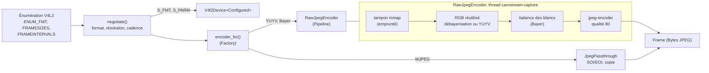

# 0008 — Formats bruts (Bayer, YUYV), négociation automatique et conversion JPEG sur le Pi

- Statut : Proposé
- Date : 2026-11-27
- Décisions concernées : [ADR 0002](0002-transport-mjpeg-multipart.md) (contrat « trames
  JPEG »), [ADR 0003](0003-choix-des-crates.md) (crate d'encodage),
  [ADR 0006](0006-capture-a-la-demande.md) (sonde, délai de grâce),
  [architecture § 3.5](../architecture.md#35-capture--adaptateurs)

## Contexte

La webcam de l'utilisateur, branchée sur son Raspberry Pi, **ne propose pas de MJPEG**. Sa
sortie `v4l2-ctl --list-formats-ext` (relevé du 2026-11-27) :

```text
'GRBG' (8-bit Bayer GRGR/BGBG)
    Size: Discrete 162x120
    Size: Discrete 324x240
```

La v1 exigeait MJPEG (`UnsupportedFormat`, erreur fatale, sinon) et demandait 640x480 à
15 i/s sans consulter l'offre réelle du périphérique : Camstream était inutilisable avec
cette caméra. Il faut donc :

1. **négocier** format, résolution et cadence à partir de ce que la caméra **énumère**
   (`VIDIOC_ENUM_FMT`, `VIDIOC_ENUM_FRAMESIZES`, `VIDIOC_ENUM_FRAMEINTERVALS`), et non
   imposer une demande que le pilote ajuste à l'aveugle ;
2. **convertir** les formats non compressés en JPEG sur le Pi, puisque le navigateur
   n'affiche que du JPEG dans un flux `multipart/x-mixed-replace` (ADR 0002) ;
3. le faire **sans bloquer le runtime async**, avec un coût CPU et mémoire maîtrisé.

Contraintes : architecture hexagonale (le cœur ne connaît ni V4L2 ni l'encodage), `unsafe`
interdit, dépendances minimales et 100 % Rust compatibles aarch64, testabilité sans matériel.

## Options envisagées

### Où placer la conversion ?

| Option | Avantages | Inconvénients |
|---|---|---|
| Dans le **cœur** (`domain` / `stream`) : trait d'encodage appliqué par le superviseur | Une seule conversion pour toutes les sources | Le cœur devrait connaître les trames brutes (nouveau type `RawFrame`) et dépendre d'un encodeur ; le port `FrameSource` perdrait sa garantie « trames JPEG » ; la copie du tampon mmap brut (jusqu'à 600 Kio en 640x480 YUYV) deviendrait obligatoire pour sortir de l'adaptateur |
| Un **Decorator** `EncodingSource<S: FrameSource>` | Composable | Même problème : la source décorée devrait produire des trames non JPEG, donc un second type de trame dans le cœur (écarté dès la v1, voir design-patterns) |
| **Dans `capture`, port interne `FrameEncoder` appliqué par l'adaptateur** dans `next_frame` | Le contrat du port `FrameSource` reste vrai ; la conversion lit **directement le tampon mmap** (aucune copie de l'image brute) ; elle s'exécute dans le thread de capture ; réutilisable par la source synthétique | Chaque adaptateur doit appeler l'encodeur (deux aujourd'hui) |

### Débayerisation

| Méthode | Résolution | Coût | Qualité |
|---|---|---|---|
| « Superpixel » 2x2 (un pixel RGB par bloc) | **Divisée par deux** (324x240 → 162x120) | Minimal | Correcte mais image deux fois plus petite : inacceptable avec un capteur déjà à 324x240 |
| Plus proche voisin pleine résolution | Pleine | Très faible | Artefacts de « fermeture éclair » marqués sur les contours |
| **Bilinéaire** pleine résolution | Pleine | Faible : 2 à 4 additions et un décalage par composante, sans multiplication | Bonne pour une webcam de surveillance ; légers artefacts colorés sur les contours fins |
| Malvar-He-Cutler, adaptatives (AHD, VNG) | Pleine | 3 à 10 fois le bilinéaire, multiplications | Meilleure netteté, superflue à 324x240 |

### Encodage JPEG

| Crate | Avantages | Inconvénients |
|---|---|---|
| **`jpeg-encoder`** 0.7.1 | 100 % Rust, **aucune dépendance**, `forbid(unsafe_code)` sans la feature `simd` (AVX2 x86 seulement, inutile sur aarch64) ; utilisée par `image` (≈ 11 millions de téléchargements, 3,8 millions sur 90 jours) ; publiée le 2026-07-27 (0.7.0 en 2026-01, 0.6.1 en 2025-03) : maintenue ; `rust-version` 1.87 ≤ 1.88 du projet | Pas de SIMD NEON : plus lent que libjpeg-turbo ; licence `(MIT OR Apache-2.0) AND IJG` (mention obligatoire, voir Conséquences) |
| `turbojpeg` (libjpeg-turbo) | Le plus rapide (NEON) | Bibliothèque C à compiler en croisé (cmake, nasm) et à embarquer dans l'image ; `unsafe` en FFI |
| `image` | API haut niveau | Tire `jpeg-encoder` et des dizaines d'autres crates inutiles |
| `mozjpeg` | Meilleure compression | C, encore plus lent, FFI |

## Décision

1. **Négociation** dans `src/capture/negotiation.rs`, module pur (aucune dépendance V4L2) :
   - port `CapabilityQuery` (`formats`, `sizes`, `intervals`), implémenté par
     l'adaptateur `DeviceCapabilities` (`src/capture/v4l2/device.rs`, ioctl d'énumération
     sous `guarded`) et par `CapabilityTable` (table en mémoire : tests et source
     synthétique) ;
   - **format** (`choose_format`) : `CAMSTREAM_FORMAT=auto` (défaut) → MJPEG natif (`MJPG`
     ou `JPEG`) s'il est proposé, **aucun ré-encodage** ; sinon YUYV ; sinon Bayer 8 bits
     dans l'ordre `BA81`, `GBRG`, `GRBG`, `RGGB`. `mjpeg`, `yuyv`, `bayer` exigent le format ;
     une demande impossible donne `CaptureError::UnsupportedFormat { preference, offered }`
     (**fatale**, visible dès la sonde de démarrage, code de sortie 1) dont le message
     liste l'offre de la caméra (« the camera offers: GRBG 162x120, 324x240 ») ;
   - **résolution** (`choose_resolution`) : chaque plage proposée (discrète, ou par pas
     ramenée à la demande puis arrondie au pas inférieur) donne une candidate ; on retient
     la **plus grande surface qui tient dans la demande (largeur et hauteur)**, sinon la
     **plus petite surface au-dessus** ; à surface égale, le rapport d'aspect le plus proche
     de la demande. Comparer les deux dimensions (et non la seule surface) évite de retenir
     une image plus large que demandée et borne le coût de conversion ;
   - **cadence** (`choose_fps`) : la cadence proposée la plus proche de la demande, **la plus
     basse en cas d'égalité** (moins de CPU) ; plage continue : demande bornée à la plage ;
   - une énumération de tailles ou de cadences non prise en charge par le pilote n'est pas
     une erreur : la demande est transmise telle quelle (`S_FMT`/`S_PARM`) et le pilote
     l'ajuste, comme en v1. Une liste de formats **vide** (`v4l` la renvoie quand le premier
     `VIDIOC_ENUM_FMT` échoue, par exemple webcam débranchée pendant l'ouverture) est une
     erreur d'E/S (`Reopen`), pas `UnsupportedFormat` : un incident passager ne doit pas
     arrêter l'application. Un pilote sans `S_PARM` (`ENOTTY`, fréquent sur les capteurs
     bruts) garde sa cadence propre, avec un avertissement ;
   - journalisation `info` à chaque ouverture : « camera formats detected » (offre complète)
     puis « capture format selected » (format, résolution, cadence, demande, conversion).
2. **Valeurs par défaut inchangées** : 640x480 à 15 i/s reste la **demande**. Avec la
   caméra de l'utilisateur, la négociation retient **`GRBG` 324x240** (162x120 et 324x240
   tiennent dans 640x480, 324x240 a la plus grande surface) ; cadences non énumérées : 15 i/s
   demandés au pilote.
3. **Conversion** dans `src/capture/convert/`, côté adaptateurs :
   - port interne `FrameEncoder` (pattern **Strategy**) : `encode(&[u8]) -> Bytes` ;
     stratégies `JpegPassthrough` (MJPEG : vérification `SOI`/`EOI`, copie) et
     `RawJpegEncoder` (pattern **Pipeline** : brut → RGB → balance des blancs → JPEG) ;
     fabrique `encoder_for` (pattern **Factory**) selon le format négocié ;
   - appliqué par `V4l2Source::next_frame` **sur le tampon mmap emprunté**, dans l'appel
     protégé `guarded("dequeue")`, donc dans le thread `camstream-capture` ;
   - **débayerisation bilinéaire** pleine résolution pour les quatre motifs, voisins hors
     image pris par **réflexion** (conserve la parité donc la couleur ; toute taille ≥ 2x2,
     paire ou impaire) ; **YUYV → RGB** BT.601 plage limitée en entiers (virgule fixe
     8 bits) ;
   - **balance des blancs « monde gris »** (Bayer uniquement, le capteur brut n'ayant pas de
     processeur d'image) : gains rouge et bleu bornés à [0,25 ; 4], estimés sur un pixel sur
     quatre, lissés d'une trame à l'autre (25 % de la nouvelle mesure), appliqués par deux
     tables de 256 octets ; désactivable (`CAMSTREAM_WHITE_BALANCE=off`) ;
   - **encodage `jpeg-encoder`** 0.7, qualité `CAMSTREAM_JPEG_QUALITY` (1 à 100, **défaut 80** :
     sous 90 l'encodeur sous-échantillonne la chrominance en 4:2:0, ce qui réduit CPU et
     débit) ;
   - **robustesse** : `RawLayout` valide la géométrie à la configuration (pas de ligne
     `bytesperline` du pilote, ou minimal si absent/trop petit ; dimensions ≤ 65 535 et
     image ≤ 4096x4096 pixels, ce qui borne le tampon RGB à 48 Mio ; Bayer ≥ 2x2, sinon
     `UnsupportedResolution`, fatale) ; une trame plus courte que
     `stride × (hauteur − 1) + octets utiles d'une ligne` (`bytesused` insuffisant) est
     **rejetée** (`CorruptedFrame`, `Skip`) : jamais d'image partiellement lue ;
   - **mémoire** : tampon RGB alloué une fois par source et réutilisé ; aucune allocation
     par pixel ; une allocation par trame pour le JPEG produit (capacité estimée d'après la
     trame précédente), transféré **sans copie** dans le `Bytes` de la `Frame`.
4. **Source synthétique brute** `SyntheticRawSource` (`src/capture/synthetic_raw.rs`),
   choisie par `CAMSTREAM_SOURCE=synthetic` avec `CAMSTREAM_FORMAT=bayer` (table de capacités
   **identique à la caméra de l'utilisateur**) ou `yuyv` (320x240 et 640x480, 30/15/10 i/s) :
   mire RGB → mosaïque `GRBG` (ou YUYV) → même chaîne de négociation et de conversion → flux
   HTTP. Permet de tester la chaîne complète sans matériel et de mesurer le coût sur le Pi.
5. **Observabilité** : `SourceDescription` gagne `encoding: FrameEncoding` (`Native` ou
   `Software { quality }`) ; `/health` expose en `streaming` `pixel_format` (format natif :
   `MJPEG`, `YUYV`, `BA81`, `GBRG`, `GRBG`, `RGGB`), `resolution`, `fps`, `encoding`
   (`native`/`software`), `jpeg_quality` (en `software`) et `fps_origin` (`confirmed` si le
   pilote a accepté la cadence via `S_PARM`, `requested` s'il l'a refusée ou ne la rapporte
   pas : la valeur de `fps` est alors celle demandée, pas celle du capteur).



## Mesures (estimations à confirmer sur le Pi)

Coût d'une conversion complète (brut → RGB → balance des blancs → JPEG qualité 80), mesuré
par le test ignoré `capture::convert::tests::conversion_cost`
(`cargo test --release --lib -- --ignored --nocapture conversion_cost`), sur un contenu
**très texturé** (pire cas pour l'entropie JPEG), 100 trames :

| Format, taille | Natif x86_64 (Xeon 2,1 GHz) | dont → RGB | qemu-aarch64 8.2 (émulation) | JPEG produit |
|---|---|---|---|---|
| `GRBG` 324x240 | **1,5 ms** | 0,2 ms | 11,4 ms | 37 033 o |
| `GRBG` 640x480 | 5,5 ms | 0,8 ms | 43,3 ms | 134 683 o |
| `YUYV` 324x240 | 1,7 ms | 0,3 ms | 15,6 ms | 37 610 o |
| `YUYV` 640x480 | 6,0 ms | 1,0 ms | 43,8 ms | 147 860 o |

Mesure de bout en bout (binaire `release` natif, mire synthétique `GRBG` 324x240 à 30 i/s,
un client HTTP) : **5,6 % d'un cœur** (génération de la mire, conversion et HTTP compris),
JPEG d'environ 6 Kio par trame sur une image lisse.

L'émulation qemu (traduction dynamique, sans NEON) n'est **pas** représentative d'un Pi ; elle
confirme seulement que le code fonctionne en aarch64. **Estimation** pour un Raspberry Pi 4
(Cortex-A72 1,5–1,8 GHz, 2 à 3 fois plus lent par cœur que la machine de mesure) : 3 à 5 ms
par trame `GRBG` 324x240, soit 5 à 8 % d'un cœur à 15 i/s ; 12 à 18 ms en 640x480. Sur un
Pi Zero 2 W (Cortex-A53 1 GHz) : compter 4 à 6 fois le coût natif. **À mesurer sur le Pi de
l'utilisateur** (`top -H`, thread `camstream-capture`, avec
`CAMSTREAM_SOURCE=synthetic CAMSTREAM_FORMAT=bayer` puis avec la caméra).

## Conséquences

- Camstream fonctionne avec la caméra `GRBG` de l'utilisateur, sans configuration :
  `CAMSTREAM_FORMAT=auto` et la demande par défaut 640x480 donnent `GRBG` 324x240.
- Le contrat du port `FrameSource` (« trames toujours JPEG ») est inchangé ; le cœur
  (`domain`, `stream`) n'acquiert aucune dépendance. `domain` gagne seulement du
  vocabulaire : `PixelFormat::Bayer8(BayerPattern)`, `FormatPreference::Bayer`,
  `JpegQuality`, `EncodingSettings`, `WhiteBalance`, `FrameEncoding`,
  `CaptureError::UnsupportedResolution` ; `UnsupportedFormat` porte la liste de l'offre.
- Nouvelle dépendance **`jpeg-encoder`** (toujours compilée : la source synthétique brute
  en a besoin même sans la feature `v4l2`), et `jpeg-decoder` en dépendance de test.
  Binaire aarch64 `release` : 3 152 488 → 3 349 352 octets (+192 Kio, +6 %) ; glibc
  requise inchangée (`GLIBC_2.34`). Le code compile et ses tests passent en aarch64 sous
  `qemu-aarch64` (hors les 3 tests de `tests/healthcheck.rs`, qui lancent le binaire comme
  processus enfant : impossible sans `binfmt_misc` dans l'environnement de build).
  **Licence IJG** : la documentation du produit doit mentionner « this software is based in
  part on the work of the Independent JPEG Group » (fait dans le README) ; compatible avec
  un usage personnel et la redistribution de l'image Docker.
- Coût CPU sur le Pi pour les formats bruts, **y compris pendant le délai de grâce** de la
  capture à la demande (ADR 0006) : les trames continuent d'être converties alors que
  personne ne les reçoit (10 s au plus par défaut). Évolution possible : sauter la
  conversion quand le hub n'a plus d'abonné (demande à exposer à la source, hors périmètre).
- `Frame::captured_at` est pris **après** la conversion (quelques millisecondes de plus dans
  la latence mesurée).
- Les cadences non énumérées par le pilote sont rapportées comme « demandées » : `/health`
  peut afficher 15 i/s alors que le capteur produit à sa propre cadence.
- Limites connues : pas de correction du niveau de noir, du gamma ni du vignettage d'un
  capteur brut (image possiblement terne ou sombre) ; Bayer 10/12 bits et formats
  « packed » non pris en charge (listés `unsupported`) ; pas de NEON ; la négociation ne
  s'adapte pas aux cadences propres à chaque taille d'une plage continue.
- Évolutions : mise à l'échelle ou recadrage logiciels, NEON/`turbojpeg` si les mesures sur
  le Pi le justifient (nouvel ADR), exposition du dernier format négocié dans `/health` en
  état `idle`.

## Revue d'architecture (2026-11-27)

Conclusions de la revue de l'implémentation (statut toujours « Proposé » jusqu'aux mesures sur
le Pi) :

- **`FrameEncoder` dans `capture`** : validé. C'est le seul emplacement qui préserve à la fois
  le contrat « trames toujours JPEG » du port `FrameSource` et la conversion **sur place**
  depuis le tampon mmap emprunté (aucune copie de l'image brute). `FrameEncoder` et
  `CapabilityQuery` sont des **ports internes à l'adaptateur** (`capture`), pas des ports du
  cœur : le cœur n'en a pas besoin et ne les voit pas. La sélection (`choose_format`,
  `choose_resolution`, `choose_fps`, `negotiate`) est une politique **pure** testée sur
  `CapabilityTable`, sans matériel. Sens des dépendances vérifié : `jpeg-encoder` et `v4l`
  uniquement dans `capture`, `stream` inchangé, `server` sans `capture` (il ne lit que
  `SourceDescription`/`FrameEncoding` du domaine).
- **Nouveaux types de `domain`** :
  - à leur place : `PixelFormat::Bayer8(BayerPattern)` (vocabulaire du format négocié, exposé
    par `SourceDescription`), `FrameEncoding` (observabilité), `UnsupportedResolution` et
    `UnsupportedFormat { offered }` (port d'erreur) ;
  - acceptés comme **vocabulaire de configuration** : `JpegQuality`, `EncodingSettings`,
    `WhiteBalance`. Ils sont portés par `CaptureSettings`, que `config` produit et que
    `capture` consomme ; les placer dans `capture` obligerait `config` à dépendre d'un
    adaptateur (interdit par l'ADR 0001). Règle : ce sont des **valeurs sans comportement** ;
    tout algorithme associé (calcul des gains, tables) reste dans `capture::convert` ;
  - à **déplacer hors du domaine** (non bloquant) : `BayerColor` et
    `BayerPattern::color_at` (géométrie de débayerisation, utilisée seulement par
    `capture::convert::bayer`) et `BayerPattern::PREFERENCE` (politique de négociation, à
    placer dans `capture::negotiation`). Le domaine garde l'énumération `BayerPattern` seule.
- **Ordre de préférence `auto` : MJPEG, puis YUYV, puis Bayer** : validé. MJPEG évite tout
  encodage ; YUYV passe par le processeur d'image de la webcam (exposition, balance des
  blancs, gamma) pour un coût de conversion voisin du Bayer, alors que le Bayer brut n'a ni
  gamma ni niveau de noir et dépend de notre balance des blancs. Limite acceptée : le format
  est choisi **avant** la résolution, donc une caméra proposant YUYV en très petite taille et
  Bayer en grande taille donnerait du YUYV ; `CAMSTREAM_FORMAT=bayer` permet de forcer le choix.
- **Conversion pendant le délai de grâce** : acceptée en v1 (≈ 5 à 8 % d'un cœur au plus
  pendant 10 s en 324x240, estimation). Si les mesures sur le Pi justifient l'évolution, la
  forme retenue n'est **pas** d'exposer la demande à la source (couplage de l'adaptateur au
  cœur `stream`), mais d'étendre le port par une méthode à implémentation par défaut :
  `fn discard_frame(&mut self) -> Result<(), CaptureError> { self.next_frame().map(drop) }`,
  que le superviseur appelle pendant la grâce et que `V4l2Source` redéfinit pour rendre le
  tampon au pilote sans l'encoder. Les tampons restent ainsi frais (pas d'images périmées au
  retour d'un spectateur) et le contrat « trames JPEG » de `next_frame` est inchangé.
- **Points mineurs** : `Frame::captured_at` gagnerait à être pris au retrait du tampon (avant
  l'encodage) pour que la latence mesurée ne compte pas la conversion ; une cadence non
  énumérée est rapportée comme négociée (`/health`) : la distinguer (« demandée ») éviterait
  un diagnostic trompeur.

