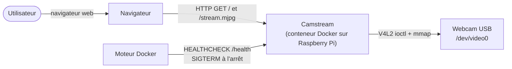
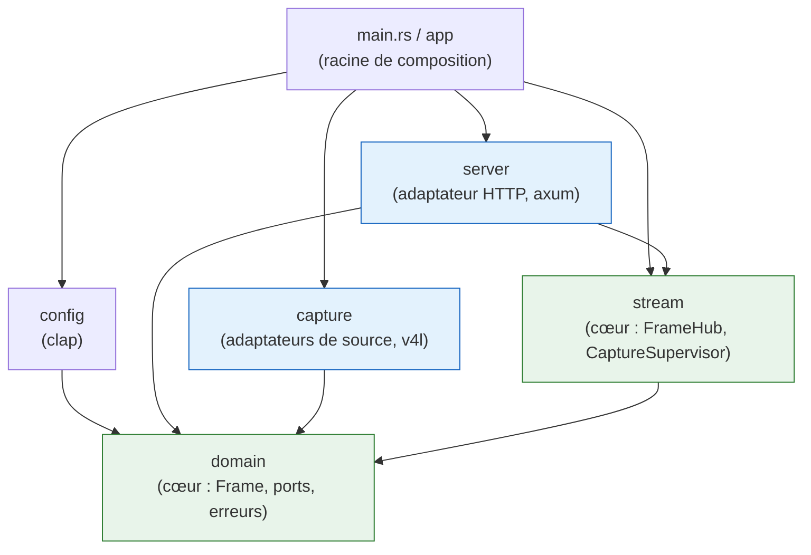
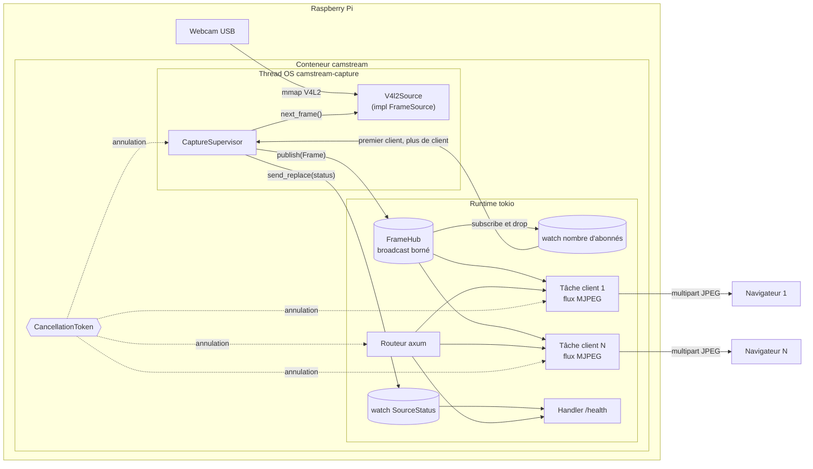
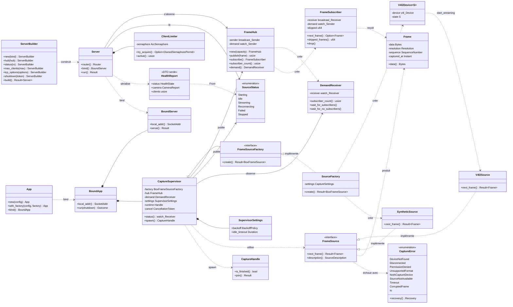
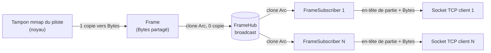
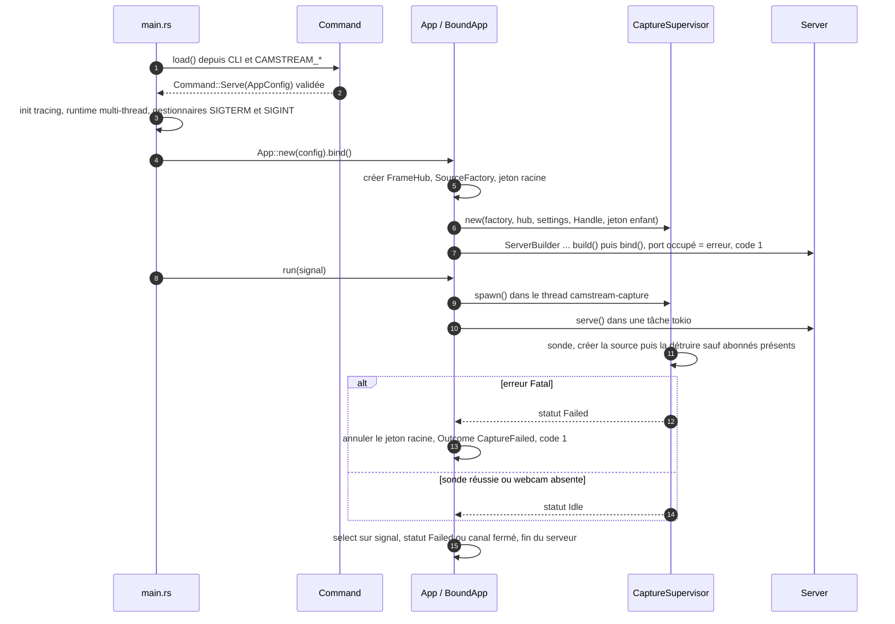
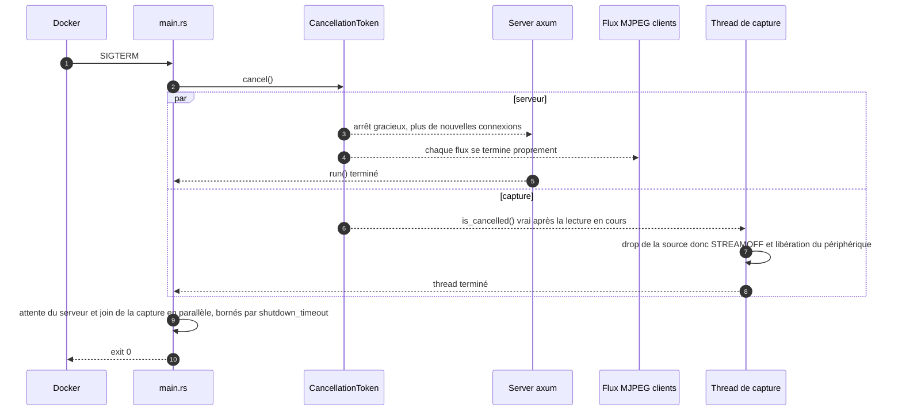
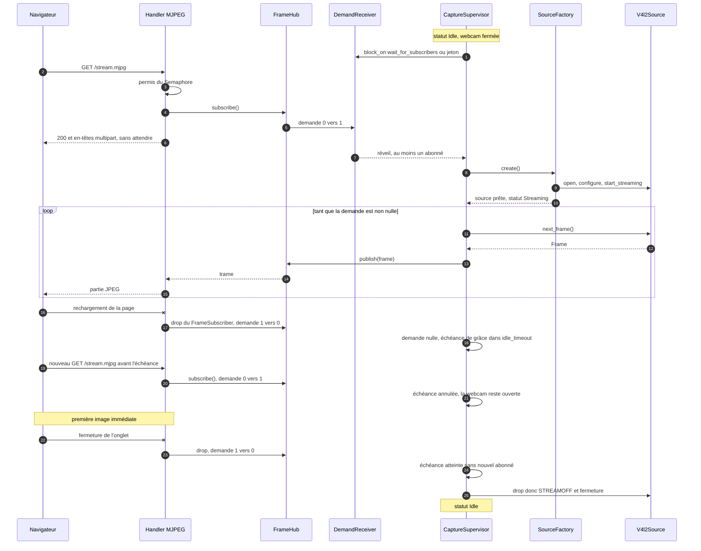
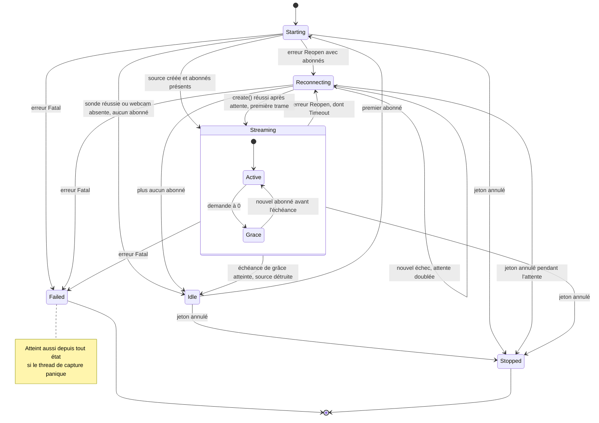

# Architecture de Camstream

> Statut : **v1 implémentée** (branche `feat/v1`). Les décisions sont tracées dans les ADR
> [0001](adr/0001-architecture-hexagonale-et-decoupage-en-modules.md) à
> [0007](adr/0007-securite-reseau-local-v1.md). Les signatures Rust de ce document reflètent le
> code ; les corps de fonctions sont omis. Les écarts avec la conception initiale sont listés au
> [§ 11](#11-écarts-entre-la-conception-initiale-et-limplémentation). Toute modification d'un
> **port** (trait) ou d'une frontière entre modules passe par une revue d'architecture.
> Les mesures sur Raspberry Pi du [spike 0001](spikes/0001-v4l.md) restent à faire : les valeurs
> par défaut documentées sont conservées en attendant.

## 1. Vue d'ensemble

Camstream lit les trames JPEG d'une webcam USB via V4L2 et les rediffuse, sans ré-encodage,
à plusieurs navigateurs sous forme de flux MJPEG (`multipart/x-mixed-replace`).

Exigences principales :

| Exigence | Réponse architecturale |
|---|---|
| Pas de ré-encodage sur le Pi | MJPEG natif de la webcam relayé tel quel ([ADR 0002](adr/0002-transport-mjpeg-multipart.md)) |
| Plusieurs clients, clients lents non bloquants | `FrameHub` sur `tokio::sync::broadcast` borné, trames sautées en cas de retard ([ADR 0004](adr/0004-distribution-des-trames-et-concurrence.md)) |
| Capture V4L2 bloquante | Thread OS dédié, jamais sur le runtime tokio |
| Webcam débranchée / rebranchée | `CaptureSupervisor` + `FrameSourceFactory`, reconnexion avec attente exponentielle |
| Webcam éteinte sans spectateur | Capture à la demande : compteur d'abonnés du `FrameHub`, délai de grâce, état `Idle` ([ADR 0006](adr/0006-capture-a-la-demande.md)) |
| Usage réseau local uniquement (v1) | Pas d'authentification ni de TLS, écoute `127.0.0.1` par défaut hors conteneur ([ADR 0007](adr/0007-securite-reseau-local-v1.md)) |
| Arrêt propre sur `SIGTERM` | `CancellationToken` racine, arrêt gracieux d'axum, join du thread de capture avec délai maximal |
| Testabilité sans matériel | Ports `FrameSource` / `FrameSourceFactory`, source synthétique |
| Évolutivité (WebRTC, multi-caméras) | Nouveaux adaptateurs abonnés au `FrameHub` ; un hub par caméra |

### Vue de contexte



## 2. Découpage en modules

Une seule crate `camstream` (bibliothèque + binaire), organisée en architecture hexagonale
([ADR 0001](adr/0001-architecture-hexagonale-et-decoupage-en-modules.md)).

```text
src/
├── main.rs              # point d'entrée : config, logs, runtime, signaux, codes de sortie (anyhow)
├── lib.rs               # expose les modules (tests d'intégration) ; #![forbid(unsafe_code)]
├── app.rs               # racine de composition : App, BoundApp, Outcome (anyhow)
├── domain/              # CŒUR — types et ports, aucune dépendance technique
│   ├── mod.rs
│   ├── frame.rs         # Frame, Resolution, Fps, SequenceNumber, PixelFormat, ParseResolutionError
│   ├── device.rs        # DevicePath, CaptureSettings, SourceKind, FormatPreference
│   └── source.rs        # ports FrameSource, FrameSourceFactory ; CaptureError, Recovery, SourceDescription
├── stream/              # CŒUR — distribution des trames et supervision
│   ├── mod.rs
│   ├── hub.rs           # FrameHub, FrameSubscriber, DemandReceiver, HubCapacity
│   ├── status.rs        # SourceStatus, StatusReceiver
│   └── supervisor.rs    # CaptureSupervisor, SupervisorSettings, BackoffPolicy, CaptureHandle,
│                        # CaptureThreadError, PanicGuard (privé)
├── capture/             # ADAPTATEURS de source
│   ├── mod.rs
│   ├── factory.rs       # SourceFactory (Factory)
│   ├── jpeg.rs          # complete_jpeg_len : vérification SOI/EOI, retrait du bourrage
│   ├── synthetic.rs     # SyntheticSource (mire JPEG embarquée, assets/synthetic/)
│   └── v4l2/            # feature Cargo « v4l2 » (par défaut)
│       ├── mod.rs       # open_source(settings)
│       ├── device.rs    # V4l2Device<S> (Typestate) : Opened -> Configured -> V4l2Source
│       ├── source.rs    # V4l2Source : impl FrameSource (Adapter, RAII)
│       ├── errno.rs     # map_open_error, map_io_error (traduction des errno)
│       └── release.rs   # Released<T> : Drop de v4l sous catch_unwind (RAII)
├── server/              # ADAPTATEUR HTTP (axum)
│   ├── mod.rs           # ServerBuilder, Server, BoundServer, ServerError
│   ├── routes.rs        # routeur : /, /stream.mjpg, /health ; ServerState (privé)
│   ├── mjpeg.rs         # corps multipart en streaming, MaxClients, ClientLimiter (Semaphore, RAII)
│   ├── health.rs        # HealthReport (DTO serde) + client healthcheck (sous-commande)
│   ├── net.rs           # TcpOptions, apply_tcp_options (keepalive, TCP_USER_TIMEOUT, NODELAY)
│   └── index.html       # page minimale (include_str!)
└── config/              # lecture et validation de la configuration
    ├── mod.rs           # Command (Serve / Healthcheck), AppConfig, HealthcheckConfig, ConfigError
    └── cli.rs           # Cli (clap derive + env), enums miroirs SourceArg / FormatArg

tests/
├── support/mod.rs       # ScriptedFactory / ScriptedSource, TestApp, client HTTP, MultipartReader
├── supervisor.rs        # capture à la demande, grâce, reconnexion, Fatal, panique, arrêt
├── http.rs              # bout en bout : page, multipart, 503, /health, healthcheck, arrêt
└── lifecycle.rs         # codes de sortie : arrêt, erreur fatale, panique, runtime refusé

assets/synthetic/        # 10 images JPEG 640x480 de la mire (scripts/generate_synthetic_frames.py)
```

Le repli YUYV (`encoder.rs`, feature `yuyv`) prévu en phase 2 n'existe pas encore.

### Graphe de dépendances entre modules

Les flèches indiquent « dépend de ». Le cœur (`domain`, `stream`) ne dépend d'aucun
adaptateur ni d'aucune crate technique (V4L2, HTTP, CLI).



### Ports et adaptateurs

| Port (trait, dans le cœur) | Rôle | Adaptateurs |
|---|---|---|
| `FrameSource` | Fournir la prochaine trame JPEG (appel bloquant) | `V4l2Source`, `SyntheticSource`, sources de test (`ScriptedSource` dans `tests/`) |
| `FrameSourceFactory` | (Re)créer une source ; utilisé à chaque reconnexion | `SourceFactory` (choix V4L2 / synthétique), fabriques de test |
| *(côté entrant)* `FrameHub` / `FrameSubscriber` | API du cœur consommée par les transports | `server::mjpeg` aujourd'hui ; WebSocket/WebRTC demain |

`FrameHub` n'est volontairement **pas** un trait : c'est le cœur lui-même. Les transports en
dépendent directement (sens autorisé adaptateur → cœur) et les tests utilisent un vrai
`FrameHub` alimenté par une source synthétique, ce qui rend un mock inutile.

### Composants à l'exécution



## 3. Types et ports (signatures proposées)

### 3.1 `domain::frame` — trames et newtypes

```rust
//! Types métier décrivant une trame vidéo et ses caractéristiques.

use bytes::Bytes;
use std::num::NonZeroU32;
use std::time::Instant;

/// Résolution d'image en pixels (largeur × hauteur), toujours non nulle.
///
/// Implémente le pattern **Newtype** : impossible de confondre largeur et hauteur
/// ou de construire une résolution nulle. Analysée depuis la forme « 640x480 ».
#[derive(Debug, Clone, Copy, PartialEq, Eq, Hash)]
pub struct Resolution {
    width: NonZeroU32,
    height: NonZeroU32,
}

impl Resolution {
    /// Construit une résolution ; `None` si une dimension est nulle (`const` : utilisable
    /// pour des constantes vérifiées à la compilation).
    pub const fn new(width: u32, height: u32) -> Option<Self>;
    /// Largeur en pixels.
    pub fn width(&self) -> u32;
    /// Hauteur en pixels.
    pub fn height(&self) -> u32;
}

/// Analyse « LARGEURxHAUTEUR » (ex. « 1280x720 »).
impl std::str::FromStr for Resolution {
    type Err = ParseResolutionError;
    fn from_str(s: &str) -> Result<Self, Self::Err>;
}

/// Nombre d'images par seconde demandé ou négocié (**Newtype**, non nul).
#[derive(Debug, Clone, Copy, PartialEq, Eq, Hash)]
pub struct Fps(NonZeroU32);

impl Fps {
    pub const fn new(fps: u32) -> Option<Self>;
    pub fn get(self) -> u32;
    /// Intervalle théorique entre deux images (`1 / fps`).
    pub fn frame_interval(self) -> Duration;
}

/// Numéro de séquence monotone d'une trame, attribué par la source (**Newtype**).
///
/// Permet aux clients et aux logs de détecter les trames sautées.
#[derive(Debug, Clone, Copy, PartialEq, Eq, PartialOrd, Ord, Hash, Default)]
pub struct SequenceNumber(u64);

impl SequenceNumber {
    pub fn new(value: u64) -> Self;
    pub fn get(self) -> u64;
    /// Numéro suivant (saturant).
    pub fn next(self) -> Self;
}

/// Format de pixels négocié avec le périphérique.
#[derive(Debug, Clone, Copy, PartialEq, Eq)]
pub enum PixelFormat {
    /// Images JPEG compressées par la webcam (format privilégié, sans ré-encodage).
    Mjpeg,
    /// Format brut YUV 4:2:2 (repli, nécessite un encodage JPEG logiciel).
    Yuyv,
}

/// Trame vidéo **encodée en JPEG**, prête à être diffusée.
///
/// Le contenu est un `Bytes` à comptage de références : cloner une `Frame` pour
/// N clients ne copie jamais l'image (essentiel sur Raspberry Pi).
#[derive(Debug, Clone)]
pub struct Frame {
    data: Bytes,
    resolution: Resolution,
    sequence: SequenceNumber,
    captured_at: Instant,
}

impl Frame {
    /// Construit une trame à partir de données JPEG déjà encodées.
    pub fn new(data: Bytes, resolution: Resolution, sequence: SequenceNumber) -> Self;
    /// Données JPEG (partagées, sans copie).
    pub fn data(&self) -> &Bytes;
    /// Résolution de l'image.
    pub fn resolution(&self) -> Resolution;
    /// Numéro de séquence attribué par la source.
    pub fn sequence(&self) -> SequenceNumber;
    /// Instant de capture (horloge monotone), utile pour mesurer la latence.
    pub fn captured_at(&self) -> Instant;
}
```

### 3.2 `domain::device` — paramètres de capture

```rust
//! Paramètres de capture indépendants de toute bibliothèque V4L2.

use std::path::PathBuf;
use std::time::Duration;

/// Chemin d'un périphérique vidéo (ex. `/dev/video0`) (**Newtype**).
#[derive(Debug, Clone, PartialEq, Eq)]
pub struct DevicePath(PathBuf);

/// Type de source à instancier par la fabrique.
#[derive(Debug, Clone, Copy, PartialEq, Eq)]
pub enum SourceKind {
    /// Webcam réelle via V4L2.
    V4l2,
    /// Mire de test JPEG générée sans matériel (démonstration, CI).
    Synthetic,
}

/// Préférence de format de pixels demandée par la configuration.
#[derive(Debug, Clone, Copy, PartialEq, Eq, Default)]
pub enum FormatPreference {
    /// MJPEG si disponible, sinon YUYV (comportement par défaut). En v1, sans
    /// repli YUYV, équivaut à `Mjpeg`.
    #[default]
    Auto,
    /// MJPEG exigé : erreur si la webcam ne le propose pas.
    Mjpeg,
    /// YUYV forcé (diagnostic ; coûteux en CPU). Phase 2 : refusé en v1.
    Yuyv,
}

/// Paramètres complets nécessaires pour créer une source.
///
/// Produit par le module `config`, consommé par la fabrique de `capture` :
/// ainsi `capture` ne dépend pas de `config`.
#[derive(Debug, Clone)]
pub struct CaptureSettings {
    /// Type de source.
    pub kind: SourceKind,
    /// Périphérique à ouvrir (ignoré par la source synthétique).
    pub device: DevicePath,
    /// Résolution demandée (le pilote peut en imposer une proche).
    pub resolution: Resolution,
    /// Cadence demandée.
    pub fps: Fps,
    /// Format de pixels souhaité.
    pub format: FormatPreference,
    /// Délai maximal d'attente d'une trame avant `CaptureError::Timeout`.
    pub read_timeout: Duration,
}
```

### 3.3 `domain::source` — ports de capture et erreurs

```rust
//! Ports (traits) de capture : abstractions que le cœur utilise sans connaître V4L2.

/// Source de trames vidéo, indépendante du matériel.
///
/// Implémente le pattern **Strategy** : le superviseur de capture ne connaît que ce
/// trait, ce qui permet de remplacer la webcam par une source synthétique ou de test.
///
/// Contrat :
/// - `next_frame` est **bloquant** : il ne doit être appelé que depuis le thread de
///   capture, jamais depuis le runtime tokio ;
/// - il rend la main au plus tard après le `read_timeout` configuré ;
/// - les trames renvoyées sont **toujours encodées en JPEG** ;
/// - la libération du périphérique se fait à la destruction de la source (**RAII**).
pub trait FrameSource: Send {
    /// Lit la prochaine trame disponible (bloquant, borné par le délai de lecture).
    fn next_frame(&mut self) -> Result<Frame, CaptureError>;

    /// Décrit les paramètres effectivement négociés (format, résolution, cadence).
    fn description(&self) -> SourceDescription;
}

/// Fabrique de sources, appelée au démarrage puis à chaque reconnexion.
///
/// Implémente le pattern **Factory** (fabrique abstraite à une méthode) : le
/// superviseur peut recréer une source après une déconnexion sans connaître son type.
pub trait FrameSourceFactory: Send {
    /// Crée et démarre une nouvelle source prête à produire des trames.
    fn create(&self) -> Result<Box<dyn FrameSource>, CaptureError>;
}

/// Erreurs de capture, typées pour permettre une politique de reprise.
///
/// Pas de `#[from] std::io::Error` : chaque adaptateur traduit explicitement les `errno`.
#[derive(Debug, thiserror::Error)]
pub enum CaptureError {
    /// Le périphérique n'existe pas (pas encore branché ou chemin erroné).
    #[error("video device not found: {0}")]
    DeviceNotFound(DevicePath),
    /// Le périphérique a disparu pendant la capture (ENODEV, câble USB retiré).
    #[error("video device disconnected")]
    Disconnected,
    /// Droits insuffisants (utilisateur hors du groupe `video`, `--device` absent).
    #[error("permission denied on video device: {0}")]
    PermissionDenied(DevicePath),
    /// Le nœud n'est pas un périphérique de capture en streaming (ex. nœud de
    /// métadonnées `/dev/video1` d'une webcam UVC).
    #[error("not a streaming video capture device: {0}")]
    NotACaptureDevice(DevicePath),
    /// Aucun format compatible avec la préférence demandée.
    #[error("no supported pixel format for preference {preference:?}")]
    UnsupportedFormat { preference: FormatPreference },
    /// Type de source non compilé dans ce binaire (feature `v4l2` absente).
    #[error("source kind {0} is not available in this build")]
    SourceNotAvailable(SourceKind),
    /// Aucune trame reçue dans le délai imparti.
    #[error("timed out waiting for a frame")]
    Timeout,
    /// Trame invalide (JPEG tronqué, tampon vide, drapeau d'erreur du pilote) : on la jette.
    #[error("corrupted frame")]
    CorruptedFrame,
    /// Autre erreur d'entrée/sortie du pilote (dont `EINVAL`, `EBUSY`).
    #[error("video I/O error")]
    Io(#[source] std::io::Error),
}

/// Action de reprise associée à une erreur de capture.
#[derive(Debug, Clone, Copy, PartialEq, Eq)]
pub enum Recovery {
    /// Ignorer et relire (trame isolée perdue).
    Skip,
    /// Fermer la source et la recréer après une attente (déconnexion).
    Reopen,
    /// Erreur non récupérable : arrêter l'application (code de sortie non nul).
    Fatal,
}

impl CaptureError {
    /// Classe l'erreur selon la politique de reprise (voir § 6).
    pub fn recovery(&self) -> Recovery;
}

/// Caractéristiques effectives d'une source démarrée.
///
/// Défini dans `domain` (et non dans `stream`) car il est renvoyé par le port
/// `FrameSource::description` : le placer dans `stream` créerait une dépendance
/// `domain` → `stream` interdite. Pas de `serde` ici : la forme JSON est un DTO de
/// `server::health` (voir § 3.6).
#[derive(Debug, Clone, PartialEq, Eq)]
pub struct SourceDescription {
    /// Nom lisible (ex. carte de la webcam, « synthetic »).
    pub name: String,
    /// Format natif négocié.
    pub pixel_format: PixelFormat,
    /// Résolution effective.
    pub resolution: Resolution,
    /// Cadence effective.
    pub fps: Fps,
}
```

Remarques d'implémentation :

- `DevicePath` implémente `Display` (via `Path::display`) pour les messages
  `#[error("... {0}")]` : `PathBuf` n'implémente pas `Display`.
- `#[from] std::io::Error` a été retiré de `Io` : l'adaptateur V4L2 convertit explicitement
  (`capture::v4l2::errno::map_open_error` à l'ouverture, `map_io_error` ensuite), pour que
  `ENODEV` devienne `Disconnected`, `EACCES`/`EPERM` `PermissionDenied`, etc.
- `SourceDescription` implémente `Display` (« Cam (MJPEG 640x480 @ 15 fps) ») pour les logs.

### 3.4 `stream` — diffuseur, état et superviseur

```rust
//! Cœur de distribution : publie les trames capturées vers N abonnés et expose
//! la demande (nombre d'abonnés) au superviseur de capture.

use std::num::NonZeroUsize;
use std::sync::Arc;
use std::time::Duration;
use tokio::sync::{broadcast, watch};
use tokio_util::sync::CancellationToken;

/// Capacité du tampon de diffusion, en trames (**Newtype**, non nulle).
#[derive(Debug, Clone, Copy)]
pub struct HubCapacity(NonZeroUsize);

/// Diffuseur de trames vers un nombre quelconque d'abonnés.
///
/// Implémente le pattern **Observer / Publish-Subscribe** au-dessus de
/// `tokio::sync::broadcast` : l'émetteur ne bloque jamais, un abonné lent saute
/// des trames au lieu de ralentir les autres. Tient aussi le compteur d'abonnés
/// (la « demande »), publié par `watch`, qui pilote la capture à la demande.
/// Cloner le hub est peu coûteux.
#[derive(Debug, Clone)]
pub struct FrameHub {
    sender: broadcast::Sender<Frame>,
    // `watch::Sender` est `Clone` : chaque abonné en garde un clone pour décrémenter
    // la demande dans son `Drop`, sans `Arc` supplémentaire.
    demand: watch::Sender<usize>,
}

impl FrameHub {
    /// Crée un hub dont le tampon conserve au plus `capacity` trames.
    pub fn new(capacity: HubCapacity) -> Self;

    /// Publie une trame (synchrone, non bloquant, appelable hors runtime).
    ///
    /// Renvoie le nombre d'abonnés ; 0 n'est pas une erreur (trame jetée).
    pub fn publish(&self, frame: Frame) -> usize;

    /// Crée un nouvel abonné qui recevra les trames publiées à partir de maintenant.
    ///
    /// Incrémente la demande (`send_modify`) : le superviseur est réveillé s'il
    /// attendait un premier client.
    pub fn subscribe(&self) -> FrameSubscriber;

    /// Nombre d'abonnés actuellement vivants (valeur du compteur de demande).
    pub fn subscriber_count(&self) -> usize;

    /// Observateur de la demande, destiné au `CaptureSupervisor`.
    pub fn demand(&self) -> DemandReceiver;
}

/// Abonné au flux de trames.
///
/// **RAII** : sa destruction désabonne le récepteur `broadcast` **et** décrémente la
/// demande ; c'est le seul chemin de décrément, donc le compteur ne peut pas dériver.
/// Volontairement non `Clone`.
#[derive(Debug)]
pub struct FrameSubscriber {
    receiver: broadcast::Receiver<Frame>,
    demand: watch::Sender<usize>,
    skipped: u64,
}

impl FrameSubscriber {
    /// Attend la prochaine trame.
    ///
    /// En cas de retard (`Lagged`), les trames perdues sont comptées et la lecture
    /// reprend avec la suivante disponible. Renvoie `None` si le hub est fermé.
    pub async fn next_frame(&mut self) -> Option<Frame>;

    /// Nombre total de trames sautées par cet abonné (client lent).
    pub fn skipped_frames(&self) -> u64;
}

impl Drop for FrameSubscriber {
    /// Décrémente la demande (`send_modify` avec `saturating_sub`).
    fn drop(&mut self);
}

/// Observateur du nombre d'abonnés du hub (**Observer**, côté superviseur).
///
/// Indépendant du transport : tout abonné compte, qu'il vienne du flux MJPEG ou
/// d'un futur transport WebRTC.
#[derive(Debug, Clone)]
pub struct DemandReceiver {
    receiver: watch::Receiver<usize>,
}

impl DemandReceiver {
    /// Nombre d'abonnés courant (lecture non bloquante, utilisable entre deux trames).
    pub fn subscriber_count(&self) -> usize;
    /// Se résout dès qu'au moins un abonné existe (immédiatement si c'est déjà le cas).
    pub async fn wait_for_subscribers(&mut self);
    /// Se résout dès que plus aucun abonné n'existe.
    pub async fn wait_for_no_subscribers(&mut self);
    // Si le hub entier a disparu, ces attentes ne se résolvent jamais (la demande ne
    // peut plus changer) : elles sont toujours combinées au jeton d'annulation.
}

/// État observable de la capture, publié via `tokio::sync::watch`.
///
/// Aucun `serde` : `/health` le convertit en DTO (`server::health::HealthReport`).
#[derive(Debug, Clone, PartialEq, Eq)]
pub enum SourceStatus {
    /// Sonde de démarrage ou ouverture de la source en cours.
    Starting,
    /// Aucun abonné : webcam fermée, en attente du premier client.
    Idle,
    /// Trames en cours de production (y compris pendant le délai de grâce).
    Streaming { source: SourceDescription },
    /// Source perdue alors que des clients attendent ; nouvelle tentative prévue.
    Reconnecting { attempt: u32, last_error: String },
    /// Erreur fatale : l'application va s'arrêter.
    Failed { reason: String },
    /// Arrêt demandé et terminé.
    Stopped,
}

/// Politique d'attente exponentielle entre deux tentatives de reconnexion.
#[derive(Debug, Clone, Copy, PartialEq, Eq, Default)]   // Default = DEFAULT
pub struct BackoffPolicy {
    initial: Duration,
    max: Duration,
}

impl BackoffPolicy {
    /// 1 s, doublée à chaque échec, plafonnée à 30 s.
    pub const DEFAULT: Self;
    /// `max` est relevé à `initial` s'il lui est inférieur.
    pub fn new(initial: Duration, max: Duration) -> Self;
    /// Délai avant la tentative numéro `attempt` (1, 2, 4… plafonné à `max`).
    pub fn delay(&self, attempt: u32) -> Duration;
}

/// Réglages du superviseur, regroupés pour garder un constructeur lisible.
/// `Default` : attente exponentielle 1 s → 30 s, délai de grâce 10 s.
#[derive(Debug, Clone, Copy, PartialEq, Eq)]
pub struct SupervisorSettings {
    /// Attente entre deux tentatives de reconnexion.
    pub backoff: BackoffPolicy,
    /// Délai de grâce avant d'éteindre la webcam après le départ du dernier client
    /// (`Duration::ZERO` : arrêt immédiat).
    pub idle_timeout: Duration,
}

/// Superviseur de capture : capture à la demande, boucle de lecture, reconnexion.
///
/// S'exécute dans un **thread OS dédié** car `FrameSource::next_frame` est bloquant.
/// Dépend uniquement des ports `FrameSourceFactory` / `FrameSource` (inversion de
/// dépendances) : il ignore tout de V4L2 et du transport HTTP.
pub struct CaptureSupervisor {
    factory: Box<dyn FrameSourceFactory>,
    hub: FrameHub,
    demand: DemandReceiver,
    status: watch::Sender<SourceStatus>,
    settings: SupervisorSettings,
    // Permet des attentes interruptibles (`block_on` + `select!`) depuis le thread
    // de capture, qui n'est pas un thread du runtime.
    runtime: tokio::runtime::Handle,
    cancel: CancellationToken,
}

impl CaptureSupervisor {
    /// Construit le superviseur (injection des dépendances par le constructeur).
    ///
    /// La demande est obtenue par `hub.demand()`.
    pub fn new(
        factory: Box<dyn FrameSourceFactory>,
        hub: FrameHub,
        settings: SupervisorSettings,
        runtime: tokio::runtime::Handle,
        cancel: CancellationToken,
    ) -> Self;

    /// Récepteur de l'état de la source (pour `/health`, les logs et `main`).
    pub fn status(&self) -> watch::Receiver<SourceStatus>;

    /// Démarre la boucle dans le thread `camstream-capture`. Un gardien RAII
    /// (`PanicGuard`) publie `Failed` si le thread panique.
    pub fn spawn(self) -> std::io::Result<CaptureHandle>;
}

/// Poignée du thread de capture.
pub struct CaptureHandle {
    thread: std::thread::JoinHandle<Result<(), CaptureError>>,
}

impl CaptureHandle {
    /// Vrai si le thread est terminé.
    pub fn is_finished(&self) -> bool;
    /// Attend la fin du thread (bloquant : via `spawn_blocking` depuis du code async).
    ///
    /// Renvoie l'erreur fatale ou la panique ayant provoqué l'arrêt de la capture.
    pub fn join(self) -> Result<(), CaptureThreadError>;
}

/// Fin anormale du thread de capture.
#[derive(Debug, thiserror::Error)]
pub enum CaptureThreadError {
    /// La capture s'est arrêtée sur une erreur non récupérable.
    #[error("capture stopped on a fatal error")]
    Fatal(#[source] CaptureError),
    /// Le thread de capture a paniqué (message de la panique).
    #[error("capture thread panicked: {0}")]
    Panicked(String),
}
```

Boucle du superviseur (pseudo-code de `stream/supervisor.rs`, détail dans le § 7) :

```text
statut = Starting
sonde : source = factory.create()
    Fatal  -> statut Failed, fin du thread avec l'erreur
    Reopen -> abonnés présents ? tentative = 1, statut Reconnecting : warn, tentative = 0
    Ok     -> abonnés présents ? garder la source (décision § 7.1) : drop(source)
boucle :
    source en attente ? -> boucle de lecture
    acquisition :
        tentative == 0 : si demande == 0 { statut Idle ; attendre(premier abonné | jeton) }
                         statut Starting ; création immédiate
        tentative >  0 : attendre(backoff.delay(tentative) | plus d'abonné | jeton)
                         plus d'abonné -> tentative = 0, retour à l'acquisition (Idle)
        create() : Ok -> boucle de lecture ; Fatal -> Failed, fin
                   Reopen -> demande > 0 ? tentative += 1, statut Reconnecting : tentative = 0
    boucle de lecture :
        demande == 0 : armer l'échéance de grâce (si pas déjà fait) ; échéance dépassée
                       -> drop(source), tentative = 0, retour à l'acquisition (Idle)
        demande > 0  : désarmer l'échéance
        next_frame() -> publish ; tentative = 0 ; statut Streaming à la première trame
        erreur Skip -> ignorer ; Reopen -> drop(source), comme un échec de create() ;
        Fatal -> drop(source), Failed, fin
jeton annulé à tout moment -> drop(source), statut Stopped, fin
panique à tout moment -> PanicGuard : statut Failed (« capture thread panicked »), fin du thread
```

Pendant la lecture, la demande est lue sans attente (`subscriber_count()`) entre deux trames ;
l'échéance de grâce est donc vérifiée au rythme des trames (≤ `read_timeout`), précision
largement suffisante pour un délai de 10 s.

Remarques d'implémentation (API réelles de `tokio` / `std`) :

- `broadcast::channel(n)` panique si `n == 0` (d'où `HubCapacity`) et **arrondit `n` à la
  puissance de deux supérieure** : une capacité de 5 conserve en réalité 8 trames.
- `broadcast::Sender::send` renvoie `Err` s'il n'y a aucun abonné : `publish` fait
  `send(frame).unwrap_or(0)`. `broadcast::Receiver::recv` est sûr à l'annulation
  (*cancel-safe*), donc utilisable dans `tokio::select!`.
- `watch::Sender::send` échoue **sans mémoriser la valeur** quand aucun récepteur n'existe :
  le superviseur doit utiliser `send_replace` (ou `send_modify`) pour que `/health` lise
  toujours l'état courant ; de même, le compteur de demande est modifié par `send_modify`,
  qui s'applique sans condition.
- `Handle::block_on` panique s'il est appelé **depuis** un contexte asynchrone ; il est
  valide ici car le thread `camstream-capture` est un thread OS ordinaire. Les minuteries
  (`tokio::time::sleep`) attendues ainsi utilisent le pilote de temps du runtime, ce qui
  impose deux précautions documentées par tokio :
  - sur un runtime **`current_thread`**, `Handle::block_on` ne fait pas avancer les pilotes
    d'E/S et de temps : minuteries et réveils ne fonctionnent que si un autre thread est en
    train d'exécuter `Runtime::block_on`. `#[tokio::main]` est multi-thread, mais
    `#[tokio::test]` est `current_thread` par défaut : les tests du superviseur doivent
    utiliser `#[tokio::test(flavor = "multi_thread")]` et ne jamais bloquer le thread de test
    (pas de `CaptureHandle::join` synchrone dans le test) ;
  - si le runtime est arrêté pendant qu'une minuterie est attendue via `Handle::block_on`,
    celle-ci **panique**. Cas possible si le join borné du thread de capture expire et que
    `main` se termine : sans conséquence (le processus sort), mais à ne pas confondre avec un
    défaut dans les logs.
- `watch::Receiver::wait_for(f)` renvoie un `watch::Ref`, c'est-à-dire un **verrou de
  lecture** (non `Send`) : le relâcher immédiatement (`.map(|_| ())`), ne jamais le garder à
  travers un `.await`. Il examine la valeur courante avant d'attendre, même si l'émetteur est
  déjà détruit : un `Failed` publié juste avant la fin du thread est donc bien vu. En revanche,
  si le thread se termine **sans** publier `Failed`, `wait_for` renvoie `Err(RecvError)` :
  `app` traite ce cas comme une fin anormale de la capture (code 1). En pratique, une panique
  publie tout de même `Failed` grâce au `PanicGuard` ; l'`Err` reste traité par défense en
  profondeur.
- `watch::Sender<T>` est `Clone` (vérifié dans tokio 1.54) : l'`Arc` autour du compteur de demande est
  donc facultatif ; un clone du `Sender` dans chaque `FrameSubscriber` suffit.
- `std::thread::JoinHandle::join` est **bloquant et sans délai maximal** : `CaptureHandle::join`
  ne doit pas être appelé directement depuis une tâche async. `app` l'appelle via
  `tokio::task::spawn_blocking`, enveloppé dans `tokio::time::timeout(shutdown_timeout, …)`.
  `std::thread::JoinHandle::join` renvoie `Err(Box<dyn Any + Send>)` si le thread a paniqué :
  `CaptureHandle::join` le traduit en `CaptureThreadError::Panicked(message)`. Les paniques des
  `Drop` de `v4l` (`STREAMOFF` autre que `ENODEV`, `munmap`, `close`) sont, elles, contenues
  dans l'adaptateur (`Released<T>`, § 3.5) et n'atteignent pas le superviseur.

### 3.5 `capture` — adaptateurs

```rust
//! Adaptateurs de source : webcam V4L2, mire synthétique et fabrique.

/// Fabrique concrète choisissant l'adaptateur selon `CaptureSettings::kind`.
///
/// Implémente le pattern **Factory** : seul point du code qui connaît les types
/// concrets de source.
pub struct SourceFactory {
    settings: CaptureSettings,
}

impl FrameSourceFactory for SourceFactory {
    /// Ouvre, configure et démarre la source demandée.
    fn create(&self) -> Result<Box<dyn FrameSource>, CaptureError>;
}

/// Source synthétique : rejoue des images JPEG embarquées à la cadence demandée.
///
/// Aucun encodage à l'exécution (images pré-encodées via `include_bytes!`) :
/// utilisable sur le Pi pour valider le déploiement sans webcam, et en CI.
pub struct SyntheticSource { /* images, cadence, séquence */ }

impl FrameSource for SyntheticSource { /* ... */ }
```

```rust
//! Adaptateur V4L2 (feature Cargo « v4l2 »), encapsulant la crate `v4l`.

/// États du périphérique (**Typestate**) : un périphérique ne peut démarrer le
/// streaming qu'après avoir été configuré, vérifié à la compilation.
pub struct Opened;
/// Périphérique configuré avec un format négocié.
pub struct Configured {
    negotiated: NegotiatedFormat,
}

/// Périphérique V4L2 dans l'état `S`.
///
/// Implémente les patterns **Adapter** (masque l'API `v4l`) et **Typestate**.
pub struct V4l2Device<S> {
    device: Released<v4l::Device>,   // Drop sous catch_unwind
    path: DevicePath,
    name: String,                    // carte (QUERYCAP), pour SourceDescription
    state: S,
}

impl V4l2Device<Opened> {
    /// Ouvre le périphérique ; traduit ENOENT/EACCES/EPERM/ENODEV en `CaptureError`
    /// typées ; vérifie `VIDEO_CAPTURE | STREAMING` (sinon `NotACaptureDevice`, fatale).
    pub fn open(path: &DevicePath) -> Result<Self, CaptureError>;

    /// Négocie format, résolution et cadence (MJPEG prioritaire, YUYV en repli
    /// selon `FormatPreference`).
    pub fn configure(self, settings: &CaptureSettings)
        -> Result<V4l2Device<Configured>, CaptureError>;
}

impl V4l2Device<Configured> {
    /// Alloue les tampons mmap et démarre le streaming ; consomme le périphérique.
    pub fn start_streaming(self, read_timeout: Duration) -> Result<V4l2Source, CaptureError>;
}

/// Source V4L2 en streaming ; arrête le flux et libère les tampons à la
/// destruction (**RAII**, via les `Drop` de `v4l`, sous `catch_unwind`).
pub struct V4l2Source {
    stream: Released<MmapStream<'static>>,   // détruit en premier (ordre des champs)
    _device: Released<v4l::Device>,
    path: DevicePath,
    description: SourceDescription,
    sequence: SequenceNumber,
}

/// Ressource `v4l` détruite sous `catch_unwind` (**RAII**) : une panique d'un `Drop` de
/// `v4l` est journalisée au lieu d'arrêter le thread de capture.
pub(crate) struct Released<T> { value: Option<T>, what: &'static str }

/// Ouvre, configure et démarre une webcam (utilisé par `SourceFactory`).
pub fn open_source(settings: &CaptureSettings) -> Result<V4l2Source, CaptureError>;

impl FrameSource for V4l2Source {
    /// Copie le tampon mmap dans un `Bytes` (seule copie de la chaîne) puis le rend
    /// au pilote ; encode en JPEG uniquement si le format négocié est YUYV.
    fn next_frame(&mut self) -> Result<Frame, CaptureError>;
    fn description(&self) -> SourceDescription;
}
```

> Constats sur `v4l` 0.14.0 (code source vérifié), à confirmer par le spike sur matériel.
> Leur prise en compte dans le code : troncature à `bytesused` puis vérification
> `SOI`/`EOI` et retrait du bourrage (`capture::jpeg::complete_jpeg_len`) ; trame marquée
> `V4L2_BUF_FLAG_ERROR` → `CorruptedFrame` ; délai de `poll` borné à `i32::MAX` ms ;
> `Timeout` → `Reopen` ; `Drop` sous `catch_unwind` (`Released<T>`) ; `STREAMON` envoyé par
> `v4l` à la première lecture (la latence de démarrage apparaît dans le premier
> `next_frame`).
>
>
> - **Pas d'auto-référence** : `MmapStream::with_buffers(&dev, Type::VideoCapture, n)` clone
>   l'`Arc<Handle>` du `Device` et ne l'emprunte pas ; le paramètre de durée de vie ne concerne
>   que les tampons mmap. `V4l2Source` peut donc stocker un `MmapStream<'static>` (qui est
>   `Send`) à côté de son `Device`.
> - **Délai de lecture** : `MmapStream::set_timeout(Duration)` existe ; `next()` fait un `poll`
>   puis renvoie `io::ErrorKind::TimedOut` à l'expiration.
> - **Taille utile** : `CaptureStream::next()` renvoie le tampon mmap **entier** ; il faut le
>   tronquer à `meta.bytesused` avant la copie dans `Bytes`, sinon chaque trame contient des
>   octets parasites et pèse la taille du tampon.
> - **Reprise après délai** : `next()` remet en file (`QBUF`) le tampon précédent *avant* le
>   `poll`. Après un `TimedOut`, l'appel suivant remet en file un tampon déjà en file
>   (`EINVAL` attendu). **Décision** : `Timeout` est classé `Reopen` (voir § 6). Un délai de
>   2 s à 15 i/s signifie une webcam figée, pour laquelle recréer la source est la bonne
>   réaction ; la reconnexion est de toute façon un chemin courant avec la capture à la
>   demande. Le contournement (réimplémenter la boucle `DQBUF`/`QBUF` ou corriger `v4l`) est
>   écarté : code bas niveau ou fork à maintenir pour un cas rare.
> - **`Drop`** : le `Drop` du flux panique si `STREAMOFF` échoue avec une erreur autre que
>   `ENODEV` (voir les remarques du § 3.4 sur `join`).
> - `Device::with_path` ouvre en `O_RDWR | O_NONBLOCK` ; le format se négocie par le trait
>   `v4l::video::Capture` (`enum_formats`, `set_format`, `set_params(&Parameters::with_fps(n))`),
>   le nom de la carte par `query_caps()?.card`.

### 3.6 `server` — adaptateur HTTP

```rust
//! Adaptateur HTTP (axum) : page d'accueil, flux MJPEG et santé.

/// Nombre maximal de clients de flux simultanés (**Newtype**, non nul ; `DEFAULT` = 10).
/// Défini dans `server/mjpeg.rs`, réexporté par `server`.
#[derive(Debug, Clone, Copy, PartialEq, Eq)]
pub struct MaxClients(NonZeroUsize);

/// Construit le serveur HTTP étape par étape.
///
/// Implémente le pattern **Builder** : paramètres obligatoires (adresse, hub,
/// état, jeton d'arrêt) vérifiés par `build`, paramètres optionnels avec défauts
/// (`MaxClients`, options TCP).
#[derive(Debug)]
pub struct ServerBuilder { /* champs optionnels */ }

impl ServerBuilder {
    /// Démarre la construction pour l'adresse d'écoute donnée.
    pub fn new(bind: SocketAddr) -> Self;
    /// Source des trames diffusées.
    pub fn hub(self, hub: FrameHub) -> Self;
    /// État de la capture exposé par `/health`.
    pub fn status(self, status: watch::Receiver<SourceStatus>) -> Self;
    /// Limite de clients simultanés (défaut : 10).
    pub fn max_clients(self, max: MaxClients) -> Self;
    /// Détection des clients disparus (défaut : keepalive 30 s, `TCP_USER_TIMEOUT` 30 s).
    pub fn tcp_options(self, options: TcpOptions) -> Self;
    /// Jeton déclenchant l'arrêt gracieux (fin des flux en cours).
    pub fn shutdown(self, token: CancellationToken) -> Self;
    /// Valide et construit le serveur.
    pub fn build(self) -> Result<Server, ServerError>;
}

/// Serveur HTTP prêt à démarrer.
pub struct Server { /* adresse, routeur, options TCP, jeton */ }

impl Server {
    /// Routeur axum, exposé pour les tests sans socket (`tower::ServiceExt::oneshot`).
    pub fn router(&self) -> axum::Router;
    /// Réserve l'adresse (erreur `Bind` immédiate si le port est occupé).
    pub async fn bind(self) -> Result<BoundServer, ServerError>;
    /// `bind` puis `serve`.
    pub async fn run(self) -> Result<(), ServerError>;
}

/// Serveur dont l'adresse est réservée : permet de connaître le port réel (port 0 en test)
/// avant de servir.
pub struct BoundServer { /* TcpListener, adresse effective, routeur, options, jeton */ }

impl BoundServer {
    pub fn local_addr(&self) -> SocketAddr;
    /// Sert jusqu'à l'annulation du jeton puis attend la fin des connexions (à borner
    /// par l'appelant).
    pub async fn serve(self) -> Result<(), ServerError>;
}

/// Limiteur de clients de flux : `MaxClients` permis.
///
/// `try_acquire_owned` réserve une place sans attente (échec → `503`) ; le
/// `OwnedSemaphorePermit` renvoyé est stocké dans l'état du corps MJPEG et libère la
/// place à sa destruction (**RAII**), même en cas de coupure brutale.
#[derive(Debug, Clone)]
struct ClientLimiter {
    semaphore: Arc<tokio::sync::Semaphore>,
    max: MaxClients,
}

impl ClientLimiter {
    /// Réserve une place ; `None` si la limite est atteinte.
    fn try_acquire(&self) -> Option<tokio::sync::OwnedSemaphorePermit>;
    /// Nombre de clients en cours (`max - available_permits()`), pour `/health`.
    fn active(&self) -> usize;
}

/// Options appliquées à chaque socket acceptée (via `socket2::SockRef`).
#[derive(Debug, Clone, Copy)]
pub struct TcpOptions {
    /// Inactivité avant la première sonde keepalive.
    pub keepalive_idle: Duration,
    /// Intervalle entre sondes keepalive.
    pub keepalive_interval: Duration,
    /// Nombre de sondes keepalive sans réponse avant fermeture (`TCP_KEEPCNT`).
    pub keepalive_retries: u32,
    /// Durée maximale de données non acquittées avant fermeture par le noyau
    /// (`TCP_USER_TIMEOUT`, Linux).
    pub user_timeout: Duration,
    /// `TCP_NODELAY` (défaut : vrai) : chaque partie MJPEG part sans attendre.
    pub nodelay: bool,
}

/// Représentation JSON de `/health` (DTO de l'adaptateur HTTP).
///
/// Découple le contrat JSON des types du cœur, qui restent sans `serde`.
#[derive(Debug, serde::Serialize)]
pub struct HealthReport {
    /// `HealthState::Ok` / `Failed`, sérialisé en `"ok"` ou `"failed"` ; le code
    /// HTTP en est déduit (pas de comparaison de chaînes).
    pub status: HealthState,
    /// État de la caméra (`state` : `starting`, `idle`, `streaming`, `reconnecting`,
    /// `failed`, `stopped`, plus les détails utiles).
    pub camera: CameraReport,
    /// Clients de flux connectés.
    pub clients: usize,
}

/// État de la caméra tel qu'exposé en JSON.
#[derive(Debug, serde::Serialize)]
pub struct CameraReport {
    /// Nom d'état stable en `snake_case`.
    pub state: &'static str,
    /// Paramètres négociés, présents en `streaming`.
    #[serde(skip_serializing_if = "Option::is_none")]
    pub source: Option<SourceReport>,
    /// Numéro de tentative, présent en `reconnecting`.
    #[serde(skip_serializing_if = "Option::is_none")]
    pub attempt: Option<u32>,
    /// Dernière erreur, présente en `reconnecting` et `failed`.
    #[serde(skip_serializing_if = "Option::is_none")]
    pub error: Option<String>,
}

/// DTO de `SourceDescription` (nom, format, `"640x480"`, cadence).
#[derive(Debug, serde::Serialize)]
pub struct SourceReport { pub name: String, pub pixel_format: &'static str,
                          pub resolution: String, pub fps: u32 }

/// Correspondance explicite cœur → JSON : renommer une variante du cœur ne change
/// pas le contrat JSON sans modification visible ici.
impl From<&SourceStatus> for CameraReport { /* ... */ }

impl HealthReport {
    pub fn new(status: &SourceStatus, clients: usize) -> Self;
    /// 503 si `failed`, 200 sinon.
    pub fn http_status(&self) -> StatusCode;
}

/// Client de la sous-commande `camstream healthcheck` (bibliothèque standard, bloquant).
pub fn healthcheck_target(bind: IpAddr, port: u16) -> SocketAddr; // 0.0.0.0 -> 127.0.0.1, :: -> ::1
pub fn check(addr: SocketAddr, timeout: Duration) -> Result<(), HealthcheckError>;

/// Échec de la sonde : `Connect`, `Io`, `InvalidResponse`, `Unhealthy(code)`.
pub enum HealthcheckError { /* ... */ }

/// Erreurs du serveur HTTP.
#[derive(Debug, thiserror::Error)]
pub enum ServerError {
    /// Paramètre obligatoire absent du builder.
    #[error("missing server parameter: {0}")]
    MissingParameter(&'static str),
    /// Impossible d'écouter sur l'adresse (port occupé, droits).
    #[error("cannot bind {addr}")]
    Bind { addr: SocketAddr, #[source] source: std::io::Error },
    /// Erreur fatale pendant le service.
    #[error("HTTP server error")]
    Serve(#[source] std::io::Error),
}
```

Routes :

| Route | Réponse |
|---|---|
| `GET /` | Page HTML minimale (``, texte « Démarrage de la caméra… » jusqu'au premier `onload`, quelques lignes de JS pour recharger l'image si la connexion tombe) |
| `GET /stream.mjpg` | `200`, `multipart/x-mixed-replace; boundary=frame`, `Cache-Control: no-cache, no-store, must-revalidate`, corps infini ; `503` (avec `Retry-After: 5`) si `MaxClients` atteint |
| `GET /health` | JSON `HealthReport`, ex. `{"status":"ok","camera":{"state":"idle"},"clients":0}` ; `200` dans tous les états sauf `failed` → `503` |
| autre | `404` ; méthode autre que `GET`/`HEAD` sur une route connue : `405` |

Format d'une partie MJPEG (deux `Bytes` émis successivement, sans copie du JPEG) :

```text
\r\n--frame\r\n
Content-Type: image/jpeg\r\n
Content-Length: <taille>\r\n
\r\n
<octets JPEG>
```

Le `\r\n` qui suit les octets JPEG est placé **en tête** de l'en-tête de la partie suivante :
selon la RFC 2046, ce CRLF fait partie du délimiteur (`CRLF--frame`). On n'émet ainsi que deux
morceaux par trame (en-tête construit, puis le `Bytes` partagé) au lieu de trois ; le CRLF
initial de la toute première partie est un préambule vide, ignoré par les navigateurs.

Le corps est construit avec `axum::body::Body::from_stream`, qui exige un flux
`Send + 'static` dont l'erreur implémente `Into<BoxError>` : l'état du flux possède le
`FrameSubscriber`, le permis `OwnedSemaphorePermit` et un clone du `CancellationToken`
(attente via `cancelled_owned()` ou clone par itération, `cancelled()` empruntant le jeton).

Ordre dans le handler `/stream.mjpg` : (1) `try_acquire` du permis, sinon `503` ;
(2) `hub.subscribe()` — la demande devient visible et réveille le superviseur ;
(3) réponse `200` immédiate avec les en-têtes multipart ; (4) les parties suivent dès que la
webcam produit ([ADR 0006](adr/0006-capture-a-la-demande.md)). Le handler n'attend jamais la
première trame.

Options TCP : `axum::serve` accepte un `Listener` ; les options sont appliquées à chaque
connexion acceptée par `axum::serve::ListenerExt::tap_io` (vérifié dans axum 0.8.9 :
`fn tap_io<F>(self, tap_fn: F) -> TapIo<Self, F> where F: FnMut(&mut Self::Io) + Send + 'static`,
appelé sur le **listener**, pas sur `Serve`) :

```rust
use axum::serve::ListenerExt;

let listener = tokio::net::TcpListener::bind(addr).await?.tap_io(move |stream| {
    // Erreur non fatale : la connexion reste servie sans les options.
    if let Err(err) = net::apply_tcp_options(socket2::SockRef::from(&*stream), &options) {
        tracing::debug!(%err, "cannot set TCP options on accepted connection");
    }
});
axum::serve(listener, router).with_graceful_shutdown(token.cancelled_owned()).await
```

Avec `socket2` 0.6 : `SockRef::set_tcp_keepalive(&TcpKeepalive::new().with_time(..)
.with_interval(..).with_retries(..))` et `SockRef::set_tcp_user_timeout(Some(..))`.
`with_retries` et `set_tcp_user_timeout` n'existent qu'avec la feature **`all`** de `socket2`
(et, pour le second, sous Linux/Android/Fuchsia), ce qui convient à la cible ; le code les
conditionne à `target_os = "linux"`/`"android"`. `TCP_NODELAY` est appliqué au même endroit
(`TcpOptions::nodelay`) pour réduire la latence des parties.

### 3.7 `config`

```rust
//! Configuration : arguments de ligne de commande et variables d'environnement.

/// Configuration complète et validée de l'application.
///
/// Construite une seule fois au démarrage puis découpée et injectée dans chaque
/// composant : aucun composant ne lit l'environnement lui-même.
#[derive(Debug, Clone)]
pub struct AppConfig {
    /// Paramètres de la source vidéo.
    pub capture: CaptureSettings,
    /// Adresse d'écoute HTTP.
    pub bind: SocketAddr,
    /// Limite de clients simultanés.
    pub max_clients: NonZeroUsize,
    /// Capacité du tampon de diffusion.
    pub hub_capacity: NonZeroUsize,
    /// Première attente avant reconnexion de la webcam.
    pub reconnect_initial: Duration,
    /// Attente maximale entre deux tentatives de reconnexion.
    pub reconnect_max: Duration,
    /// Délai de grâce avant d'éteindre la webcam sans client (capture à la demande).
    pub idle_timeout: Duration,
    /// Délai maximal accordé à l'arrêt gracieux.
    pub shutdown_timeout: Duration,
}

/// Ce que l'invocation demande de faire.
pub enum Command {
    /// Démarrer le serveur de diffusion.
    Serve(AppConfig),
    /// `camstream healthcheck` : interroger `/health` de l'instance locale.
    Healthcheck(HealthcheckConfig),
}

impl Command {
    /// Lit la CLI et l'environnement (`CAMSTREAM_*`), applique les défauts, valide.
    pub fn load() -> Result<Self, ConfigError>;
    /// Variante testable à partir d'arguments explicites.
    pub fn try_parse_from<I, T>(args: I) -> Result<Self, ConfigError>
    where
        I: IntoIterator<Item = T>,
        T: Into<std::ffi::OsString> + Clone;
}

/// Paramètres de la sous-commande `healthcheck` (`--bind`/`--port` sont des options
/// globales, partagées avec le serveur ; `--timeout-ms`, défaut 2000).
pub struct HealthcheckConfig {
    pub bind: SocketAddr,
    pub timeout: Duration,
}

/// Erreurs de configuration.
#[derive(Debug, thiserror::Error)]
pub enum ConfigError {
    /// Argument ou variable mal formé (message de clap).
    #[error(transparent)]
    Parse(#[from] clap::Error),
    /// Combinaison de valeurs incohérente.
    #[error("invalid configuration: {0}")]
    Invalid(String),
}
```

`config` ne dépend que de `domain` (newtypes) : il ne connaît ni `FrameHub` ni axum. Comme
`domain` ne doit pas dépendre de `clap`, `config/cli.rs` déclare des enums miroirs
(`SourceArg`, `FormatArg`, `clap::ValueEnum`) convertis par `From` ; `Resolution` est analysée
par son `FromStr`. Les commentaires `///` des options sont en français (règle du projet) et
le texte d'aide, technique, est donné en anglais par l'attribut `help`. Validation
(`ConfigError::Invalid`, code de sortie 2) : `--format yuyv` refusé en v1, délai de lecture
supérieur à l'intervalle entre images, `--hub-capacity` ≤ 64, `--reconnect-max-ms` ≥
`--reconnect-initial-ms`. À noter : `try_parse_from` lit quand même les variables
`CAMSTREAM_*` du processus (feature `env`) ; les tests de configuration vérifient qu'aucune
n'est définie. C'est
`app` qui convertit `AppConfig` en `HubCapacity`, `SupervisorSettings`, `MaxClients`.
L'adresse d'écoute par défaut est `127.0.0.1:8080` ; l'image Docker fixe
`CAMSTREAM_BIND=0.0.0.0` ([ADR 0007](adr/0007-securite-reseau-local-v1.md)). La liste des
variables et leurs défauts figure dans [deploiement.md](deploiement.md#5-variables-denvironnement).

### 3.8 `app` — racine de composition

```rust
//! Racine de composition : câble le hub, le superviseur de capture et le serveur.

/// Issue du cycle de vie, traduite en code de sortie par `main` (0 si `Stopped`, 1 sinon).
pub enum Outcome { Stopped, CaptureFailed, ServerFailed }

/// Application non démarrée ; la fabrique est injectée (réelle ou scriptée en test).
pub struct App { /* AppConfig, Box<dyn FrameSourceFactory> */ }

impl App {
    pub fn new(config: AppConfig) -> Self;                       // SourceFactory
    pub fn with_factory(config: AppConfig, factory: Box<dyn FrameSourceFactory>) -> Self;
    /// Crée hub, superviseur (jeton enfant) et serveur (jeton enfant), réserve le port.
    /// Refuse un runtime `current_thread` (minuteries de `Handle::block_on`).
    pub async fn bind(self) -> anyhow::Result<BoundApp>;
}

pub struct BoundApp { /* BoundServer, CaptureSupervisor, StatusReceiver, jeton racine */ }

impl BoundApp {
    pub fn local_addr(&self) -> SocketAddr;
    pub fn status(&self) -> StatusReceiver;
    /// Lance la capture et le serveur ; `select!` sur `shutdown` (signal), `Failed` ou
    /// canal d'état fermé (fin anormale de la capture), fin du serveur ; puis annule le
    /// jeton racine et attend serveur et capture en parallèle, jusqu'à `shutdown_timeout`.
    pub async fn run(self, shutdown: impl Future<Output = ()>) -> anyhow::Result<Outcome>;
}
```

`main.rs` installe les gestionnaires `SIGTERM`/`SIGINT` (`tokio::signal::unix`) et passe le futur
correspondant à `run` ; les tests passent un `CancellationToken::cancelled_owned()`. Après
`run`, `main` détruit le runtime avec `shutdown_timeout(500 ms)` : une tâche bloquante restante
(join de la capture expiré) ne peut pas empêcher le processus de quitter.

## 4. Diagramme de classes



## 5. Flux de données et séquences

### 5.1 Chemin d'une trame (copies minimales)



La seule copie de l'image a lieu à la sortie du tampon mmap (qui doit être rendu au pilote
pour être réutilisé). En repli YUYV, cette étape est remplacée par l'encodage JPEG.

### 5.2 Démarrage



Le `select!` de `BoundApp::run` est le **seul** endroit qui décide de l'arrêt global : sur
`Failed` (observé par `status.wait_for`) ou sur la fermeture du canal d'état sans `Failed`
(fin anormale du thread), il annule le jeton racine puis suit la séquence du § 5.4 et renvoie
`Outcome::CaptureFailed`, que `main` traduit en code 1
([ADR 0004](adr/0004-distribution-des-trames-et-concurrence.md), décision 5).

### 5.3 Connexion d'un client et streaming


### 5.4 Arrêt propre (`SIGTERM`)



Point d'attention : les clones de `FrameHub` détenus par le serveur gardent l'émetteur
`broadcast` vivant ; un flux MJPEG ne se termine donc **pas** par `Closed`. Chaque flux doit
attendre `tokio::select!` sur `subscriber.next_frame()` **et** `token.cancelled()`, sans quoi
l'arrêt gracieux d'axum attendrait indéfiniment la fin des connexions longues.

Ce `select!` ne suffit pas toujours : si l'écriture vers un client est bloquée (fenêtre TCP
pleine, client disparu sans `RST`), hyper ne sonde plus le flux du corps et le jeton n'est
jamais observé. `app` borne donc l'attente du serveur par la même échéance que le join du
thread de capture (`tokio::time::timeout_at`), puis interrompt la tâche du serveur (`abort`)
si l'échéance est dépassée.
Les options `SO_KEEPALIVE` / `TCP_USER_TIMEOUT` (§ 3.6) réduisent ce cas en fonctionnement
normal : un client disparu est déconnecté par le noyau au bout d'environ 30 s.

### 5.5 Capture à la demande : premier client, rechargement, dernier départ



Latence du premier client : ouverture et première trame (≈ 0,3 à 1,5 s selon la webcam)
pendant lesquelles la connexion est ouverte mais sans image ; la page HTML affiche
« Démarrage de la caméra… » jusqu'au premier `onload` de l'image. Les spectateurs suivants,
et les rechargements dans le délai de grâce, ne subissent pas cette latence.

## 6. Gestion des erreurs

| Couche | Type | Traitement |
|---|---|---|
| `domain` / `capture` | `CaptureError` | Classée par `recovery()` puis traitée par le superviseur |
| `server` | `ServerError` | Remonte à `main` (port occupé → sortie code 1) |
| Flux client | erreurs d'écriture socket | Fin silencieuse du flux (log `debug`), aucune propagation |
| `config` | `ConfigError` | Message clair et sortie code 2 (`--help`/`--version` gérés par clap) |
| Thread de capture | `CaptureThreadError` | `Fatal` (déjà signalée par `Failed`) ou `Panicked` (fin anormale, code 1) |
| `main` / `app` | `anyhow::Error` | Contexte ajouté (`.context(...)`), log `error`, code de sortie non nul |

Politique de reprise de la capture :

| `CaptureError` | `Recovery` | Comportement |
|---|---|---|
| `CorruptedFrame` (pas de `SOI`/`EOI`, tampon vide, drapeau `V4L2_BUF_FLAG_ERROR`) | `Skip` | Trame jetée, log `debug` |
| `Timeout` | `Reopen` | Webcam figée : la source est détruite puis recréée (choix lié au comportement de `v4l` 0.14, § 3.5) |
| `Disconnected`, `DeviceNotFound`, `Io` (dont `EINVAL`, `EBUSY`) | `Reopen` | Statut `Reconnecting`, attente exponentielle (1 s, 2 s, 4 s… max 30 s), nouvel appel à la fabrique — **uniquement tant qu'il y a des abonnés** ; sinon `Idle` |
| `PermissionDenied`, `NotACaptureDevice`, `UnsupportedFormat` (dont « pas de MJPEG » en v1), `SourceNotAvailable` | `Fatal` | Statut `Failed`, fin du thread de capture avec l'erreur ; `main` l'observe (statut `watch` ou fin du thread) et annule le jeton racine, sortie code 1 (la politique `restart` de Docker prend le relais) |

Le superviseur reçoit un jeton **enfant** (§ 5.2) : annuler un `child_token()` n'annule pas
son parent. Le superviseur ne peut donc pas déclencher lui-même l'arrêt global ; c'est `main`
qui réagit à `Failed`.

Aucun `unwrap()`/`expect()` hors tests ; les invariants (ex. constantes non nulles) passent
par des constructeurs `const` ou sont commentés.

## 7. Cycle de vie de la capture, capture à la demande et reconnexion



`Active` et `Grace` sont des sous-états internes du superviseur ; l'état publié reste
`Streaming` dans les deux cas (la webcam est ouverte). `Starting` couvre la sonde initiale et
chaque ouverture déclenchée par un premier abonné ; `Streaming` n'est publié qu'à la
**première trame** (une source ouverte qui ne produit rien reste `Starting` ou `Reconnecting`).

### 7.1 Décisions prises à l'implémentation (points ouverts de la revue)

1. **Ordre sonde de démarrage / premier client.** Un client peut s'abonner pendant la sonde
   (le serveur écoute avant le lancement du thread de capture). Décision : si des abonnés sont
   présents à l'issue d'une sonde réussie, la source est **conservée** et sert directement
   (pas de fermeture/réouverture qui ajouterait la latence d'ouverture au premier spectateur).
   Si la sonde échoue avec une erreur `Reopen` alors que des abonnés attendent, la reconnexion
   démarre aussitôt (`Reconnecting`, tentative 1) ; sans abonné, l'état passe à `Idle`. Testé
   par `subscribers_present_at_startup_keep_the_probed_source` et
   `missing_camera_at_startup_is_retried_only_with_viewers` (`tests/supervisor.rs`).
2. **Fin du thread de capture sans `Failed` = fin anormale.** Une panique dans le thread de
   capture (bogue, ou `Drop` de `v4l` paniquant hors de `Released<T>`) arrête l'application avec
   le code 1, comme une erreur fatale : un thread de capture mort laisserait sinon un serveur
   « sain » qui ne diffuse plus rien. Mise en œuvre en deux niveaux :
   - un gardien RAII (`PanicGuard`, `stream/supervisor.rs`) publie
     `Failed { reason: "capture thread panicked" }` pendant le déroulement de la panique :
     `/health` passe à `503` et `app` réagit comme pour une erreur fatale ;
   - par défense en profondeur, `app` traite aussi la **fermeture du canal d'état sans
     `Failed`** comme une fin anormale, et `CaptureHandle::join` traduit la panique en
     `CaptureThreadError::Panicked(message)` (code 1 même si l'arrêt avait été demandé).
   Les paniques des `Drop` de `v4l` sont d'abord contenues dans l'adaptateur (`Released<T>`,
   § 3.5) : la ressource est perdue de toute façon et la source sera recréée. Limite : une
   double panique pendant un déroulement provoque un `abort` du processus (Docker redémarre le
   conteneur). Le profil `release` garde `panic = "unwind"` (défaut), indispensable à ces
   mécanismes.

Règles :

- l'attente de reconnexion est **interruptible** par le jeton (pas de `thread::sleep` de 30 s
  qui retarderait l'arrêt). `CancellationToken` n'offre **aucune attente synchrone** : la
  solution retenue est `tokio::runtime::Handle::block_on` sur un `select!` entre
  `cancelled()`, la demande et `tokio::time::sleep` (le `Handle` est injecté au superviseur,
  [ADR 0006](adr/0006-capture-a-la-demande.md)) ;
- toutes les attentes du thread de capture (premier abonné, attente exponentielle) sont des
  `Handle::block_on` sur un `select!` (jeton, demande, minuterie) : aucune attente active ;
- pendant `Reconnecting`, les clients restent connectés : ils ne reçoivent plus de trames,
  puis le flux reprend sur la **même connexion** quand la webcam revient ;
- l'attente exponentielle est interrompue si la demande tombe à 0 (→ `Idle`, tentatives
  remises à zéro) ; depuis `Idle`, la première tentative au retour d'un abonné est immédiate ;
- sans abonné, la webcam n'est pas surveillée : un débranchement n'est détecté qu'au client
  suivant ;
- l'ancienne source est détruite (RAII) **avant** la tentative suivante, pour libérer le
  périphérique ;
- le compteur de tentatives est remis à zéro dès qu'une trame est publiée.

Limite côté Docker : la reconnexion suppose que le nœud du périphérique reste valide dans le
conteneur après rebranchement (voir [deploiement.md](deploiement.md#7-reconnexion-de-la-webcam-dans-docker)).

## 8. Concurrence

| Activité | Exécution | Communication |
|---|---|---|
| Lecture V4L2, reconnexion, capture à la demande | Thread OS `camstream-capture` | `FrameHub::publish` (synchrone), `watch::Sender::send_replace`, `DemandReceiver` ; attentes via `Handle::block_on` |
| Serveur HTTP et flux clients | Runtime tokio multi-thread (une tâche par connexion) | `FrameSubscriber::next_frame().await` |
| Signaux | Tâche tokio (`tokio::signal::unix`) | `CancellationToken::cancel()` |

- Aucun verrou partagé entre capture et clients : uniquement des canaux (`broadcast`, `watch`).
- Limite de clients : `Arc<Semaphore>` et `try_acquire_owned()` (ADR 0004, décision 6) ;
  réservation atomique par construction, libération par `Drop` du permis.
- Demande (capture à la demande) : `watch<usize>` du `FrameHub`, incrémenté dans `subscribe`,
  décrémenté dans `Drop for FrameSubscriber`, observé par le superviseur.
- Threads du runtime : `worker_threads` laissé au défaut (nombre de cœurs du Pi) ; à réduire à 2
  si les mesures montrent une contention avec la capture.

### Format YUYV de repli

Si la webcam ne propose pas MJPEG, le navigateur ne peut pas afficher du YUYV : il faut encoder
en JPEG sur le Pi. Cet encodage est confiné à `V4l2Source` (stratégie `JpegEncoder` interne,
crate `jpeg-encoder`, qualité `CAMSTREAM_JPEG_QUALITY`) afin que le contrat « trames JPEG » du
port reste vrai. Il est prévu en **phase 2** (feature `yuyv`) ; en phase 1, l'absence de MJPEG
produit `UnsupportedFormat` (erreur fatale explicite). En YUYV, limiter la résolution (640x480)
et la cadence (10 à 15 i/s).

## 9. Observabilité

- `tracing` avec `EnvFilter` (`RUST_LOG`, défaut `info`).
- Champs structurés par client (`client_id`, `remote`) : `info` à la connexion et à la
  déconnexion (durée, trames envoyées, trames sautées) ; `warn` au refus `503`.
- `warn` à chaque perte de webcam et tentative de reconnexion, `info` au rétablissement.
- `info` à l'allumage et à l'extinction de la webcam (capture à la demande), avec la durée
  d'ouverture (`elapsed_ms`) et le délai jusqu'à la première trame (`first_frame_ms`).
- Couleurs ANSI seulement si la sortie est un terminal (`docker logs` reste lisible).
- Aucune trace par trame au-dessus du niveau `trace`.

## 10. Évolutions prévues (non implémentées)

| Évolution | Impact |
|---|---|
| WebSocket / WebRTC | Nouvel adaptateur de transport abonné au `FrameHub` ; ADR dédié |
| Plusieurs caméras | Un couple `CaptureSupervisor` + `FrameHub` par caméra, routes `/cameras/{id}/stream.mjpg` |
| `/snapshot.jpg` | Nécessite de conserver la dernière trame (un `watch<Option<Frame>>` en plus du hub) |
| Authentification / TLS | Hors v1 ([ADR 0007](adr/0007-securite-reseau-local-v1.md)) : reverse proxy en amont ou VPN, nouvel ADR |
| Conversion YUYV → JPEG | Phase 2 (feature `yuyv`) ; en v1, webcam sans MJPEG = erreur fatale explicite |

## 11. Écarts entre la conception initiale et l'implémentation

| Élément | Conception initiale | Implémentation | Raison |
|---|---|---|---|
| `CaptureError` | 7 variantes, `Io` avec `#[from]` | + `NotACaptureDevice` et `SourceNotAvailable` (fatales) ; `#[from]` retiré | Nœud de métadonnées `/dev/video1` (erreur de configuration fréquente, sinon reconnexion sans fin) ; binaire compilé sans `v4l2` ; traduction explicite des `errno` |
| `CaptureHandle::join` | `Result<(), CaptureError>` | `Result<(), CaptureThreadError>` (`Fatal` / `Panicked`) | La panique est un concept de thread, pas une erreur de capture du domaine |
| Panique du thread de capture | Point ouvert | `PanicGuard` publie `Failed` ; canal fermé sans `Failed` = fin anormale (§ 7.1) | Décision de la revue |
| Sonde et abonnés présents | Point ouvert | Source conservée (§ 7.1) | Décision de la revue |
| `Streaming` | Publié à l'ouverture de la source | Publié à la première trame | `/health` ne dit `streaming` que si des images circulent |
| Demande du hub | `Arc<watch::Sender<usize>>` | `watch::Sender<usize>` cloné | `watch::Sender` est `Clone` (tokio ≥ 1.37) |
| `Server` | `run()` | `bind()` → `BoundServer { local_addr(), serve() }` + `run()` | Connaître le port réel (port 0 en test) ; erreur `Bind` avant le lancement de la capture |
| `AppConfig::load` | Renvoie `AppConfig` | `Command::load` renvoie `Serve(AppConfig)` ou `Healthcheck(HealthcheckConfig)` | Sous-commande `healthcheck` |
| `app` | « `App::from_config` » | `App::new` / `App::with_factory`, `BoundApp::run(shutdown)`, `Outcome` | Fabrique et signal injectés : cycle de vie testable |
| `MaxClients` | `server/mod.rs` | `server/mjpeg.rs`, réexporté | Proche de `ClientLimiter` qui l'utilise |
| `TcpOptions` | 4 champs | + `nodelay` | `TCP_NODELAY` recommandé au § 3.6 |
| `CameraReport` | `state`, `source`, `error` | + `attempt` (en `reconnecting`) | Diagnostic de la reconnexion |
| Validation de la vidéo | Non précisée | `capture::jpeg::complete_jpeg_len` (`SOI`/`EOI`, bourrage) | Spike 0001 : bourrage et trames tronquées possibles |
| `CAMSTREAM_JPEG_QUALITY` | Listée | Non implémentée | Repli YUYV en phase 2 |
| Runtime `current_thread` | Mise en garde | Refusé par `App::bind` (erreur explicite) | `Handle::block_on` n'y ferait pas avancer les minuteries |
