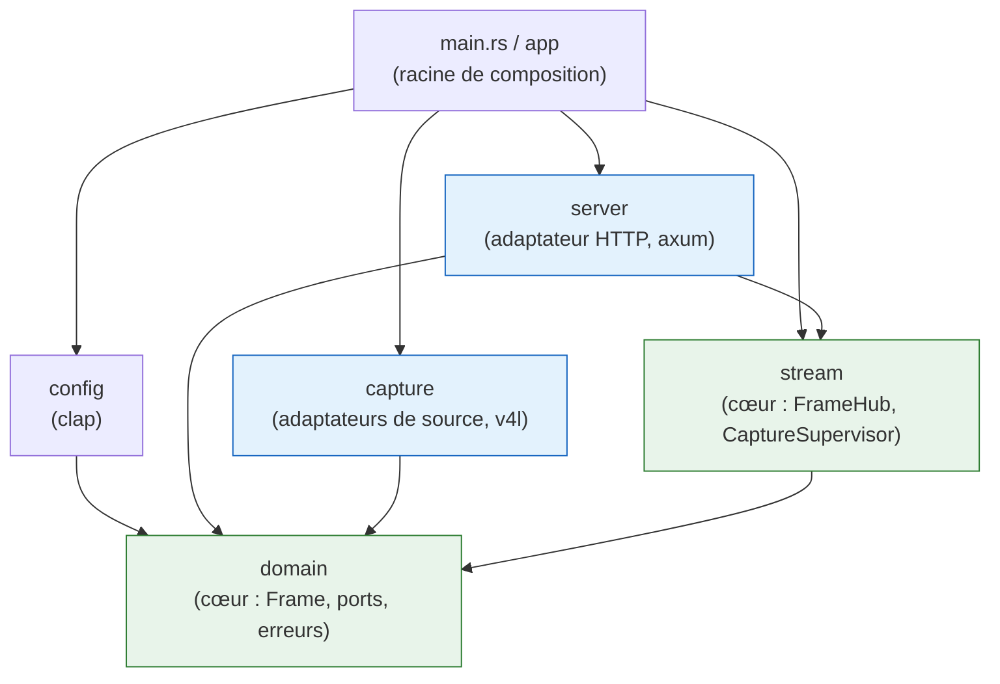
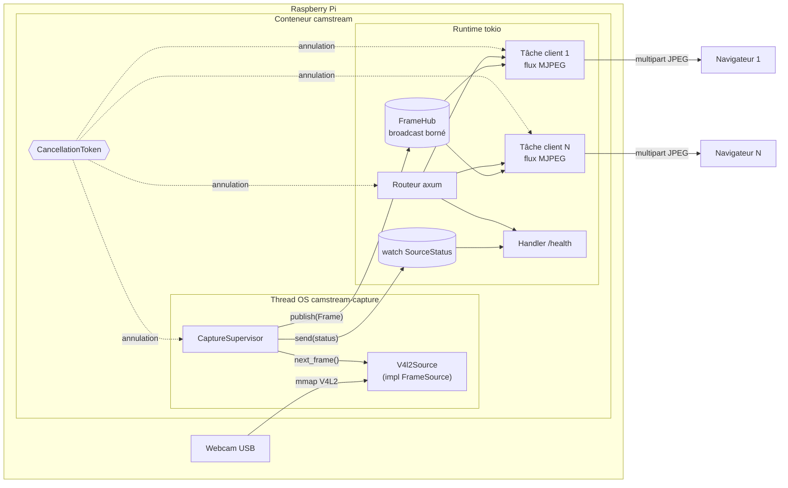
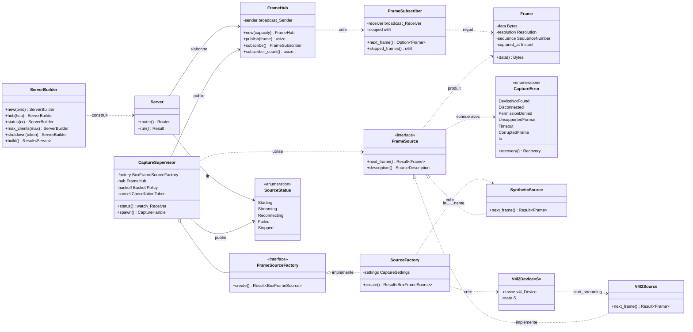
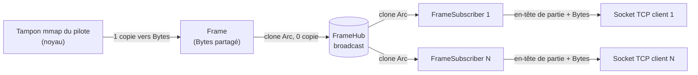
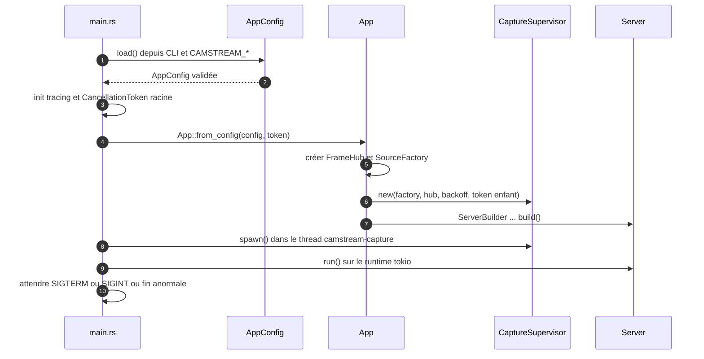
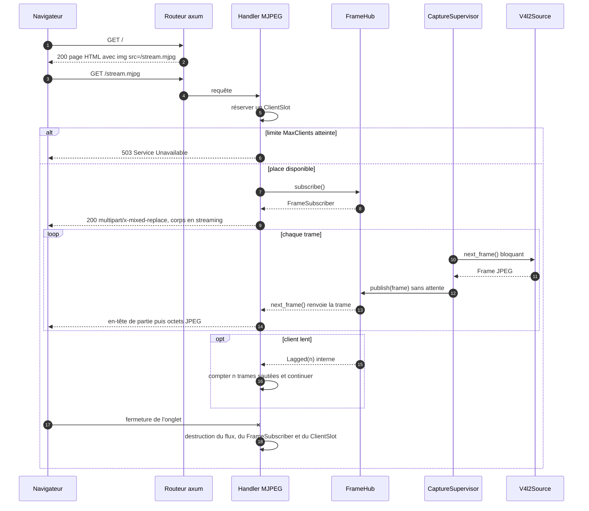
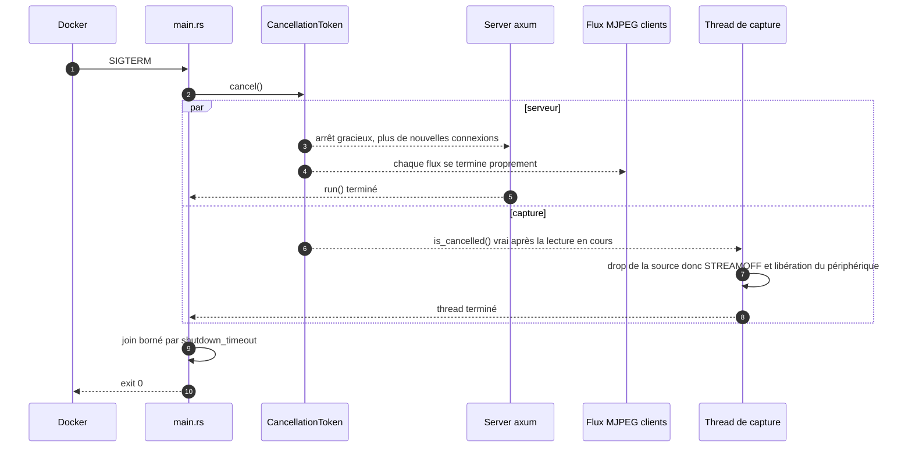
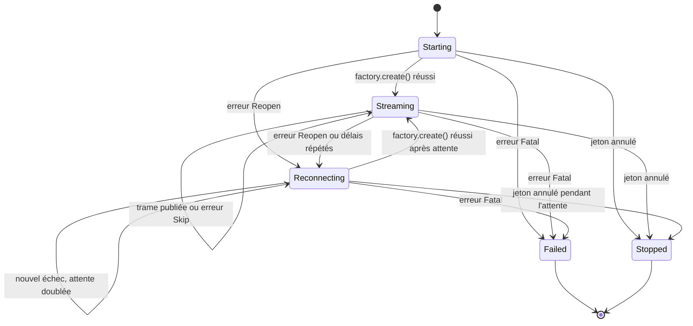

# Architecture de Camstream

> Statut : **conception initiale (proposée)**, avant implémentation. Les décisions sont tracées
> dans les ADR [0001](adr/0001-architecture-hexagonale-et-decoupage-en-modules.md) à
> [0005](adr/0005-image-docker-et-compilation-arm64.md). Les signatures Rust de ce document
> sont des **propositions** : l'implémentation peut les ajuster (noms de champs privés,
> détails d'API des crates), mais toute modification d'un **port** (trait) ou d'une frontière
> entre modules passe par une revue d'architecture.

## 1. Vue d'ensemble

Camstream lit les trames JPEG d'une webcam USB via V4L2 et les rediffuse, sans ré-encodage,
à plusieurs navigateurs sous forme de flux MJPEG (`multipart/x-mixed-replace`).

Exigences principales :

| Exigence | Réponse architecturale |
|---|---|
| Pas de ré-encodage sur le Pi | MJPEG natif de la webcam relayé tel quel ([ADR 0002](adr/0002-transport-mjpeg-multipart.md)) |
| Plusieurs clients, clients lents non bloquants | `FrameHub` sur `tokio::sync::broadcast` borné, trames sautées en cas de retard ([ADR 0004](adr/0004-distribution-des-trames-et-concurrence.md)) |
| Capture V4L2 bloquante | Thread OS dédié, jamais sur le runtime tokio |
| Webcam débranchée / rebranchée | `CaptureSupervisor` + `FrameSourceFactory`, reconnexion avec attente exponentielle |
| Arrêt propre sur `SIGTERM` | `CancellationToken` racine, arrêt gracieux d'axum, join du thread de capture avec délai maximal |
| Testabilité sans matériel | Ports `FrameSource` / `FrameSourceFactory`, source synthétique |
| Évolutivité (WebRTC, multi-caméras) | Nouveaux adaptateurs abonnés au `FrameHub` ; un hub par caméra |

### Vue de contexte


## 2. Découpage en modules

Une seule crate `camstream` (bibliothèque + binaire), organisée en architecture hexagonale
([ADR 0001](adr/0001-architecture-hexagonale-et-decoupage-en-modules.md)).

```text
src/
├── main.rs              # point d'entrée : parsing config, logs, signaux, anyhow
├── lib.rs               # expose les modules (tests d'intégration)
├── app.rs               # racine de composition : App, câblage, cycle de vie
├── domain/              # CŒUR — types et ports, aucune dépendance technique
│   ├── mod.rs
│   ├── frame.rs         # Frame, Resolution, Fps, SequenceNumber, PixelFormat
│   ├── device.rs        # DevicePath, CaptureSettings, SourceKind, FormatPreference
│   └── source.rs        # ports FrameSource, FrameSourceFactory ; CaptureError, Recovery, SourceDescription
├── stream/              # CŒUR — distribution des trames et supervision
│   ├── mod.rs
│   ├── hub.rs           # FrameHub, FrameSubscriber, HubCapacity
│   ├── status.rs        # SourceStatus
│   └── supervisor.rs    # CaptureSupervisor, BackoffPolicy, CaptureHandle
├── capture/             # ADAPTATEURS de source
│   ├── mod.rs
│   ├── factory.rs       # SourceFactory (Factory)
│   ├── synthetic.rs     # SyntheticSource (mire de test JPEG embarquée)
│   └── v4l2/            # feature Cargo « v4l2 » (par défaut)
│       ├── mod.rs
│       ├── device.rs    # V4l2Device<S> (Typestate) : Opened -> Configured
│       ├── source.rs    # V4l2Source : impl FrameSource (Adapter)
│       └── encoder.rs   # JpegEncoder (repli YUYV, phase 2, feature « yuyv »)
├── server/              # ADAPTATEUR HTTP (axum)
│   ├── mod.rs           # ServerBuilder, Server, ServerError
│   ├── routes.rs        # routeur : /, /stream.mjpg, /health
│   ├── mjpeg.rs         # corps multipart en streaming, ClientSlot (RAII)
│   ├── health.rs        # HealthReport + client healthcheck (sous-commande)
│   └── index.html       # page minimale (include_str!)
└── config/              # lecture et validation de la configuration
    ├── mod.rs           # AppConfig, ConfigError
    └── cli.rs           # Cli (clap derive + env)
```

### Graphe de dépendances entre modules

Les flèches indiquent « dépend de ». Le cœur (`domain`, `stream`) ne dépend d'aucun
adaptateur ni d'aucune crate technique (V4L2, HTTP, CLI).



### Ports et adaptateurs

| Port (trait, dans le cœur) | Rôle | Adaptateurs |
|---|---|---|
| `FrameSource` | Fournir la prochaine trame JPEG (appel bloquant) | `V4l2Source`, `SyntheticSource`, sources de test (`ScriptedSource` dans `tests/`) |
| `FrameSourceFactory` | (Re)créer une source ; utilisé à chaque reconnexion | `SourceFactory` (choix V4L2 / synthétique), fabriques de test |
| *(côté entrant)* `FrameHub` / `FrameSubscriber` | API du cœur consommée par les transports | `server::mjpeg` aujourd'hui ; WebSocket/WebRTC demain |

`FrameHub` n'est volontairement **pas** un trait : c'est le cœur lui-même. Les transports en
dépendent directement (sens autorisé adaptateur → cœur) et les tests utilisent un vrai
`FrameHub` alimenté par une source synthétique, ce qui rend un mock inutile.

### Composants à l'exécution



## 3. Types et ports (signatures proposées)

### 3.1 `domain::frame` — trames et newtypes

```rust
//! Types métier décrivant une trame vidéo et ses caractéristiques.

use bytes::Bytes;
use std::num::NonZeroU32;
use std::time::Instant;

/// Résolution d'image en pixels (largeur × hauteur), toujours non nulle.
///
/// Implémente le pattern **Newtype** : impossible de confondre largeur et hauteur
/// ou de construire une résolution nulle. Analysée depuis la forme « 640x480 ».
#[derive(Debug, Clone, Copy, PartialEq, Eq, Hash)]
pub struct Resolution {
    width: NonZeroU32,
    height: NonZeroU32,
}

impl Resolution {
    /// Construit une résolution ; `None` si une dimension est nulle.
    pub fn new(width: u32, height: u32) -> Option<Self>;
    /// Largeur en pixels.
    pub fn width(&self) -> u32;
    /// Hauteur en pixels.
    pub fn height(&self) -> u32;
}

/// Analyse « LARGEURxHAUTEUR » (ex. « 1280x720 »).
impl std::str::FromStr for Resolution {
    type Err = ParseResolutionError;
    fn from_str(s: &str) -> Result<Self, Self::Err>;
}

/// Nombre d'images par seconde demandé ou négocié (**Newtype**, non nul).
#[derive(Debug, Clone, Copy, PartialEq, Eq)]
pub struct Fps(NonZeroU32);

/// Numéro de séquence monotone d'une trame, attribué par la source (**Newtype**).
///
/// Permet aux clients et aux logs de détecter les trames sautées.
#[derive(Debug, Clone, Copy, PartialEq, Eq, PartialOrd, Ord)]
pub struct SequenceNumber(u64);

/// Format de pixels négocié avec le périphérique.
#[derive(Debug, Clone, Copy, PartialEq, Eq)]
pub enum PixelFormat {
    /// Images JPEG compressées par la webcam (format privilégié, sans ré-encodage).
    Mjpeg,
    /// Format brut YUV 4:2:2 (repli, nécessite un encodage JPEG logiciel).
    Yuyv,
}

/// Trame vidéo **encodée en JPEG**, prête à être diffusée.
///
/// Le contenu est un `Bytes` à comptage de références : cloner une `Frame` pour
/// N clients ne copie jamais l'image (essentiel sur Raspberry Pi).
#[derive(Debug, Clone)]
pub struct Frame {
    data: Bytes,
    resolution: Resolution,
    sequence: SequenceNumber,
    captured_at: Instant,
}

impl Frame {
    /// Construit une trame à partir de données JPEG déjà encodées.
    pub fn new(data: Bytes, resolution: Resolution, sequence: SequenceNumber) -> Self;
    /// Données JPEG (partagées, sans copie).
    pub fn data(&self) -> &Bytes;
    /// Résolution de l'image.
    pub fn resolution(&self) -> Resolution;
    /// Numéro de séquence attribué par la source.
    pub fn sequence(&self) -> SequenceNumber;
    /// Instant de capture (horloge monotone), utile pour mesurer la latence.
    pub fn captured_at(&self) -> Instant;
}
```

### 3.2 `domain::device` — paramètres de capture

```rust
//! Paramètres de capture indépendants de toute bibliothèque V4L2.

use std::path::PathBuf;
use std::time::Duration;

/// Chemin d'un périphérique vidéo (ex. `/dev/video0`) (**Newtype**).
#[derive(Debug, Clone, PartialEq, Eq)]
pub struct DevicePath(PathBuf);

/// Type de source à instancier par la fabrique.
#[derive(Debug, Clone, Copy, PartialEq, Eq)]
pub enum SourceKind {
    /// Webcam réelle via V4L2.
    V4l2,
    /// Mire de test JPEG générée sans matériel (démonstration, CI).
    Synthetic,
}

/// Préférence de format de pixels demandée par la configuration.
#[derive(Debug, Clone, Copy, PartialEq, Eq, Default)]
pub enum FormatPreference {
    /// MJPEG si disponible, sinon YUYV (comportement par défaut).
    #[default]
    Auto,
    /// MJPEG exigé : erreur si la webcam ne le propose pas.
    Mjpeg,
    /// YUYV forcé (diagnostic ; coûteux en CPU).
    Yuyv,
}

/// Paramètres complets nécessaires pour créer une source.
///
/// Produit par le module `config`, consommé par la fabrique de `capture` :
/// ainsi `capture` ne dépend pas de `config`.
#[derive(Debug, Clone)]
pub struct CaptureSettings {
    /// Type de source.
    pub kind: SourceKind,
    /// Périphérique à ouvrir (ignoré par la source synthétique).
    pub device: DevicePath,
    /// Résolution demandée (le pilote peut en imposer une proche).
    pub resolution: Resolution,
    /// Cadence demandée.
    pub fps: Fps,
    /// Format de pixels souhaité.
    pub format: FormatPreference,
    /// Délai maximal d'attente d'une trame avant `CaptureError::Timeout`.
    pub read_timeout: Duration,
}
```

### 3.3 `domain::source` — ports de capture et erreurs

```rust
//! Ports (traits) de capture : abstractions que le cœur utilise sans connaître V4L2.

/// Source de trames vidéo, indépendante du matériel.
///
/// Implémente le pattern **Strategy** : le superviseur de capture ne connaît que ce
/// trait, ce qui permet de remplacer la webcam par une source synthétique ou de test.
///
/// Contrat :
/// - `next_frame` est **bloquant** : il ne doit être appelé que depuis le thread de
///   capture, jamais depuis le runtime tokio ;
/// - il rend la main au plus tard après le `read_timeout` configuré ;
/// - les trames renvoyées sont **toujours encodées en JPEG** ;
/// - la libération du périphérique se fait à la destruction de la source (**RAII**).
pub trait FrameSource: Send {
    /// Lit la prochaine trame disponible (bloquant, borné par le délai de lecture).
    fn next_frame(&mut self) -> Result<Frame, CaptureError>;

    /// Décrit les paramètres effectivement négociés (format, résolution, cadence).
    fn description(&self) -> SourceDescription;
}

/// Fabrique de sources, appelée au démarrage puis à chaque reconnexion.
///
/// Implémente le pattern **Factory** (fabrique abstraite à une méthode) : le
/// superviseur peut recréer une source après une déconnexion sans connaître son type.
pub trait FrameSourceFactory: Send {
    /// Crée et démarre une nouvelle source prête à produire des trames.
    fn create(&self) -> Result<Box<dyn FrameSource>, CaptureError>;
}

/// Erreurs de capture, typées pour permettre une politique de reprise.
#[derive(Debug, thiserror::Error)]
pub enum CaptureError {
    /// Le périphérique n'existe pas (pas encore branché ou chemin erroné).
    #[error("video device not found: {0}")]
    DeviceNotFound(DevicePath),
    /// Le périphérique a disparu pendant la capture (ENODEV, câble USB retiré).
    #[error("video device disconnected")]
    Disconnected,
    /// Droits insuffisants (utilisateur hors du groupe `video`, `--device` absent).
    #[error("permission denied on video device: {0}")]
    PermissionDenied(DevicePath),
    /// Aucun format compatible avec la préférence demandée.
    #[error("no supported pixel format for preference {preference:?}")]
    UnsupportedFormat { preference: FormatPreference },
    /// Aucune trame reçue dans le délai imparti.
    #[error("timed out waiting for a frame")]
    Timeout,
    /// Trame invalide (JPEG tronqué, tampon vide) : on la jette.
    #[error("corrupted frame")]
    CorruptedFrame,
    /// Autre erreur d'entrée/sortie du pilote.
    #[error("video I/O error")]
    Io(#[from] std::io::Error),
}

/// Action de reprise associée à une erreur de capture.
#[derive(Debug, Clone, Copy, PartialEq, Eq)]
pub enum Recovery {
    /// Ignorer et relire (trame isolée perdue).
    Skip,
    /// Fermer la source et la recréer après une attente (déconnexion).
    Reopen,
    /// Erreur non récupérable : arrêter l'application (code de sortie non nul).
    Fatal,
}

impl CaptureError {
    /// Classe l'erreur selon la politique de reprise (voir § 6).
    pub fn recovery(&self) -> Recovery;
}

/// Caractéristiques effectives d'une source démarrée.
///
/// Défini dans `domain` (et non dans `stream`) car il est renvoyé par le port
/// `FrameSource::description` : le placer dans `stream` créerait une dépendance
/// `domain` → `stream` interdite.
#[derive(Debug, Clone, PartialEq, Eq, serde::Serialize)]
pub struct SourceDescription {
    /// Nom lisible (ex. carte de la webcam, « synthetic »).
    pub name: String,
    /// Format natif négocié.
    pub pixel_format: PixelFormat,
    /// Résolution effective.
    pub resolution: Resolution,
    /// Cadence effective.
    pub fps: Fps,
}
```

Remarques d'implémentation :

- `DevicePath` doit implémenter `Display` (via `Path::display`) pour les messages
  `#[error("... {0}")]` : `PathBuf` n'implémente pas `Display`.
- `#[from] std::io::Error` sur `Io` rend la conversion implicite par `?` : toute erreur
  d'entrée/sortie de `v4l` deviendrait `Io` sans passer par la traduction des `errno`
  (`ENODEV` → `Disconnected`, etc.). L'adaptateur doit donc convertir explicitement
  (fonction `map_io_error`), et `#[from]` peut être retiré.

### 3.4 `stream` — diffuseur, état et superviseur

```rust
//! Cœur de distribution : publie les trames capturées vers N abonnés.

use std::num::NonZeroUsize;
use tokio::sync::{broadcast, watch};
use tokio_util::sync::CancellationToken;

/// Capacité du tampon de diffusion, en trames (**Newtype**, non nulle).
#[derive(Debug, Clone, Copy)]
pub struct HubCapacity(NonZeroUsize);

/// Diffuseur de trames vers un nombre quelconque d'abonnés.
///
/// Implémente le pattern **Observer / Publish-Subscribe** au-dessus de
/// `tokio::sync::broadcast` : l'émetteur ne bloque jamais, un abonné lent saute
/// des trames au lieu de ralentir les autres. Cloner le hub est peu coûteux.
#[derive(Debug, Clone)]
pub struct FrameHub {
    sender: broadcast::Sender<Frame>,
}

impl FrameHub {
    /// Crée un hub dont le tampon conserve au plus `capacity` trames.
    pub fn new(capacity: HubCapacity) -> Self;

    /// Publie une trame (synchrone, non bloquant, appelable hors runtime).
    ///
    /// Renvoie le nombre d'abonnés ; 0 n'est pas une erreur (trame jetée).
    pub fn publish(&self, frame: Frame) -> usize;

    /// Crée un nouvel abonné qui recevra les trames publiées à partir de maintenant.
    pub fn subscribe(&self) -> FrameSubscriber;

    /// Nombre d'abonnés actuellement connectés.
    pub fn subscriber_count(&self) -> usize;
}

/// Abonné au flux de trames ; se désabonne automatiquement à la destruction (**RAII**).
#[derive(Debug)]
pub struct FrameSubscriber {
    receiver: broadcast::Receiver<Frame>,
    skipped: u64,
}

impl FrameSubscriber {
    /// Attend la prochaine trame.
    ///
    /// En cas de retard (`Lagged`), les trames perdues sont comptées et la lecture
    /// reprend avec la suivante disponible. Renvoie `None` si le hub est fermé.
    pub async fn next_frame(&mut self) -> Option<Frame>;

    /// Nombre total de trames sautées par cet abonné (client lent).
    pub fn skipped_frames(&self) -> u64;
}

/// État observable de la capture, publié via `tokio::sync::watch`.
#[derive(Debug, Clone, PartialEq, Eq, serde::Serialize)]
#[serde(tag = "state", rename_all = "snake_case")]
pub enum SourceStatus {
    /// Ouverture initiale en cours.
    Starting,
    /// Trames en cours de production.
    Streaming { source: SourceDescription },
    /// Source perdue ; nouvelle tentative prévue.
    Reconnecting { attempt: u32, last_error: String },
    /// Erreur fatale : l'application va s'arrêter.
    Failed { reason: String },
    /// Arrêt demandé et terminé.
    Stopped,
}

/// Politique d'attente exponentielle entre deux tentatives de reconnexion.
#[derive(Debug, Clone, Copy)]
pub struct BackoffPolicy {
    initial: Duration,
    max: Duration,
}

impl BackoffPolicy {
    /// Délai avant la tentative numéro `attempt` (1, 2, 4… plafonné à `max`).
    pub fn delay(&self, attempt: u32) -> Duration;
}

/// Superviseur de capture : boucle de lecture, reconnexion, publication.
///
/// S'exécute dans un **thread OS dédié** car `FrameSource::next_frame` est bloquant.
/// Dépend uniquement des ports `FrameSourceFactory` / `FrameSource` (inversion de
/// dépendances) : il ignore tout de V4L2.
pub struct CaptureSupervisor {
    factory: Box<dyn FrameSourceFactory>,
    hub: FrameHub,
    status: watch::Sender<SourceStatus>,
    backoff: BackoffPolicy,
    cancel: CancellationToken,
}

impl CaptureSupervisor {
    /// Construit le superviseur (injection des dépendances par le constructeur).
    pub fn new(
        factory: Box<dyn FrameSourceFactory>,
        hub: FrameHub,
        backoff: BackoffPolicy,
        cancel: CancellationToken,
    ) -> Self;

    /// Récepteur de l'état de la source (pour `/health` et les logs).
    pub fn status(&self) -> watch::Receiver<SourceStatus>;

    /// Démarre la boucle dans le thread `camstream-capture`.
    pub fn spawn(self) -> std::io::Result<CaptureHandle>;
}

/// Poignée du thread de capture.
pub struct CaptureHandle {
    thread: std::thread::JoinHandle<Result<(), CaptureError>>,
}

impl CaptureHandle {
    /// Attend la fin du thread (à appeler après annulation du jeton).
    ///
    /// Renvoie l'erreur fatale éventuelle ayant provoqué l'arrêt de la capture.
    pub fn join(self) -> Result<(), CaptureError>;
}
```

Remarques d'implémentation (API réelles de `tokio` / `std`) :

- `broadcast::channel(n)` panique si `n == 0` (d'où `HubCapacity`) et **arrondit `n` à la
  puissance de deux supérieure** : une capacité de 5 conserve en réalité 8 trames.
- `broadcast::Sender::send` renvoie `Err` s'il n'y a aucun abonné : `publish` fait
  `send(frame).unwrap_or(0)`. `broadcast::Receiver::recv` est sûr à l'annulation
  (*cancel-safe*), donc utilisable dans `tokio::select!`.
- `watch::Sender::send` échoue **sans mémoriser la valeur** quand aucun récepteur n'existe :
  le superviseur doit utiliser `send_replace` (ou `send_modify`) pour que `/health` lise
  toujours l'état courant.
- `std::thread::JoinHandle::join` est **bloquant et sans délai maximal** : `CaptureHandle::join`
  ne doit pas être appelé directement depuis une tâche async. `app` l'appelle via
  `tokio::task::spawn_blocking`, enveloppé dans `tokio::time::timeout(shutdown_timeout, …)`.
  `join` renvoie aussi `Err(Box<dyn Any + Send>)` si le thread a paniqué (notamment le `Drop`
  de `v4l::io::mmap::Stream`, qui panique sur une erreur de `STREAMOFF` autre que `ENODEV`) :
  ce cas doit être traduit (variante dédiée ou erreur `anyhow` dans `app`).

### 3.5 `capture` — adaptateurs

```rust
//! Adaptateurs de source : webcam V4L2, mire synthétique et fabrique.

/// Fabrique concrète choisissant l'adaptateur selon `CaptureSettings::kind`.
///
/// Implémente le pattern **Factory** : seul point du code qui connaît les types
/// concrets de source.
pub struct SourceFactory {
    settings: CaptureSettings,
}

impl FrameSourceFactory for SourceFactory {
    /// Ouvre, configure et démarre la source demandée.
    fn create(&self) -> Result<Box<dyn FrameSource>, CaptureError>;
}

/// Source synthétique : rejoue des images JPEG embarquées à la cadence demandée.
///
/// Aucun encodage à l'exécution (images pré-encodées via `include_bytes!`) :
/// utilisable sur le Pi pour valider le déploiement sans webcam, et en CI.
pub struct SyntheticSource { /* images, cadence, séquence */ }

impl FrameSource for SyntheticSource { /* ... */ }
```

```rust
//! Adaptateur V4L2 (feature Cargo « v4l2 »), encapsulant la crate `v4l`.

/// États du périphérique (**Typestate**) : un périphérique ne peut démarrer le
/// streaming qu'après avoir été configuré, vérifié à la compilation.
pub struct Opened;
/// Périphérique configuré avec un format négocié.
pub struct Configured {
    negotiated: NegotiatedFormat,
}

/// Périphérique V4L2 dans l'état `S`.
///
/// Implémente les patterns **Adapter** (masque l'API `v4l`) et **Typestate**.
pub struct V4l2Device<S> {
    device: v4l::Device,
    path: DevicePath,
    state: S,
}

impl V4l2Device<Opened> {
    /// Ouvre le périphérique ; traduit ENOENT/EACCES en `CaptureError` typées.
    pub fn open(path: &DevicePath) -> Result<Self, CaptureError>;

    /// Négocie format, résolution et cadence (MJPEG prioritaire, YUYV en repli
    /// selon `FormatPreference`).
    pub fn configure(self, settings: &CaptureSettings)
        -> Result<V4l2Device<Configured>, CaptureError>;
}

impl V4l2Device<Configured> {
    /// Alloue les tampons mmap et démarre le streaming ; consomme le périphérique.
    pub fn start_streaming(self, read_timeout: Duration) -> Result<V4l2Source, CaptureError>;
}

/// Source V4L2 en streaming ; arrête le flux et libère les tampons à la
/// destruction (**RAII**, via les `Drop` de `v4l`).
pub struct V4l2Source { /* flux mmap, format négocié, séquence, encodeur optionnel */ }

impl FrameSource for V4l2Source {
    /// Copie le tampon mmap dans un `Bytes` (seule copie de la chaîne) puis le rend
    /// au pilote ; encode en JPEG uniquement si le format négocié est YUYV.
    fn next_frame(&mut self) -> Result<Frame, CaptureError>;
    fn description(&self) -> SourceDescription;
}
```

> Constats sur `v4l` 0.14.0 (code source vérifié), à confirmer par le spike sur matériel :
>
> - **Pas d'auto-référence** : `MmapStream::with_buffers(&dev, Type::VideoCapture, n)` clone
>   l'`Arc<Handle>` du `Device` et ne l'emprunte pas ; le paramètre de durée de vie ne concerne
>   que les tampons mmap. `V4l2Source` peut donc stocker un `MmapStream<'static>` (qui est
>   `Send`) à côté de son `Device`.
> - **Délai de lecture** : `MmapStream::set_timeout(Duration)` existe ; `next()` fait un `poll`
>   puis renvoie `io::ErrorKind::TimedOut` à l'expiration.
> - **Taille utile** : `CaptureStream::next()` renvoie le tampon mmap **entier** ; il faut le
>   tronquer à `meta.bytesused` avant la copie dans `Bytes`, sinon chaque trame contient des
>   octets parasites et pèse la taille du tampon.
> - **Reprise après délai** : `next()` remet en file (`QBUF`) le tampon précédent *avant* le
>   `poll`. Après un `TimedOut`, l'appel suivant remet en file un tampon déjà en file
>   (`EINVAL` attendu). La politique « `Timeout` → `Skip` » du § 6 ne fonctionne donc pas telle
>   quelle avec `v4l` 0.14 : traiter `Timeout` comme `Reopen` dans l'adaptateur V4L2, ou
>   contourner dans `V4l2Source` (à trancher pendant le spike).
> - **`Drop`** : le `Drop` du flux panique si `STREAMOFF` échoue avec une erreur autre que
>   `ENODEV` (voir les remarques du § 3.4 sur `join`).
> - `Device::with_path` ouvre en `O_RDWR | O_NONBLOCK` ; le format se négocie par le trait
>   `v4l::video::Capture` (`enum_formats`, `set_format`, `set_params(&Parameters::with_fps(n))`),
>   le nom de la carte par `query_caps()?.card`.

### 3.6 `server` — adaptateur HTTP

```rust
//! Adaptateur HTTP (axum) : page d'accueil, flux MJPEG et santé.

/// Nombre maximal de clients de flux simultanés (**Newtype**, non nul).
#[derive(Debug, Clone, Copy)]
pub struct MaxClients(NonZeroUsize);

/// Construit le serveur HTTP étape par étape.
///
/// Implémente le pattern **Builder** : paramètres obligatoires (adresse, hub,
/// état, jeton d'arrêt) vérifiés par `build`, paramètres optionnels avec défauts.
#[derive(Debug)]
pub struct ServerBuilder { /* champs optionnels */ }

impl ServerBuilder {
    /// Démarre la construction pour l'adresse d'écoute donnée.
    pub fn new(bind: SocketAddr) -> Self;
    /// Source des trames diffusées.
    pub fn hub(self, hub: FrameHub) -> Self;
    /// État de la capture exposé par `/health`.
    pub fn status(self, status: watch::Receiver<SourceStatus>) -> Self;
    /// Limite de clients simultanés (défaut : 10).
    pub fn max_clients(self, max: MaxClients) -> Self;
    /// Jeton déclenchant l'arrêt gracieux (fin des flux en cours).
    pub fn shutdown(self, token: CancellationToken) -> Self;
    /// Valide et construit le serveur.
    pub fn build(self) -> Result<Server, ServerError>;
}

/// Serveur HTTP prêt à démarrer.
pub struct Server { /* routeur, adresse, jeton */ }

impl Server {
    /// Routeur axum, exposé pour les tests sans socket (`tower::ServiceExt::oneshot`).
    pub fn router(&self) -> axum::Router;
    /// Écoute et sert jusqu'à l'annulation du jeton.
    pub async fn run(self) -> Result<(), ServerError>;
}

/// Place de client réservée ; libérée automatiquement à la déconnexion (**RAII**).
struct ClientSlot { /* compteur partagé */ }

/// Erreurs du serveur HTTP.
#[derive(Debug, thiserror::Error)]
pub enum ServerError {
    /// Paramètre obligatoire absent du builder.
    #[error("missing server parameter: {0}")]
    MissingParameter(&'static str),
    /// Impossible d'écouter sur l'adresse (port occupé, droits).
    #[error("cannot bind {addr}")]
    Bind { addr: SocketAddr, #[source] source: std::io::Error },
    /// Erreur fatale pendant le service.
    #[error("HTTP server error")]
    Serve(#[source] std::io::Error),
}
```

Routes :

| Route | Réponse |
|---|---|
| `GET /` | Page HTML minimale (``, quelques lignes de JS pour recharger l'image si la connexion tombe) |
| `GET /stream.mjpg` | `200`, `multipart/x-mixed-replace; boundary=frame`, corps infini ; `503` si `MaxClients` atteint |
| `GET /health` | JSON `{"status":"ok","camera":{...SourceStatus...},"clients":N}` ; `200` sauf `Failed` → `503` |
| autre | `404` |

Format d'une partie MJPEG (deux `Bytes` émis successivement, sans copie du JPEG) :

```text
\r\n--frame\r\n
Content-Type: image/jpeg\r\n
Content-Length: <taille>\r\n
\r\n
<octets JPEG>
```

Le `\r\n` qui suit les octets JPEG est placé **en tête** de l'en-tête de la partie suivante :
selon la RFC 2046, ce CRLF fait partie du délimiteur (`CRLF--frame`). On n'émet ainsi que deux
morceaux par trame (en-tête construit, puis le `Bytes` partagé) au lieu de trois ; le CRLF
initial de la toute première partie est un préambule vide, ignoré par les navigateurs.

Le corps est construit avec `axum::body::Body::from_stream`, qui exige un flux
`Send + 'static` dont l'erreur implémente `Into<BoxError>` : l'état du flux possède le
`FrameSubscriber`, le `ClientSlot` et un clone du `CancellationToken` (attente via
`cancelled_owned()` ou clone par itération, `cancelled()` empruntant le jeton).

### 3.7 `config`

```rust
//! Configuration : arguments de ligne de commande et variables d'environnement.

/// Configuration complète et validée de l'application.
///
/// Construite une seule fois au démarrage puis découpée et injectée dans chaque
/// composant : aucun composant ne lit l'environnement lui-même.
#[derive(Debug, Clone)]
pub struct AppConfig {
    /// Paramètres de la source vidéo.
    pub capture: CaptureSettings,
    /// Adresse d'écoute HTTP.
    pub bind: SocketAddr,
    /// Limite de clients simultanés.
    pub max_clients: NonZeroUsize,
    /// Capacité du tampon de diffusion.
    pub hub_capacity: NonZeroUsize,
    /// Première attente avant reconnexion de la webcam.
    pub reconnect_initial: Duration,
    /// Attente maximale entre deux tentatives de reconnexion.
    pub reconnect_max: Duration,
    /// Délai maximal accordé à l'arrêt gracieux.
    pub shutdown_timeout: Duration,
}

impl AppConfig {
    /// Lit la CLI et l'environnement (`CAMSTREAM_*`), applique les défauts, valide.
    pub fn load() -> Result<Self, ConfigError>;
    /// Variante testable à partir d'arguments explicites.
    pub fn try_parse_from<I, T>(args: I) -> Result<Self, ConfigError>
    where
        I: IntoIterator<Item = T>,
        T: Into<std::ffi::OsString> + Clone;
}

/// Erreurs de configuration.
#[derive(Debug, thiserror::Error)]
pub enum ConfigError {
    /// Argument ou variable mal formé (message de clap).
    #[error(transparent)]
    Parse(#[from] clap::Error),
    /// Combinaison de valeurs incohérente.
    #[error("invalid configuration: {0}")]
    Invalid(String),
}
```

`config` ne dépend que de `domain` (newtypes) : il ne connaît ni `FrameHub` ni axum. Comme
`domain` ne doit pas dépendre de `clap`, `SourceKind` et `FormatPreference` ne peuvent pas
dériver `clap::ValueEnum` : soit `domain` implémente `FromStr` (clap l'utilise alors comme
analyseur de valeur), soit `config` déclare ses propres enums miroirs et les convertit. À noter
aussi : `try_parse_from` lit quand même les variables `CAMSTREAM_*` du processus (feature
`env`) ; les tests de configuration doivent en tenir compte. C'est
`app` qui convertit `AppConfig` en `HubCapacity`, `BackoffPolicy`, `MaxClients`. La liste des
variables et leurs défauts figure dans [deploiement.md](deploiement.md#5-variables-denvironnement).

## 4. Diagramme de classes



## 5. Flux de données et séquences

### 5.1 Chemin d'une trame (copies minimales)



La seule copie de l'image a lieu à la sortie du tampon mmap (qui doit être rendu au pilote
pour être réutilisé). En repli YUYV, cette étape est remplacée par l'encodage JPEG.

### 5.2 Démarrage



### 5.3 Connexion d'un client et streaming



### 5.4 Arrêt propre (`SIGTERM`)



Point d'attention : les clones de `FrameHub` détenus par le serveur gardent l'émetteur
`broadcast` vivant ; un flux MJPEG ne se termine donc **pas** par `Closed`. Chaque flux doit
attendre `tokio::select!` sur `subscriber.next_frame()` **et** `token.cancelled()`, sans quoi
l'arrêt gracieux d'axum attendrait indéfiniment la fin des connexions longues.

Ce `select!` ne suffit pas toujours : si l'écriture vers un client est bloquée (fenêtre TCP
pleine, client disparu sans `RST`), hyper ne sonde plus le flux du corps et le jeton n'est
jamais observé. Le futur `Server::run` doit donc lui aussi être borné par
`tokio::time::timeout(shutdown_timeout, …)` dans `app`, au même titre que le join du thread de
capture.

## 6. Gestion des erreurs

| Couche | Type | Traitement |
|---|---|---|
| `domain` / `capture` | `CaptureError` | Classée par `recovery()` puis traitée par le superviseur |
| `server` | `ServerError` | Remonte à `main` (port occupé → sortie code 1) |
| Flux client | erreurs d'écriture socket | Fin silencieuse du flux (log `debug`), aucune propagation |
| `config` | `ConfigError` | Message clair et sortie code 2 (`--help`/`--version` gérés par clap) |
| `main` / `app` | `anyhow::Error` | Contexte ajouté (`.context(...)`), log `error`, code de sortie non nul |

Politique de reprise de la capture :

| `CaptureError` | `Recovery` | Comportement |
|---|---|---|
| `CorruptedFrame` | `Skip` | Trame jetée, log `debug` |
| `Timeout` | `Skip` puis `Reopen` | Après 3 délais consécutifs, la source est recréée (webcam figée) |
| `Disconnected`, `DeviceNotFound`, `Io` | `Reopen` | Statut `Reconnecting`, attente exponentielle (1 s, 2 s, 4 s… max 30 s), nouvel appel à la fabrique |
| `PermissionDenied`, `UnsupportedFormat` | `Fatal` | Statut `Failed`, fin du thread de capture avec l'erreur ; `main` l'observe (statut `watch` ou fin du thread) et annule le jeton racine, sortie code 1 (la politique `restart` de Docker prend le relais) |

Le superviseur reçoit un jeton **enfant** (§ 5.2) : annuler un `child_token()` n'annule pas
son parent. Le superviseur ne peut donc pas déclencher lui-même l'arrêt global ; c'est `main`
qui réagit à `Failed`.

Aucun `unwrap()`/`expect()` hors tests ; les invariants (ex. constantes non nulles) passent
par des constructeurs `const` ou sont commentés.

## 7. Cycle de vie de la capture et reconnexion



Règles :

- l'attente de reconnexion est **interruptible** par le jeton (pas de `thread::sleep` de 30 s
  qui retarderait l'arrêt). `CancellationToken` n'offre **aucune attente synchrone** (seulement
  `is_cancelled()` et le futur `cancelled()`) : depuis le thread de capture, attendre par
  tranches courtes (ex. 100 ms) en testant `is_cancelled()`, ou utiliser
  `tokio::runtime::Handle::block_on` sur un `select!` entre `cancelled()` et
  `tokio::time::sleep` (le `Handle` est alors injecté au superviseur) ;
- pendant `Reconnecting`, les clients restent connectés : ils ne reçoivent plus de trames,
  puis le flux reprend sur la **même connexion** quand la webcam revient ;
- l'ancienne source est détruite (RAII) **avant** la tentative suivante, pour libérer le
  périphérique ;
- le compteur de tentatives est remis à zéro dès qu'une trame est publiée.

Limite côté Docker : la reconnexion suppose que le nœud du périphérique reste valide dans le
conteneur après rebranchement (voir [deploiement.md](deploiement.md#7-reconnexion-de-la-webcam-dans-docker)).

## 8. Concurrence

| Activité | Exécution | Communication |
|---|---|---|
| Lecture V4L2 et reconnexion | Thread OS `camstream-capture` | `FrameHub::publish` (synchrone), `watch::Sender::send_replace` |
| Serveur HTTP et flux clients | Runtime tokio multi-thread (une tâche par connexion) | `FrameSubscriber::next_frame().await` |
| Signaux | Tâche tokio (`tokio::signal::unix`) | `CancellationToken::cancel()` |

- Aucun verrou partagé entre capture et clients : uniquement des canaux (`broadcast`, `watch`).
- Compteur de clients : `Arc<AtomicUsize>` encapsulé dans `ClientSlot` (opération atomique,
  pas de verrou). La réservation doit être un test-et-incrément atomique (`fetch_update` /
  `compare_exchange`), pas un `load` suivi d'un `fetch_add`, sinon deux connexions simultanées
  peuvent dépasser `MaxClients`.
- Threads du runtime : `worker_threads` laissé au défaut (nombre de cœurs du Pi) ; à réduire à 2
  si les mesures montrent une contention avec la capture.

### Format YUYV de repli

Si la webcam ne propose pas MJPEG, le navigateur ne peut pas afficher du YUYV : il faut encoder
en JPEG sur le Pi. Cet encodage est confiné à `V4l2Source` (stratégie `JpegEncoder` interne,
crate `jpeg-encoder`, qualité `CAMSTREAM_JPEG_QUALITY`) afin que le contrat « trames JPEG » du
port reste vrai. Il est prévu en **phase 2** (feature `yuyv`) ; en phase 1, l'absence de MJPEG
produit `UnsupportedFormat` (erreur fatale explicite). En YUYV, limiter la résolution (640x480)
et la cadence (10 à 15 i/s).

## 9. Observabilité

- `tracing` avec `EnvFilter` (`RUST_LOG`, défaut `info`).
- Un *span* par client (`client_id`, adresse distante) : `info` à la connexion et à la
  déconnexion (durée, trames envoyées, trames sautées).
- `warn` à chaque perte de webcam et tentative de reconnexion, `info` au rétablissement.
- Aucune trace par trame au-dessus du niveau `trace`.

## 10. Évolutions prévues (non implémentées)

| Évolution | Impact |
|---|---|
| WebSocket / WebRTC | Nouvel adaptateur de transport abonné au `FrameHub` ; ADR dédié |
| Plusieurs caméras | Un couple `CaptureSupervisor` + `FrameHub` par caméra, routes `/cameras/{id}/stream.mjpg` |
| Capture à la demande (aucun client → webcam en pause) | Le superviseur observe `subscriber_count()` ; à décider (voir points ouverts) |
| `/snapshot.jpg` | Nécessite de conserver la dernière trame (un `watch<Option<Frame>>` en plus du hub) |
| Authentification / TLS | Déléguée à un reverse proxy en amont |
