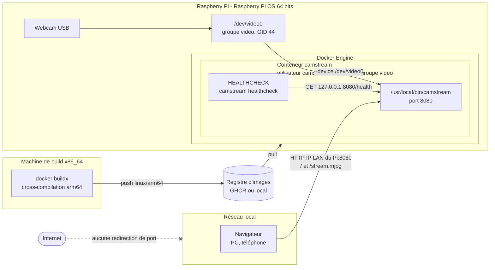

# Déploiement : Docker et Raspberry Pi

> Statut : **v1 implémentée**. Le [`Dockerfile`](../Dockerfile) et le
> [`docker-compose.yml`](../docker-compose.yml) sont à la racine du dépôt ; les extraits
> ci-dessous en sont des copies commentées. Le build `docker buildx` n'a pas encore pu être
> exécuté (registre Docker Hub inaccessible depuis l'environnement de développement) : la
> compilation croisée a été validée hors Docker (§ 3.1). Décisions :
> [ADR 0005](adr/0005-image-docker-et-compilation-arm64.md) (image, arm64 uniquement),
> [ADR 0006](adr/0006-capture-a-la-demande.md) (capture à la demande),
> [ADR 0007](adr/0007-securite-reseau-local-v1.md) (sécurité, réseau local).

## 1. Cibles

| Matériel | OS | Plateforme Docker | Cible Rust | Statut |
|---|---|---|---|---|
| Raspberry Pi 3 / 4 / 5, Zero 2 W | Raspberry Pi OS 64 bits (Bookworm) | `linux/arm64` | `aarch64-unknown-linux-gnu` | **Seule cible de production** |
| Poste de développement | Linux x86_64 | `linux/amd64` | `x86_64-unknown-linux-gnu` | Développement et CI uniquement (pas d'image publiée) |

Les Raspberry Pi OS **32 bits** (`linux/arm/v7`) et les modèles ARMv6 (Pi 1, Zero première
génération) ne sont **pas** pris en charge (ADR 0005).

## 2. Diagramme de déploiement



## 3. Dockerfile (multi-étapes, cross-compilation)

Principe : l'étape `builder` s'exécute sur l'architecture de la machine de build
(`$BUILDPLATFORM`) et produit un binaire pour `$TARGETPLATFORM` ; l'image finale ne contient
que le binaire et la glibc.

```dockerfile
# syntax=docker/dockerfile:1.7
# Image Camstream : compilation croisée vers arm64 (Raspberry Pi OS 64 bits), image
# finale minimale et non root. Décisions : docs/adr/0005, détails : docs/deploiement.md.

# --- Étape 1 : compilation sur la plateforme de build (rapide, sans QEMU) ---
FROM --platform=$BUILDPLATFORM rust:1-bookworm AS builder
ARG BUILDARCH
ARG TARGETARCH

# clang/libclang pour bindgen (crate v4l). Chaîne croisée arm64 et en-têtes noyau arm64
# uniquement si la machine de build n'est pas elle-même arm64.
RUN set -eu; \
    packages="clang libclang-dev"; \
    if [ "$BUILDARCH" != "$TARGETARCH" ]; then \
      case "$TARGETARCH" in \
        arm64) packages="$packages gcc-aarch64-linux-gnu libc6-dev-arm64-cross linux-libc-dev-arm64-cross" ;; \
        *) echo "unsupported cross target $TARGETARCH (arm64 only)" >&2; exit 1 ;; \
      esac; \
    fi; \
    apt-get update; \
    apt-get install -y --no-install-recommends $packages; \
    rm -rf /var/lib/apt/lists/*

# Correspondance plateforme Docker -> cible Rust (arm64 en production, amd64 pour le dev).
RUN case "$TARGETARCH" in \
      arm64) echo "aarch64-unknown-linux-gnu" ;; \
      amd64) echo "x86_64-unknown-linux-gnu" ;; \
      *) echo "unsupported arch $TARGETARCH (arm64 only)" >&2; exit 1 ;; \
    esac > /target.txt \
    && rustup target add "$(cat /target.txt)"

WORKDIR /src
COPY . .
# Éditeur de liens croisé et sysroot bindgen **par cible** (variables suffixées), et
# seulement en compilation croisée : un build natif n'est pas affecté.
RUN --mount=type=cache,target=/usr/local/cargo/registry \
    --mount=type=cache,target=/src/target,sharing=locked \
    set -eu; \
    RUST_TARGET="$(cat /target.txt)"; \
    if [ "$BUILDARCH" != "$TARGETARCH" ]; then \
      export CARGO_TARGET_AARCH64_UNKNOWN_LINUX_GNU_LINKER=aarch64-linux-gnu-gcc; \
      export BINDGEN_EXTRA_CLANG_ARGS_aarch64_unknown_linux_gnu=--sysroot=/usr/aarch64-linux-gnu; \
    fi; \
    cargo build --release --locked --target "$RUST_TARGET"; \
    install -D "target/${RUST_TARGET}/release/camstream" /out/camstream

# --- Étape 2 : image d'exécution minimale ---
FROM debian:bookworm-slim

# Utilisateur non root, membre du groupe video (GID 44 sous Debian).
RUN useradd --system --uid 10001 --no-create-home --shell /usr/sbin/nologin \
        --groups video camstream

COPY --from=builder /out/camstream /usr/local/bin/camstream

# Forme « nom seul » volontaire : avec « USER camstream:camstream » (groupe explicite),
# le runtime n'applique pas les groupes supplémentaires de /etc/group et le processus
# perdrait l'appartenance au groupe video.
USER camstream
ENV CAMSTREAM_BIND=0.0.0.0 \
    CAMSTREAM_PORT=8080 \
    RUST_LOG=info
EXPOSE 8080
STOPSIGNAL SIGTERM

# Sonde sans curl : le binaire interroge lui-même /health sur 127.0.0.1. Sa durée
# totale est bornée par CAMSTREAM_HEALTHCHECK_TIMEOUT_MS (2 s par défaut), inférieure
# au --timeout de 3 s : la sonde conclut toujours (code 0 ou 1) avant que Docker la tue.
HEALTHCHECK --interval=30s --timeout=3s --start-period=10s --retries=3 \
    CMD ["/usr/local/bin/camstream", "healthcheck"]

ENTRYPOINT ["/usr/local/bin/camstream"]
```

Remarques :

- la chaîne croisée arm64 (`gcc-aarch64-linux-gnu`, `*-arm64-cross`) n'est installée, et
  l'éditeur de liens croisé et la sysroot bindgen ne sont définis, **que si**
  `$BUILDARCH` ≠ `$TARGETARCH` : une machine de build arm64 (Mac Apple Silicon, runner ARM,
  Raspberry Pi) compile nativement, sans ces paquets absents de ses dépôts ;
- les variables `CARGO_TARGET_AARCH64_…` et `BINDGEN_EXTRA_CLANG_ARGS_aarch64_…` sont suffixées
  par la cible : elles n'affectent jamais un build natif `x86_64` (pas de sysroot globale) ;
- le cache `target` est en `sharing=locked` : deux builds lancés en parallèle (ex. `arm64`
  et `amd64` en CI) s'y succèdent au lieu de s'y écrire simultanément ;
- `--locked` impose le `Cargo.lock` versionné ;
- la mire synthétique (`assets/synthetic/*.jpg`) est embarquée dans le binaire : l'image
  peut valider un déploiement sans webcam (`CAMSTREAM_SOURCE=synthetic`) ;
- l'icône et le logo de la page (`assets/logo/camstream-icon.svg`,
  `assets/logo/camstream-logo-dark.svg`) sont aussi embarqués : `assets/` ne doit pas être
  ajouté au `.dockerignore` ;
- le [`.dockerignore`](../.dockerignore) exclut `target/`, `.git/`, `docs/`, `spikes/`…

Commandes :

```bash
# Image arm64 chargée localement (pour test) :
docker buildx build --platform linux/arm64 -t camstream:latest --load .

# Image arm64 poussée vers un registre :
docker buildx build --platform linux/arm64 \
    -t ghcr.io/jprecigout/camstream:latest --push .

# Sans registre : transfert direct vers le Pi.
docker save camstream:latest | gzip | ssh pi@raspberrypi.local 'gunzip | docker load'
```

### 3.1 Compilation croisée hors Docker (validée)

Mêmes paquets et variables que le Dockerfile, sur un PC Debian/Ubuntu x86_64 avec `rustup` :

```bash
sudo apt install clang libclang-dev gcc-aarch64-linux-gnu \
    libc6-dev-arm64-cross linux-libc-dev-arm64-cross
rustup target add aarch64-unknown-linux-gnu
export CARGO_TARGET_AARCH64_UNKNOWN_LINUX_GNU_LINKER=aarch64-linux-gnu-gcc
export BINDGEN_EXTRA_CLANG_ARGS_aarch64_unknown_linux_gnu=--sysroot=/usr/aarch64-linux-gnu
cargo build --release --locked --target aarch64-unknown-linux-gnu
scp target/aarch64-unknown-linux-gnu/release/camstream pi@raspberrypi.local:~/
```

Résultat obtenu le 2026-11-26 (Rust 1.97, `std` aarch64 recompilée par `-Zbuild-std` faute
d'accès à `static.rust-lang.org`, comme pour le [spike 0001](spikes/0001-v4l.md#33-écart-avec-le-dockerfile)) :
binaire `ELF 64-bit ARM aarch64` de 3,0 Mio (`strip`, LTO *thin*), dépendances dynamiques
`libc.so.6`, `libm.so.6`, `libgcc_s.so.1` uniquement, glibc requise ≤ `GLIBC_2.34` (Bookworm :
2.36). Sous `qemu-aarch64` : `--version`, mire synthétique servie en MJPEG, `healthcheck`,
arrêt sur `SIGTERM` (code 0), et les 87 tests unitaires et d'intégration réussis.

## 4. Exécution

### Commande `docker run`

```bash
docker run -d --name camstream \
    --device /dev/video0:/dev/video0 \
    --group-add video \
    -p 192.168.1.20:8080:8080 \
    --read-only --cap-drop ALL --security-opt no-new-privileges:true \
    --restart unless-stopped \
    camstream:latest
```

Jamais `--privileged` : seul le nœud `/dev/video0` est exposé. Remplacer `192.168.1.20` par
l'adresse LAN du Pi (voir § 9). Cette adresse doit être **fixe** (bail DHCP réservé sur la
box ou IP statique) : si elle change, Docker ne peut plus publier le port
(`cannot assign requested address`) et le conteneur ne démarre pas.

### `docker-compose.yml` d'exemple

Fichier [`docker-compose.yml`](../docker-compose.yml) à la racine (image `ghcr.io/…` à publier,
ou `build: .` pour construire localement) :

```yaml
services:
  camstream:
    image: ghcr.io/jprecigout/camstream:latest
    # build: .                       # alternative : construire localement
    restart: unless-stopped
    init: true                       # récolte des zombies ; SIGTERM transmis à camstream
    devices:
      - "/dev/video0:/dev/video0"
    group_add:
      - "video"                      # ou le GID numérique : stat -c %g /dev/video0
    ports:
      - "192.168.1.20:8080:8080"     # adresse LAN du Pi uniquement (voir § 9)
    environment:
      CAMSTREAM_DEVICE: /dev/video0
      CAMSTREAM_RESOLUTION: 640x480
      CAMSTREAM_FPS: "15"
      CAMSTREAM_MAX_CLIENTS: "10"
      CAMSTREAM_IDLE_TIMEOUT_MS: "10000"
      # CAMSTREAM_SOURCE: synthetic   # mire de test, pour valider le déploiement sans webcam
      RUST_LOG: info
    read_only: true
    cap_drop: [ALL]
    security_opt:
      - "no-new-privileges:true"
    stop_grace_period: 10s           # supérieur à CAMSTREAM_SHUTDOWN_TIMEOUT_MS (5 s)
    mem_limit: 128m
    cpus: 1.0
    logging:
      driver: json-file
      options:
        max-size: "10m"              # préserver la carte SD
        max-file: "3"
```

## 5. Variables d'environnement

Chaque variable a son option CLI équivalente (clap, feature `env`) ; la CLI a priorité sur
l'environnement. Les valeurs invalides provoquent un arrêt immédiat avec un message explicite
(code de sortie 2). Source de vérité : `src/config/cli.rs` (`camstream --help`).

| Variable | Option CLI | Défaut | Description |
|---|---|---|---|
| `CAMSTREAM_SOURCE` | `--source` | `v4l2` | Type de source : `v4l2` ou `synthetic` (mire de test, sans webcam) |
| `CAMSTREAM_DEVICE` | `--device` | `/dev/video0` | Périphérique V4L2 |
| `CAMSTREAM_RESOLUTION` | `--resolution` | `640x480` | Résolution demandée (`LARGEURxHAUTEUR`) |
| `CAMSTREAM_FPS` | `--fps` | `15` | Cadence demandée (1 à 120) |
| `CAMSTREAM_FORMAT` | `--format` | `auto` | `auto`, `mjpeg`, `yuyv`. En v1, MJPEG est obligatoire : `auto` équivaut à `mjpeg` (webcam sans MJPEG → erreur fatale) et `yuyv` est refusé ; le repli YUYV arrive en phase 2 |
| `CAMSTREAM_READ_TIMEOUT_MS` | `--read-timeout-ms` | `2000` | Délai maximal d'attente d'une trame ; au-delà, la webcam est considérée figée et rouverte (doit dépasser l'intervalle entre images **et rester inférieur à `CAMSTREAM_SHUTDOWN_TIMEOUT_MS`**, sinon code 2) |
| `CAMSTREAM_MAX_CORRUPTED_FRAMES` | `--max-corrupted-frames` | `30` | Trames invalides (JPEG tronqué, erreur du pilote) **consécutives** tolérées avant de rouvrir la webcam (≈ 2 s à 15 i/s) ; le compteur repart de zéro à chaque trame valide |
| `CAMSTREAM_IDLE_TIMEOUT_MS` | `--idle-timeout-ms` | `10000` | Délai de grâce avant d'éteindre la webcam quand plus aucun client ne regarde (`0` : immédiat) |
| `CAMSTREAM_BIND` | `--bind` | `127.0.0.1` (image Docker : `0.0.0.0`) | Adresse d'écoute HTTP |
| `CAMSTREAM_PORT` | `--port` | `8080` | Port HTTP (utilisé aussi par `camstream healthcheck`, avec `CAMSTREAM_BIND`) |
| `CAMSTREAM_MAX_CLIENTS` | `--max-clients` | `10` | Clients de flux simultanés maximum (au-delà : `503` ; 1000 au plus) |
| `CAMSTREAM_HUB_CAPACITY` | `--hub-capacity` | `4` | Trames conservées dans le tampon de diffusion (arrondi à la puissance de deux supérieure ; 64 au plus) |
| `CAMSTREAM_RECONNECT_INITIAL_MS` | `--reconnect-initial-ms` | `1000` | Première attente avant reconnexion de la webcam |
| `CAMSTREAM_RECONNECT_MAX_MS` | `--reconnect-max-ms` | `30000` | Attente maximale entre deux tentatives (≥ attente initiale) |
| `CAMSTREAM_SHUTDOWN_TIMEOUT_MS` | `--shutdown-timeout-ms` | `5000` | Délai maximal de l'arrêt gracieux (doit dépasser le délai de lecture) |
| `CAMSTREAM_HEALTHCHECK_TIMEOUT_MS` | `healthcheck --timeout-ms` | `2000` | Durée **totale** maximale de la sonde `healthcheck` (connexion, envoi, lecture) ; à garder sous le `--timeout` du `HEALTHCHECK` (3 s) |
| `CAMSTREAM_JPEG_QUALITY` | — | — | **Non implémentée en v1** : qualité JPEG du repli YUYV, prévue en phase 2 |
| `CAMSTREAM_NO_BANNER` | `--no-banner` | `false` | Désactive la bannière de démarrage (nom en couleurs, version, source, URL du flux), affichée sur la sortie standard avant les logs ; couleurs seulement sur un terminal, hors `TERM=dumb` et sans `NO_COLOR` |
| `RUST_LOG` | — | `info` | Filtre `tracing` (ex. `camstream=debug`) |

Les défauts 640x480, 15 i/s et 10 clients sont confirmés (moins de 10 spectateurs prévus).
Ordre de grandeur réseau : un flux MJPEG 640x480 à 15 i/s représente environ 0,5 à 1 Mo/s
(4 à 8 Mbit/s) **par client** ; quelques spectateurs simultanés restent compatibles avec le
Wi-Fi d'un Pi.

## 6. Accès à la webcam et droits

1. Vérifier la webcam sur l'hôte : `v4l2-ctl --list-devices` puis
   `v4l2-ctl -d /dev/video0 --list-formats-ext` (présence de `MJPG`).
2. Vérifier le groupe du nœud : `stat -c '%G %g' /dev/video0` (attendu : `video 44`).
3. Si le GID diffère de celui du groupe `video` de l'image, utiliser le GID numérique dans
   `group_add`.
4. Symptôme d'un problème de droits : statut `failed` et log `permission denied on video
   device` → erreur fatale volontaire (voir [architecture](architecture.md#6-gestion-des-erreurs)).

Une webcam USB expose souvent **deux** nœuds (`/dev/video0` capture, `/dev/video1`
métadonnées) : seul le nœud de capture est à exposer.

## 7. Reconnexion de la webcam dans Docker

L'application gère la perte et le retour de la webcam (statut `reconnecting`, attente
exponentielle). Mais avec `--device`, Docker crée le nœud dans le conteneur **au démarrage**,
avec les numéros majeur/mineur de ce moment-là :

- si la webcam est rebranchée et retrouve le **même** nœud (`/dev/video0`, 81:0), la
  reconnexion fonctionne sans redémarrer le conteneur ;
- si elle obtient un autre mineur (ex. `/dev/video2`, autre périphérique branché entre-temps),
  le nœud du conteneur ne correspond plus ;
- si `/dev/video0` n'existe pas au démarrage, Docker refuse de lancer le conteneur.

Options (à valider, voir points ouverts) :

| Option | Avantages | Inconvénients |
|---|---|---|
| `--device` simple (défaut) | Le plus restrictif | Reconnexion limitée au même nœud |
| `device_cgroup_rules: ["c 81:* rmw"]` + montage de `/dev/v4l/by-id` (lien stable) | Reconnexion robuste, chemin stable par webcam | Autorise tous les périphériques V4L2 de l'hôte ; montage de `/dev` partiel |
| Règle udev sur l'hôte créant un lien fixe (`/dev/camstream0`) | Chemin stable | Configuration hôte supplémentaire ; même limite de nœud au démarrage |

## 8. Santé et arrêt

- `GET /health` : `200` tant que l'application tourne, y compris webcam éteinte faute de
  spectateur (`"state": "idle"`) ou en reconnexion (`"reconnecting"`) ; l'état détaillé est
  dans le corps JSON ; `503` si l'état est `failed`.
- Capture à la demande : le voyant de la webcam ne s'allume que pendant un visionnage (plus
  le délai de grâce). Une webcam débranchée sans spectateur n'est détectée qu'à l'arrivée du
  client suivant.
- `camstream healthcheck` : sous-commande qui interroge `/health` sur `CAMSTREAM_BIND:CAMSTREAM_PORT`
  (`127.0.0.1` si l'adresse d'écoute est `0.0.0.0`, `::1` si `::`) avec la bibliothèque standard
  (pas de `curl` dans l'image), code de sortie 0 (HTTP 200) ou 1. Sa durée **totale** est
  bornée par `CAMSTREAM_HEALTHCHECK_TIMEOUT_MS` (2 s) : elle conclut toujours avant le
  `--timeout=3s` du `HEALTHCHECK`. Si ce dernier est réduit, réduire la variable d'autant
  (par exemple `--timeout=2s` avec `CAMSTREAM_HEALTHCHECK_TIMEOUT_MS=1500`).
- `docker stop` envoie `SIGTERM` : l'application arrête d'accepter des connexions, termine les
  flux en cours, arrête la capture et libère la webcam en moins de
  `CAMSTREAM_SHUTDOWN_TIMEOUT_MS` ; `stop_grace_period` doit être supérieur. Le délai de
  lecture (`CAMSTREAM_READ_TIMEOUT_MS`) doit être inférieur au délai d'arrêt (validé au
  démarrage) : une lecture bloquée tient ainsi dans l'arrêt gracieux.
- Webcam qui ne produit que des trames corrompues : rouverte après
  `CAMSTREAM_MAX_CORRUPTED_FRAMES` trames consécutives (état `reconnecting`, erreur
  `30 consecutive corrupted frames`). Défaillance interne de la bibliothèque V4L2 (donnée
  inattendue du pilote) : état `reconnecting` avec `video driver library failed during …`,
  sans redémarrage du conteneur.
- Docker ne redémarre **pas** un conteneur seulement `unhealthy` (hors Swarm) : l'état de santé
  sert au diagnostic et à la supervision externe ; le redémarrage automatique repose sur la
  sortie du processus (erreur fatale ou panique du thread de capture → code 1 →
  `restart: unless-stopped`).
- Codes de sortie : `0` arrêt demandé, `1` échec (capture, serveur, port occupé), `2`
  configuration invalide.
- Diagnostic sans webcam : `CAMSTREAM_SOURCE=synthetic` diffuse une mire de test (barres de
  couleur, carré mobile) et valide image, réseau et navigateur.

## 9. Sécurité

Décision : [ADR 0007](adr/0007-securite-reseau-local-v1.md). **La v1 n'a ni authentification
ni TLS : elle est réservée au réseau local.** Toute personne connectée au LAN peut voir le flux.

Règles de déploiement :

- **Ne jamais exposer Camstream sur Internet** : aucune redirection de port sur la box ou le
  routeur, UPnP désactivé pour ce port.
- **Publier le port sur l'adresse LAN du Pi** (`"192.168.1.20:8080:8080"`) plutôt que sur
  toutes les interfaces (`"8080:8080"`), en particulier si le Pi a plusieurs interfaces
  (Wi-Fi + Ethernet, VPN).
- **Ne pas compter sur `ufw`** : Docker insère ses propres règles `iptables`, un port publié
  contourne les règles `ufw` de l'hôte. Filtrer, si besoin, dans la chaîne `DOCKER-USER`.
- Adresse d'écoute : `127.0.0.1` par défaut hors conteneur (`cargo run` n'expose rien) ;
  l'image fixe `CAMSTREAM_BIND=0.0.0.0`, nécessaire pour que la publication de port Docker
  fonctionne.
- Durcissement du conteneur : utilisateur non root, `--cap-drop ALL`, `no-new-privileges`,
  système de fichiers en lecture seule (l'application n'écrit rien sur disque), uniquement des
  routes `GET`, limite de clients.
- En-têtes HTTP de sécurité sur toutes les réponses : `X-Content-Type-Options: nosniff`,
  `Content-Security-Policy` stricte (aucun script ni style en ligne, aucune ressource tierce,
  `frame-ancestors 'none'`), `X-Frame-Options: DENY`, `Referrer-Policy: no-referrer`
  ([architecture § 3.6](architecture.md#36-server--adaptateur-http)). Ils ne remplacent ni
  l'authentification ni TLS.

Évolution prévue (hors v1) : accès distant via un **reverse proxy** assurant TLS et
authentification, ou via un **VPN** vers le réseau local. Camstream ne serait alors joignable
que par le proxy (réseau Docker interne, sans `ports:` publiés). Aucun changement de code n'est
nécessaire ; la décision fera l'objet d'un nouvel ADR.
