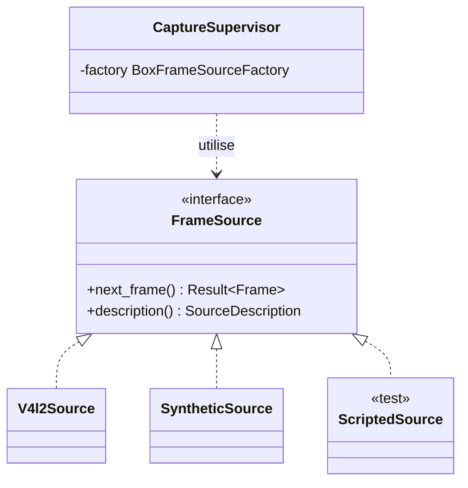
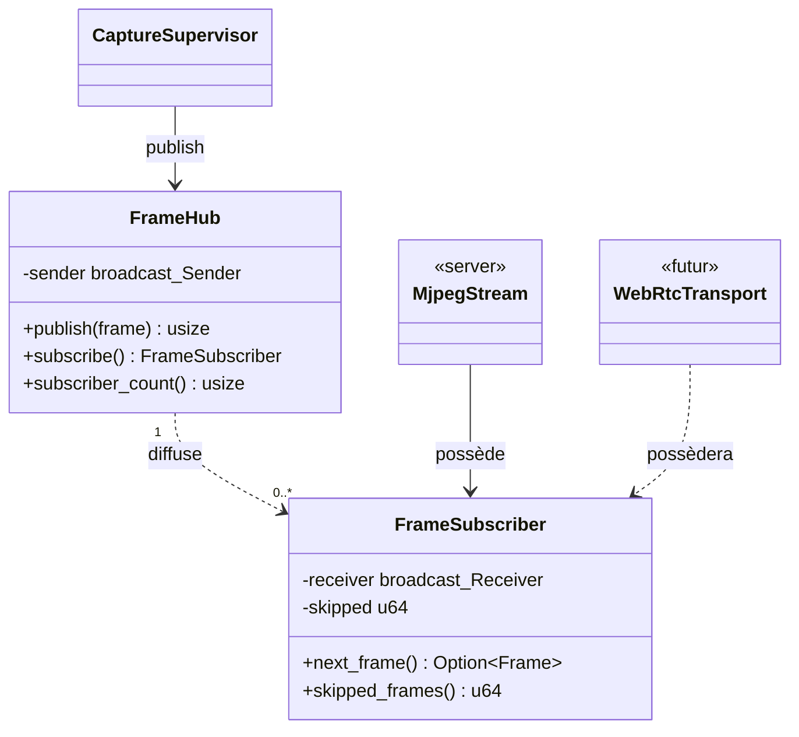
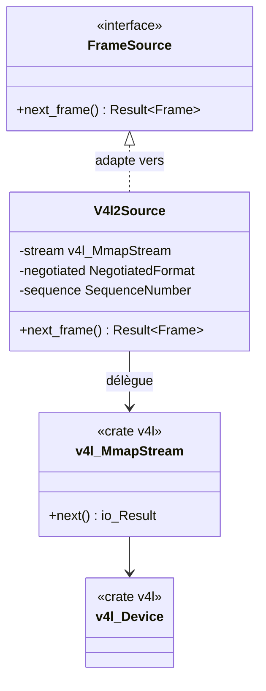
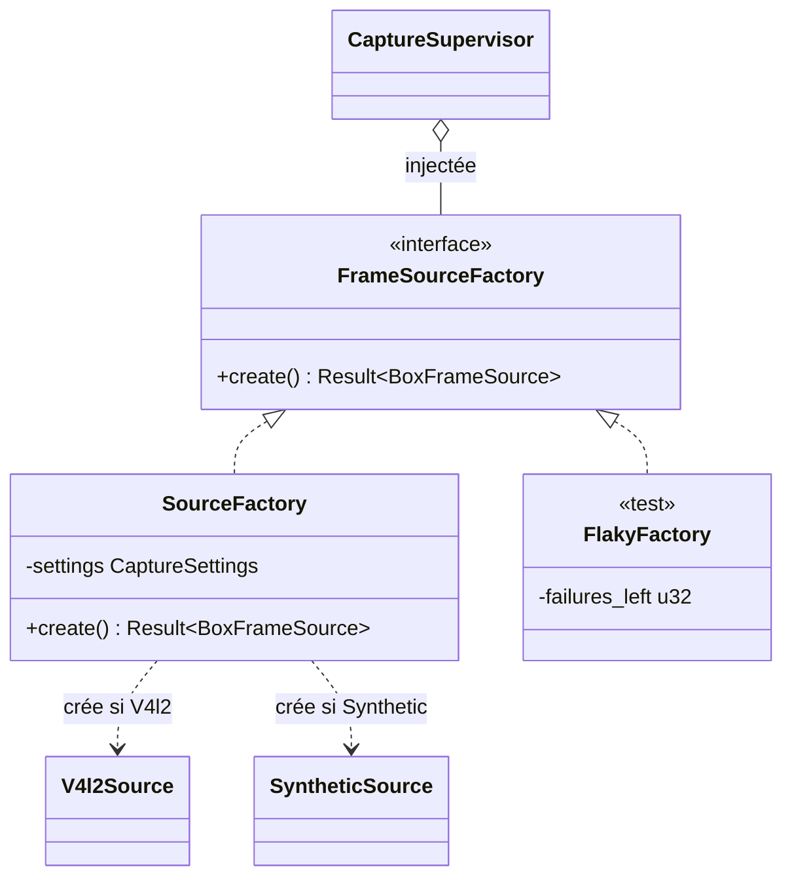
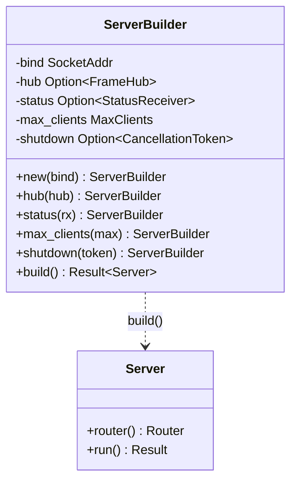
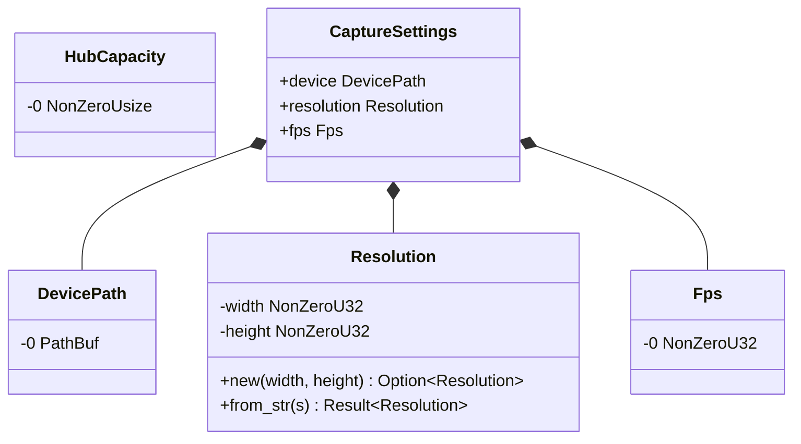
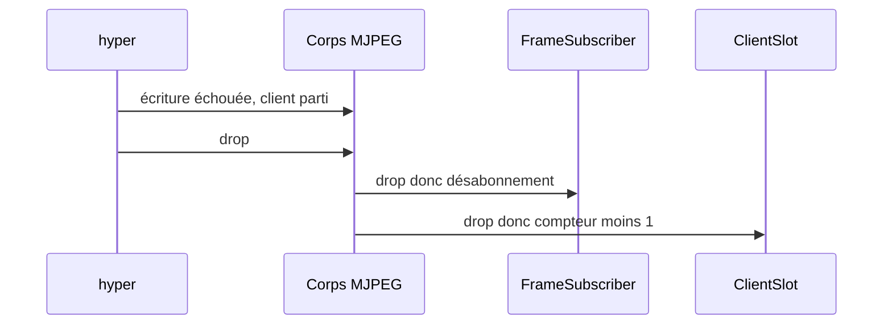
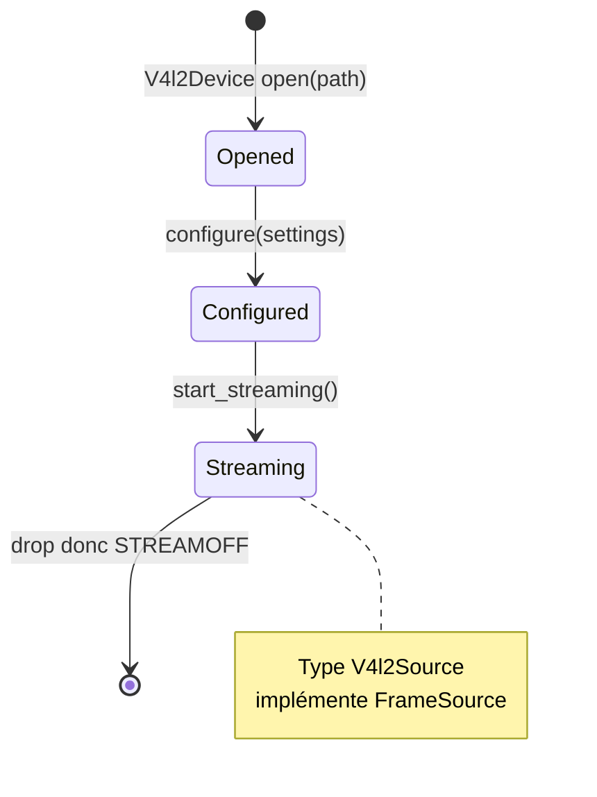
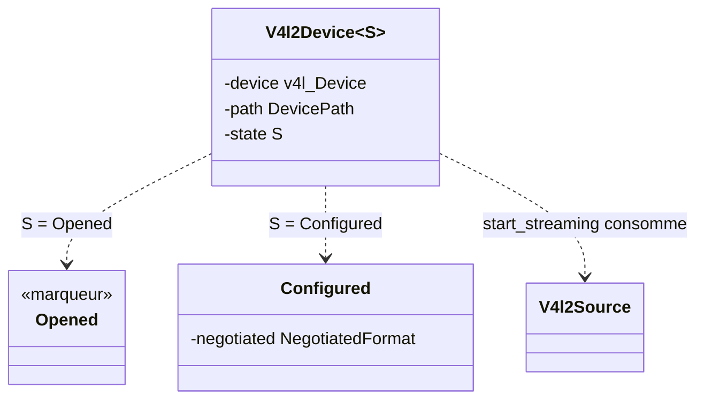

# Catalogue des design patterns

> Statut : **conception initiale (proposée)**. Les emplacements indiqués sont les fichiers
> **prévus** (voir [architecture.md](architecture.md#2-découpage-en-modules)). Conformément à
> `CLAUDE.md`, chaque type concerné nommera son pattern dans son commentaire `///`
> (ex. « Implémente le pattern **Strategy** »), et ce catalogue sera mis à jour dans le même
> commit que le code.

## Synthèse

| Pattern | Catégorie | Problème résolu | Où (prévu) |
|---|---|---|---|
| [Strategy](#strategy) | Comportement | Remplacer la webcam par une autre source sans toucher au cœur | `src/domain/source.rs` — `FrameSource` |
| [Observer / Publish-Subscribe](#observer--publish-subscribe) | Comportement | Livrer chaque trame à N clients sans que les lents bloquent | `src/stream/hub.rs` — `FrameHub`, `FrameSubscriber` |
| [Adapter](#adapter) | Structure | Isoler la crate `v4l` et axum derrière nos propres types | `src/capture/v4l2/` — `V4l2Device`, `V4l2Source` ; `src/server/` |
| [Factory](#factory) | Création | Recréer une source après déconnexion sans connaître son type | `src/domain/source.rs` — `FrameSourceFactory` ; `src/capture/factory.rs` — `SourceFactory` |
| [Builder](#builder) | Création | Construire le serveur avec paramètres obligatoires et optionnels | `src/server/mod.rs` — `ServerBuilder` |
| [Newtype](#newtype) | Idiome Rust | Interdire les valeurs invalides ou confondues | `src/domain/frame.rs`, `src/domain/device.rs`, `src/stream/hub.rs`, `src/server/mod.rs` |
| [RAII](#raii) | Idiome Rust | Libérer périphérique, tampons, abonnements et places client sans oubli | `V4l2Source`, `FrameSubscriber`, `ClientSlot` |
| [Typestate](#typestate) | Idiome Rust | Garantir l'ordre ouvrir → configurer → streamer à la compilation | `src/capture/v4l2/device.rs` — `V4l2Device<S>` |

---

## Strategy

- **Catégorie** : comportement.
- **Problème résolu** : le `CaptureSupervisor` doit lire des trames sans savoir si elles
  viennent d'une webcam V4L2, d'une mire synthétique ou d'une source de test scriptée. Sans
  abstraction, le cœur dépendrait de V4L2 et ne serait testable qu'avec du matériel.
- **Où** : trait `FrameSource` (`src/domain/source.rs`) ; stratégies `V4l2Source`
  (`src/capture/v4l2/source.rs`), `SyntheticSource` (`src/capture/synthetic.rs`),
  `ScriptedSource` (tests, `tests/support/`).
- **Choix Rust** : objet trait `Box<dyn FrameSource>` plutôt que générique, car la stratégie est
  choisie **à l'exécution** (configuration) et recréée à chaque reconnexion ; le coût d'un appel
  dynamique par trame est négligeable.

## Observer / Publish-Subscribe

- **Catégorie** : comportement.
- **Problème résolu** : une trame capturée doit être livrée à un nombre variable de clients
  navigateur qui arrivent et partent à tout moment ; l'émetteur (thread de capture) ne doit
  jamais attendre un client lent ([ADR 0004](adr/0004-distribution-des-trames-et-concurrence.md)).
- **Où** : `FrameHub` (sujet / éditeur) et `FrameSubscriber` (observateur / abonné) dans
  `src/stream/hub.rs`, construits sur `tokio::sync::broadcast`. Variante « dernière valeur »
  pour l'état : `watch<SourceStatus>` (`src/stream/status.rs`).
- **Politique clients lents** : `RecvError::Lagged(n)` est absorbé par `FrameSubscriber` (trames
  sautées comptées), le client continue.

## Adapter

- **Catégorie** : structure.
- **Problème résolu** : l'API de la crate `v4l` (types `Device`, `MmapStream`, `FourCC`, erreurs
  `io::Error`) et celle d'axum ne doivent pas fuiter dans le cœur. L'adaptateur traduit vers nos
  types (`Frame`, `CaptureError`, `SourceDescription`) et permet de changer de crate
  (repli `linuxvideo`, [ADR 0003](adr/0003-choix-des-crates.md)) sans impact hors du module.
- **Où** :
  - côté sortant : `V4l2Device<S>` et `V4l2Source` (`src/capture/v4l2/`) adaptent `v4l` au port
    `FrameSource` ; traduction des `errno` (`ENODEV` → `Disconnected`, `EACCES` et `EPERM` →
    `PermissionDenied`, `ENOENT` → `DeviceNotFound`). `EPERM` est le code renvoyé par le
    cgroup de périphériques de Docker ; `ENODEV`/`ENXIO` à l'**ouverture** (nœud présent dans
    le conteneur mais webcam débranchée) doivent mener à `Reopen`, pas à une erreur fatale ;
  - côté entrant : `src/server/` adapte le `FrameHub` au protocole HTTP multipart.

## Factory

- **Catégorie** : création.
- **Problème résolu** : à chaque reconnexion, le superviseur doit obtenir une **nouvelle**
  source sans savoir laquelle construire ni comment (ouverture, négociation de format, démarrage
  du streaming). La fabrique est aussi le seul endroit qui transforme `SourceKind` en type
  concret, et elle est remplaçable en test (fabrique qui échoue N fois puis réussit, pour tester
  la reconnexion).
- **Où** : port `FrameSourceFactory` (`src/domain/source.rs`), implémentation `SourceFactory`
  (`src/capture/factory.rs`), fabriques de test dans `tests/`.

## Builder

- **Catégorie** : création.
- **Problème résolu** : le serveur combine des dépendances obligatoires (adresse, `FrameHub`,
  récepteur d'état, jeton d'arrêt) et des options avec défauts (`MaxClients`, éventuellement
  délais). Un constructeur à 6 paramètres serait illisible et fragile ; le builder rend chaque
  paramètre explicite et `build()` valide l'ensemble (`ServerError::MissingParameter`).
- **Où** : `ServerBuilder` → `Server` (`src/server/mod.rs`).

## Newtype

- **Catégorie** : idiome Rust.
- **Problème résolu** : éviter les « valeurs magiques » et les confusions de paramètres
  (`u32` largeur/hauteur, `usize` capacité/limite, `PathBuf` quelconque). La validation a lieu
  une fois, à la construction ; ensuite le type garantit l'invariant (ex. non nul).
- **Où** :

| Newtype | Invariant | Fichier prévu |
|---|---|---|
| `Resolution` | largeur et hauteur non nulles, analyse « 640x480 » | `src/domain/frame.rs` |
| `Fps` | non nul | `src/domain/frame.rs` |
| `SequenceNumber` | monotone, attribué par la source | `src/domain/frame.rs` |
| `DevicePath` | chemin de périphérique | `src/domain/device.rs` |
| `HubCapacity` | non nulle (`broadcast` panique sur 0) | `src/stream/hub.rs` |
| `MaxClients` | non nul | `src/server/mod.rs` |

## RAII

- **Catégorie** : idiome Rust.
- **Problème résolu** : chaque chemin de sortie (erreur, déconnexion du client, perte de la
  webcam, arrêt `SIGTERM`) doit libérer les ressources sans code de nettoyage explicite :
  - `V4l2Source` : `STREAMOFF`, `munmap` des tampons et fermeture du descripteur (via les `Drop`
    de `v4l`) — indispensable pour rouvrir la webcam après reconnexion ;
  - `FrameSubscriber` : désabonnement du `broadcast` dès que le flux HTTP est détruit ;
  - `ClientSlot` (`src/server/mjpeg.rs`) : décrémente le compteur de clients dans son `Drop`,
    même si le client coupe brutalement la connexion.

## Typestate

- **Catégorie** : idiome Rust.
- **Retenu, avec une portée limitée** à l'adaptateur V4L2. L'ordre ouvrir → configurer le format
  → allouer les tampons et démarrer est une contrainte réelle de V4L2 (changer le format après
  `STREAMON` échoue avec `EBUSY`). Le typestate rend l'ordre incorrect **impossible à
  compiler**, pour un coût faible (deux types marqueurs, pas de généricité exposée hors du
  module). L'état « en streaming » n'est pas un troisième paramètre : c'est le type distinct
  `V4l2Source`, qui implémente `FrameSource`.
- **Où** : `V4l2Device<Opened>`, `V4l2Device<Configured>` → `V4l2Source`
  (`src/capture/v4l2/device.rs`).
- Le typestate n'est **pas** utilisé pour le cycle de vie du superviseur (états dynamiques,
  déterminés à l'exécution) : un `enum SourceStatus` + `match` y est plus adapté.

---

## Patterns envisagés et écartés

| Pattern | Raison de l'écarter |
|---|---|
| Builder pour la configuration | `clap` (derive + `env`) produit déjà la structure avec ses défauts ; les tests utilisent `AppConfig::try_parse_from` ou `Default` + syntaxe de mise à jour de structure. Un builder dupliquerait clap. |
| Decorator pour l'encodage YUYV → JPEG | Nécessiterait un type de trame « brute » distinct dans le cœur pour un cas de repli unique ; un encodeur interne à `V4l2Source` suffit et préserve le contrat « trames JPEG » du port. À reconsidérer si d'autres transformations apparaissent (redimensionnement, horodatage incrusté). |
| State (GoF) pour le superviseur | Un `enum` et un `match` dans une boucle sont l'idiome Rust équivalent, plus lisible qu'une hiérarchie d'objets état. |
| Singleton / état global | Interdit par `CLAUDE.md` ; tout est injecté par construction depuis `app`. |
| Abstract Factory multi-familles | Une seule famille de produits (`FrameSource`) : la fabrique à une méthode suffit. |
| Trait pour `FrameHub` | Le hub est le cœur lui-même ; les tests utilisent le vrai hub. Un trait n'ajouterait qu'une indirection. |
| Command / Mediator | Aucun besoin de commandes différées ni d'orchestration complexe en v1. |
