# Catalogue des design patterns

> Statut : **v1 implémentée**, plus les formats bruts et la négociation
> ([ADR 0008](adr/0008-formats-bruts-et-conversion-jpeg.md)). Les emplacements indiqués sont les fichiers et types **réels**
> (voir [architecture.md](architecture.md#2-découpage-en-modules)). Conformément à `CLAUDE.md`,
> chaque type concerné nomme son pattern dans son commentaire `///` (ex. « Implémente le
> pattern **Strategy** ») ; ce catalogue est mis à jour dans le même commit que le code.

## Synthèse

| Pattern | Catégorie | Problème résolu | Où |
|---|---|---|---|
| [Strategy](#strategy) | Comportement | Remplacer la webcam par une autre source sans toucher au cœur ; choisir la conversion en JPEG et la source des capacités à l'exécution | `src/domain/source.rs` — `FrameSource` ; `V4l2Source`, `SyntheticSource`, `SyntheticRawSource`, `ScriptedSource` (tests) ; `src/capture/convert/mod.rs` — `FrameEncoder` ; `src/capture/negotiation.rs` — `CapabilityQuery` |
| [Pipeline](#pipeline) | Comportement | Enchaîner conversion RGB, balance des blancs et encodage JPEG sur un tampon réutilisé | `src/capture/convert/mod.rs` — `RawJpegEncoder` |
| [Observer / Publish-Subscribe](#observer--publish-subscribe) | Comportement | Livrer chaque trame à N clients sans que les lents bloquent ; réveiller la capture au premier client | `src/stream/hub.rs` — `FrameHub`, `FrameSubscriber`, `DemandReceiver` ; `src/stream/status.rs` — `SourceStatus` |
| [Adapter](#adapter) | Structure | Isoler la crate `v4l` et axum derrière nos propres types | `src/capture/v4l2/` — `V4l2Device`, `V4l2Source`, `DeviceCapabilities` ; `src/server/` |
| [Factory](#factory) | Création | Recréer une source après déconnexion sans connaître son type ; choisir la stratégie de conversion selon le format négocié | `src/domain/source.rs` — `FrameSourceFactory` ; `src/capture/factory.rs` — `SourceFactory` ; `ScriptedFactory` (tests) ; `src/capture/convert/mod.rs` — `encoder_for` |
| [Builder](#builder) | Création | Construire le serveur avec paramètres obligatoires et optionnels | `src/server/mod.rs` — `ServerBuilder` |
| [Decorator](#decorator) | Structure | Ajouter les en-têtes de sécurité à **toutes** les réponses sans modifier chaque handler | `src/server/security.rs` — `add_security_headers` ; appliqué dans `src/server/routes.rs` (`map_response`) |
| [DTO](#dto-data-transfer-object) | Structure | Contrat JSON de `/health` indépendant des types du cœur | `src/server/health.rs` — `HealthReport`, `CameraReport`, `SourceReport` |
| [Newtype](#newtype) | Idiome Rust | Interdire les valeurs invalides ou confondues | `src/domain/frame.rs`, `src/domain/device.rs`, `src/stream/hub.rs`, `src/server/mjpeg.rs`, `src/capture/negotiation.rs`, `src/capture/convert/mod.rs` |
| [RAII](#raii) | Idiome Rust | Libérer périphérique, tampons, abonnements, demande et places client sans oubli ; signaler une panique | `V4l2Source`, `Released<T>`, `FrameSubscriber`, `ClientSession`, `OwnedSemaphorePermit`, `PanicGuard` |
| [Typestate](#typestate) | Idiome Rust | Garantir l'ordre ouvrir → configurer → streamer à la compilation | `src/capture/v4l2/device.rs` — `V4l2Device<S>` |

---

## Strategy

- **Catégorie** : comportement.
- **Problème résolu** : le `CaptureSupervisor` doit lire des trames sans savoir si elles
  viennent d'une webcam V4L2, d'une mire synthétique ou d'une source de test scriptée. Sans
  abstraction, le cœur dépendrait de V4L2 et ne serait testable qu'avec du matériel.
- **Où** : trait `FrameSource` (`src/domain/source.rs`) ; stratégies `V4l2Source`
  (`src/capture/v4l2/source.rs`), `SyntheticSource` (`src/capture/synthetic.rs`),
  `ScriptedSource` (tests, `tests/support/mod.rs`).
- **Choix Rust** : objet trait `Box<dyn FrameSource>` plutôt que générique, car la stratégie est
  choisie **à l'exécution** (configuration) et recréée à chaque reconnexion ; le coût d'un appel
  dynamique par trame est négligeable.

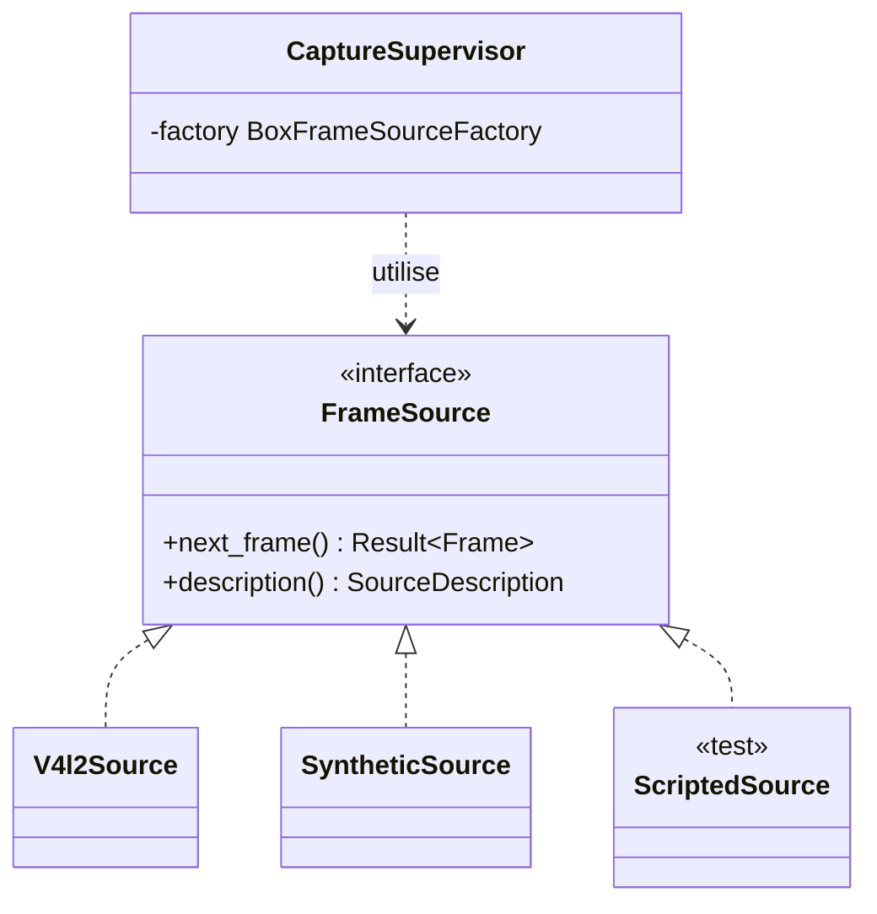

### Stratégies internes aux adaptateurs de source (ADR 0008)

- **`FrameEncoder`** (`src/capture/convert/mod.rs`) : transformation d'un tampon de capture
  en JPEG. Stratégies `JpegPassthrough` (MJPEG natif : vérification et copie) et
  `RawJpegEncoder` (YUYV, Bayer). `V4l2Source` (`src/capture/v4l2/source.rs`) et
  `SyntheticRawSource` (`src/capture/synthetic_raw.rs`) l'appliquent dans `next_frame` sans
  connaître le format. Placée dans `capture` et non dans `domain` : le cœur ne voit que des
  trames JPEG, le port `FrameSource` garde son contrat.
- **`CapabilityQuery`** (`src/capture/negotiation.rs`) : source des capacités pour la
  négociation. `DeviceCapabilities` (ioctl V4L2, `src/capture/v4l2/device.rs`) et
  `CapabilityTable` (table en mémoire : tests, mire brute imitant la caméra `GRBG` de
  l'utilisateur). Les règles de choix (`choose_format`, `choose_resolution`, `choose_fps`)
  sont ainsi testées sans matériel.
- **Choix Rust** : `Box<dyn FrameEncoder>` (choisi à l'exécution selon le format négocié,
  un appel dynamique par trame, négligeable) ; `&dyn CapabilityQuery` pour `negotiate`.

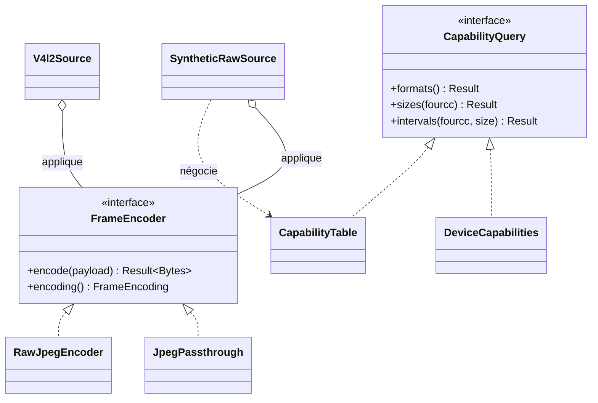

## Pipeline

- **Catégorie** : comportement (chaîne de traitement).
- **Problème résolu** : une trame brute doit traverser plusieurs étapes indépendantes
  (conversion en RGB selon le format, balance des blancs facultative, encodage JPEG) sans
  copie intermédiaire ni allocation par trame, et chaque étape doit être testable seule.
- **Où** : `RawJpegEncoder::encode` (`src/capture/convert/mod.rs`) enchaîne
  `bayer::demosaic_bilinear` ou `yuyv::yuyv_to_rgb` (`src/capture/convert/bayer.rs`,
  `yuyv.rs`), `GrayWorld::apply` (`src/capture/convert/white_balance.rs`, Bayer seulement) et
  `jpeg_encoder::Encoder`. Les étapes partagent un **tampon RGB alloué une fois** ; l'entrée
  est le tampon mmap emprunté (aucune copie de l'image brute), la sortie un `Vec` transféré
  sans copie dans le `Bytes` de la trame. Une trame tronquée est rejetée avant la première
  étape (`CorruptedFrame`).
- **Choix Rust** : pipeline statique (fonctions appelées en séquence dans `encode`) plutôt
  qu'une liste dynamique d'étapes `Vec<Box<dyn Stage>>` : trois étapes connues, sans besoin de
  reconfiguration à l'exécution ; ajouter une étape (mise à l'échelle, horodatage) reste
  local à `encode`.

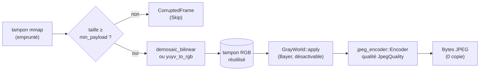

## Observer / Publish-Subscribe

- **Catégorie** : comportement.
- **Problème résolu** : une trame capturée doit être livrée à un nombre variable de clients
  navigateur qui arrivent et partent à tout moment ; l'émetteur (thread de capture) ne doit
  jamais attendre un client lent ([ADR 0004](adr/0004-distribution-des-trames-et-concurrence.md)).
- **Où** : `FrameHub` (sujet / éditeur) et `FrameSubscriber` (observateur / abonné) dans
  `src/stream/hub.rs`, construits sur `tokio::sync::broadcast`. Variante « dernière valeur »
  pour l'état : `watch<SourceStatus>` (`src/stream/status.rs`), observé par `/health`
  (`src/server/health.rs`) et par `BoundApp::run` (`src/app.rs`).
- **Politique clients lents** : `RecvError::Lagged(n)` est absorbé par `FrameSubscriber` (trames
  sautées comptées), le client continue.
- **Seconde observation, en sens inverse : la demande** ([ADR 0006](adr/0006-capture-a-la-demande.md)).
  Pour la capture à la demande, le `CaptureSupervisor` observe le **nombre d'abonnés** du hub
  via `DemandReceiver` (`watch<usize>`) : il est réveillé au premier abonné et apprend le départ
  du dernier. Le compteur est tenu par le hub (et non par le serveur HTTP) pour rester
  indépendant du transport.

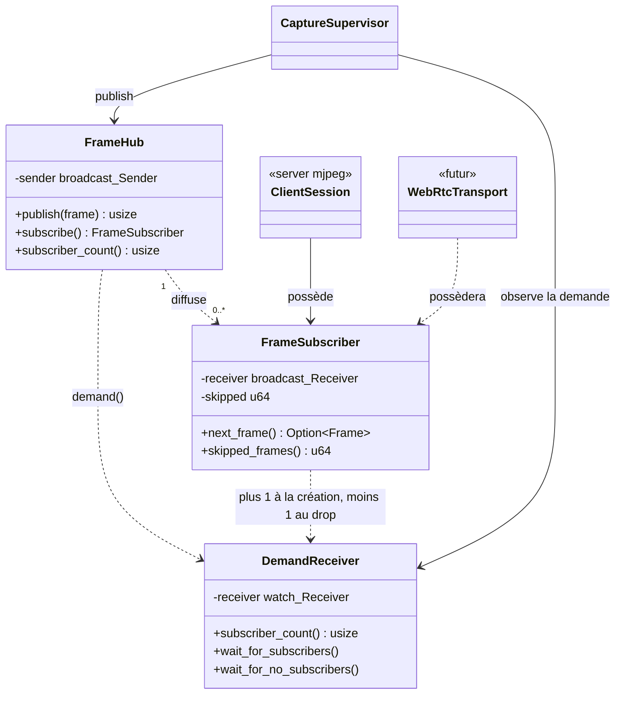

## Adapter

- **Catégorie** : structure.
- **Problème résolu** : l'API de la crate `v4l` (types `Device`, `MmapStream`, `FourCC`, erreurs
  `io::Error`) et celle d'axum ne doivent pas fuiter dans le cœur. L'adaptateur traduit vers nos
  types (`Frame`, `CaptureError`, `SourceDescription`) et permet de changer de crate
  (repli `linuxvideo`, [ADR 0003](adr/0003-choix-des-crates.md)) sans impact hors du module.
- **Où** :
  - côté sortant : `V4l2Device<S>` et `V4l2Source` (`src/capture/v4l2/`) adaptent `v4l` au port
    `FrameSource` ; traduction des `errno` (`ENODEV` → `Disconnected`, `EACCES` et `EPERM` →
    `PermissionDenied`, `ENOENT` → `DeviceNotFound`). `EPERM` est le code renvoyé par le
    cgroup de périphériques de Docker ; `ENODEV`/`ENXIO` à l'**ouverture** (nœud présent dans
    le conteneur mais webcam débranchée) doivent mener à `Reopen`, pas à une erreur fatale ;
  - côté entrant : `src/server/` adapte le `FrameHub` au protocole HTTP multipart
    (`src/server/mjpeg.rs`, fonction `stream` et `ClientSession`).
- **Énumération des capacités** : `DeviceCapabilities` (`src/capture/v4l2/device.rs`) adapte
  les ioctl `VIDIOC_ENUM_FMT`, `VIDIOC_ENUM_FRAMESIZES`, `VIDIOC_ENUM_FRAMEINTERVALS` de `v4l`
  au port `CapabilityQuery` de la négociation (types `FourCc`, `SizeRange`, `IntervalRange`),
  chaque appel sous `guarded()` ([ADR 0008](adr/0008-formats-bruts-et-conversion-jpeg.md)).
- **Traduction des erreurs** : `src/capture/v4l2/errno.rs` (`map_open_error`, `map_io_error`).
- **Traduction des paniques** : l'adaptateur ne laisse aucune panique de `v4l` atteindre le
  cœur. Les appels passent par `guarded()` (`src/capture/v4l2/guard.rs`), qui convertit une
  panique en `CaptureError::DriverFault` (`Reopen`) ; les destructions passent par
  `Released<T>` (voir [RAII](#raii)). Voir [architecture § 7.2](architecture.md#72-robustesse-après-la-revue-de-la-v1).

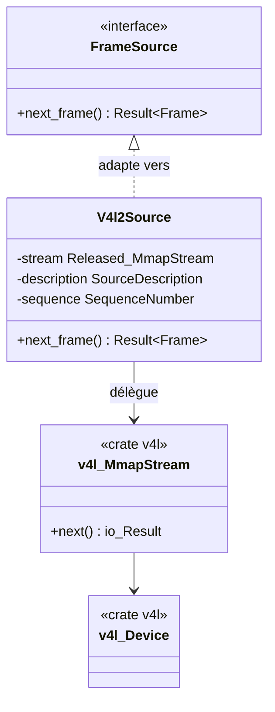

## Factory

- **Catégorie** : création.
- **Problème résolu** : à chaque reconnexion, le superviseur doit obtenir une **nouvelle**
  source sans savoir laquelle construire ni comment (ouverture, négociation de format, démarrage
  du streaming). La fabrique est aussi le seul endroit qui transforme `SourceKind` en type
  concret, et elle est remplaçable en test (fabrique qui échoue N fois puis réussit, pour tester
  la reconnexion).
- **Où** : port `FrameSourceFactory` (`src/domain/source.rs`), implémentation `SourceFactory`
  (`src/capture/factory.rs`), fabrique de test `ScriptedFactory` (`tests/support/mod.rs` :
  échecs, pertes et paniques scriptés, compteurs d'ouvertures et de sources vivantes).
  `App::with_factory` (`src/app.rs`) l'injecte dans l'application complète.
- **Fabrique de stratégies de conversion** : `encoder_for` (`src/capture/convert/mod.rs`)
  renvoie `JpegPassthrough` pour MJPEG et `RawJpegEncoder` pour YUYV/Bayer, après validation
  de la géométrie (`RawLayout`) ; appelée par `V4l2Device::configure` et
  `SyntheticRawSource::open`. `SourceFactory` choisit aussi la mire brute
  (`SyntheticRawSource`) quand `CAMSTREAM_FORMAT` vaut `bayer` ou `yuyv`.

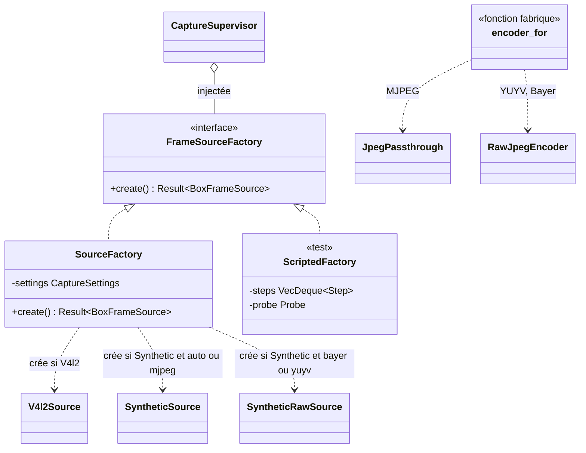

## Builder

- **Catégorie** : création.
- **Problème résolu** : le serveur combine des dépendances obligatoires (adresse, `FrameHub`,
  récepteur d'état, jeton d'arrêt) et des options avec défauts (`MaxClients`, éventuellement
  délais). Un constructeur à 6 paramètres serait illisible et fragile ; le builder rend chaque
  paramètre explicite et `build()` valide l'ensemble (`ServerError::MissingParameter`).
- **Où** : `ServerBuilder` → `Server` → `BoundServer` (`src/server/mod.rs`).

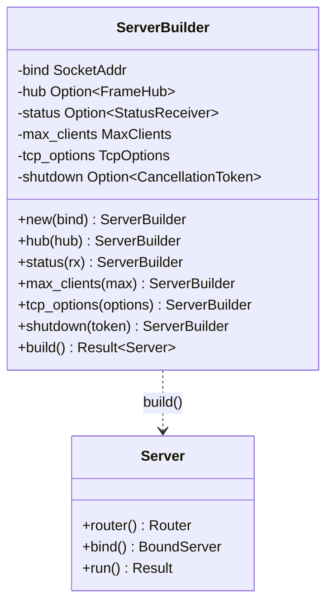

## Decorator

- **Catégorie** : structure.
- **Problème résolu** : les en-têtes de sécurité (`X-Content-Type-Options`, CSP,
  `X-Frame-Options`, `Referrer-Policy`, ADR 0007) doivent figurer sur **toutes** les réponses,
  y compris les `404`/`405` produites par axum et le `503` du limiteur de clients. Les ajouter
  dans chaque handler serait fragile (un oubli suffit) et mêlerait sécurité et logique métier.
- **Où** : `add_security_headers` (`src/server/security.rs`), posé par
  `Router::layer(map_response(...))` dans `src/server/routes.rs`. Le décorateur enveloppe le
  routeur entier : il reçoit chaque réponse, ajoute les en-têtes **sans écraser** ceux déjà
  définis par un handler, et la renvoie inchangée par ailleurs (corps MJPEG compris, qui
  reste un flux).
- **Portée** : distinct du Decorator écarté plus bas, qui concernait l'encodage des trames
  brutes en JPEG (résolu par une Strategy interne, voir [Strategy](#strategy)).

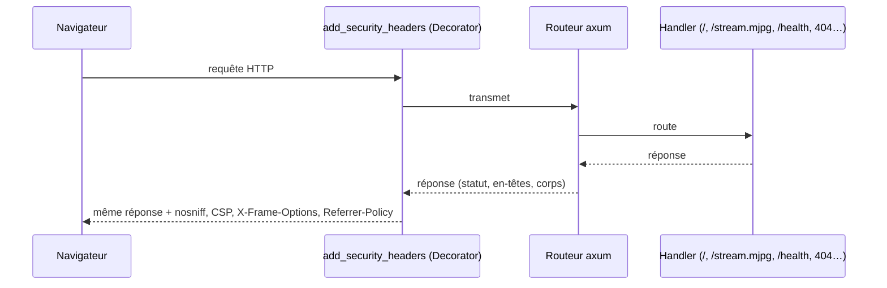

## DTO (Data Transfer Object)

- **Catégorie** : structure.
- **Problème résolu** : `/health` expose un contrat JSON stable, consommé par la sonde Docker
  et la supervision. Dériver `serde::Serialize` sur `SourceStatus` lierait ce contrat aux noms
  internes du cœur et ajouterait `serde` au cœur pour un unique endpoint. Le DTO et sa
  conversion explicite `From<&SourceStatus>` rendent visible toute modification du contrat.
- **Où** : `HealthReport`, `CameraReport`, `SourceReport` (`src/server/health.rs`).

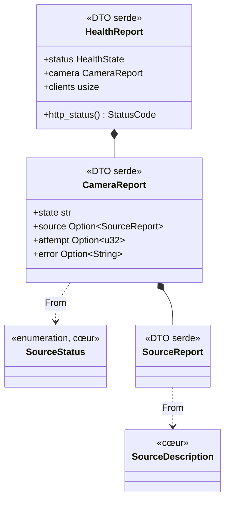

## Newtype

- **Catégorie** : idiome Rust.
- **Problème résolu** : éviter les « valeurs magiques » et les confusions de paramètres
  (`u32` largeur/hauteur, `usize` capacité/limite, `PathBuf` quelconque). La validation a lieu
  une fois, à la construction ; ensuite le type garantit l'invariant (ex. non nul).
- **Où** :

| Newtype | Invariant | Fichier |
|---|---|---|
| `Resolution` | largeur et hauteur non nulles, analyse « 640x480 » | `src/domain/frame.rs` |
| `Fps` | non nul | `src/domain/frame.rs` |
| `SequenceNumber` | monotone, attribué par la source | `src/domain/frame.rs` |
| `DevicePath` | chemin de périphérique | `src/domain/device.rs` |
| `HubCapacity` | non nulle (`broadcast` panique sur 0) | `src/stream/hub.rs` |
| `MaxClients` | non nul | `src/server/mjpeg.rs` (réexporté par `server`) |
| `JpegQuality` | de 1 à 100 (`DEFAULT` = 80) | `src/domain/frame.rs` |
| `FourCc` | code V4L2 de 4 octets, affichage sans échec (octets non UTF-8) | `src/capture/negotiation.rs` |
| `RawLayout` | géométrie convertible : pas de ligne ≥ minimal, côtés ≤ 65 535, Bayer ≥ 2x2 | `src/capture/convert/mod.rs` |

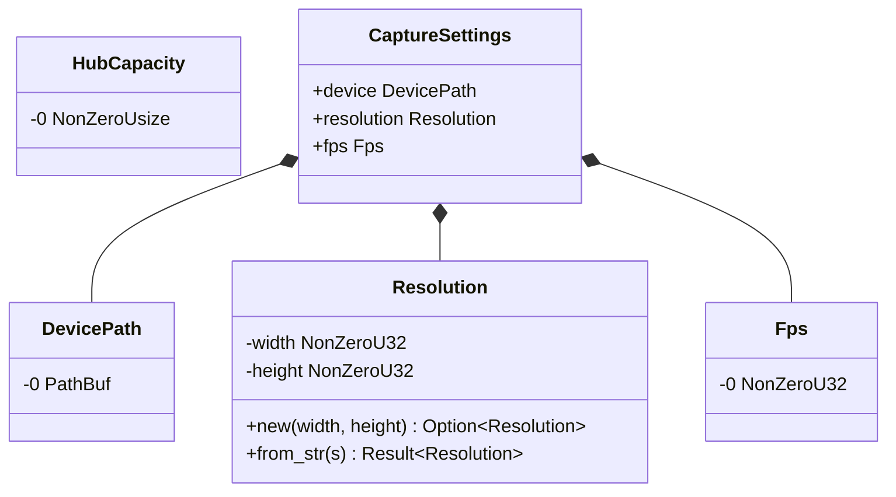

## RAII

- **Catégorie** : idiome Rust.
- **Problème résolu** : chaque chemin de sortie (erreur, déconnexion du client, perte de la
  webcam, arrêt `SIGTERM`) doit libérer les ressources sans code de nettoyage explicite :
  - `V4l2Source` : `STREAMOFF`, `munmap` des tampons et fermeture du descripteur (via les `Drop`
    de `v4l`) — indispensable pour rouvrir la webcam après reconnexion ;
  - `FrameSubscriber` : désabonnement du `broadcast` **et décrément de la demande** dès que le
    flux HTTP est détruit ; c'est l'unique chemin de décrément, ce qui garantit que la capture à
    la demande voit un compteur exact ;
  - `OwnedSemaphorePermit` (obtenu par `ClientLimiter::try_acquire`, `src/server/mjpeg.rs`) :
    rend la place de client au `Semaphore` à sa destruction, même si le client coupe
    brutalement la connexion. Il remplace le `ClientSlot` maison sur `AtomicUsize` envisagé
    d'abord : même idiome, mais fourni et éprouvé par tokio, sans course possible. Il est
    possédé, avec le `FrameSubscriber`, par `ClientSession` (état du corps MJPEG), dont le
    `Drop` journalise la déconnexion ;
  - `Released<T>` (`src/capture/v4l2/release.rs`) : détruit le flux mmap et le périphérique
    `v4l` sous `catch_unwind`, pour qu'une panique d'un `Drop` de `v4l` ne tue pas le thread
    de capture ;
  - `PanicGuard` (`src/stream/supervisor.rs`) : gardien détruit en dernier dans le thread de
    capture ; s'il est détruit pendant une panique, il publie `Failed`.

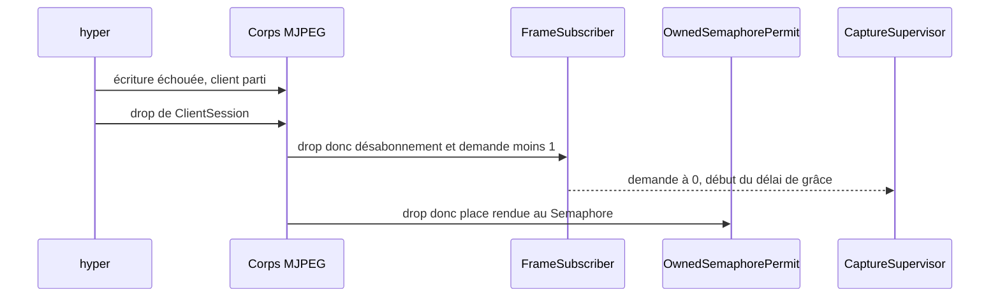

## Typestate

- **Catégorie** : idiome Rust.
- **Retenu, avec une portée limitée** à l'adaptateur V4L2. L'ordre ouvrir → configurer le format
  → allouer les tampons et démarrer est une contrainte réelle de V4L2 (changer le format après
  `STREAMON` échoue avec `EBUSY`). Le typestate rend l'ordre incorrect **impossible à
  compiler**, pour un coût faible (deux types marqueurs, pas de généricité exposée hors du
  module). L'état « en streaming » n'est pas un troisième paramètre : c'est le type distinct
  `V4l2Source`, qui implémente `FrameSource`.
- **Où** : `V4l2Device<Opened>`, `V4l2Device<Configured>` → `V4l2Source`
  (`src/capture/v4l2/device.rs`).
- Le typestate n'est **pas** utilisé pour le cycle de vie du superviseur (états dynamiques,
  déterminés à l'exécution) : un `enum SourceStatus` + `match` y est plus adapté.

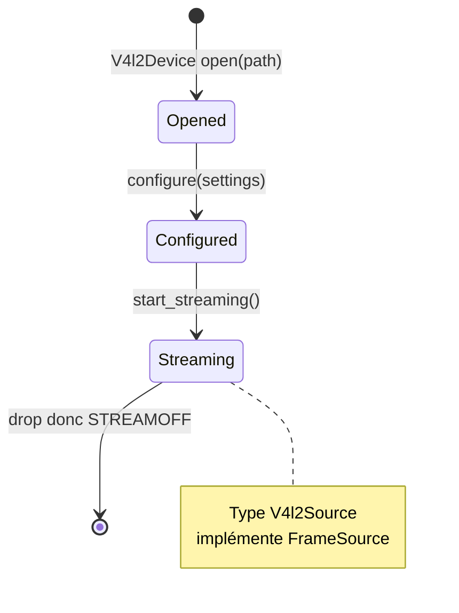

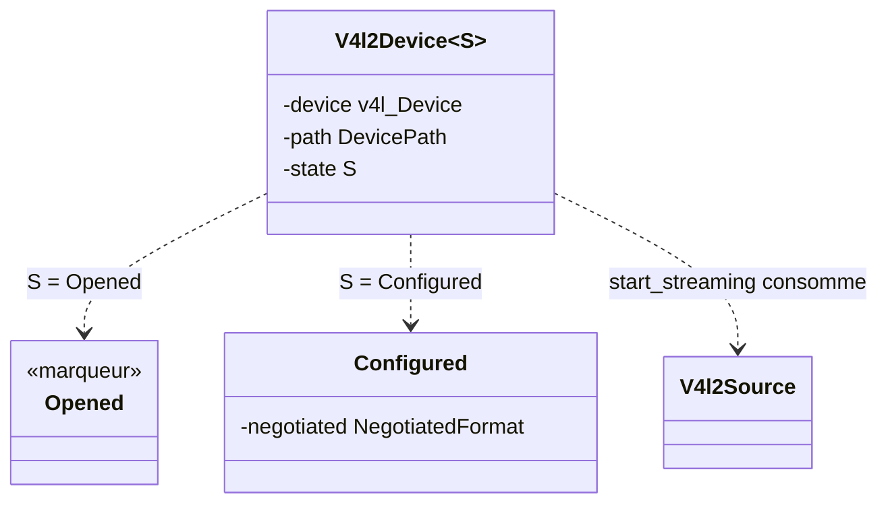

---

## Patterns envisagés et écartés

| Pattern | Raison de l'écarter |
|---|---|
| Builder pour la configuration | `clap` (derive + `env`) produit déjà la structure avec ses défauts ; les tests utilisent `AppConfig::try_parse_from` ou `Default` + syntaxe de mise à jour de structure. Un builder dupliquerait clap. |
| Decorator pour l'encodage des formats bruts (`EncodingSource<S: FrameSource>`) | Nécessiterait un type de trame « brute » distinct dans le cœur et une copie du tampon mmap pour le faire sortir de l'adaptateur ; la Strategy interne `FrameEncoder`, appliquée par les sources sur le tampon emprunté, préserve le contrat « trames JPEG » du port ([ADR 0008](adr/0008-formats-bruts-et-conversion-jpeg.md)). |
| `FrameEncoder` / `CapabilityQuery` dans `domain` | Le cœur ne manipule jamais de trame brute ni de capacité de périphérique ; ces ports restent internes à `capture` (ADR 0008). |
| State (GoF) pour le superviseur | Un `enum` et un `match` dans une boucle sont l'idiome Rust équivalent, plus lisible qu'une hiérarchie d'objets état. |
| Singleton / état global | Interdit par `CLAUDE.md` ; tout est injecté par construction depuis `app`. |
| Abstract Factory multi-familles | Une seule famille de produits (`FrameSource`) : la fabrique à une méthode suffit. |
| Trait pour `FrameHub` | Le hub est le cœur lui-même ; les tests utilisent le vrai hub. Un trait n'ajouterait qu'une indirection. |
| Typestate pour la capture à la demande | Allumage et extinction dépendent d'événements d'exécution (abonnés, délais) : même raison que pour le superviseur, l'`enum` + `match` convient mieux. |
| Pause de la webcam derrière un trait `Pausable` | La destruction de la source (RAII) et sa recréation par la fabrique couvrent le besoin sans élargir le port `FrameSource` ([ADR 0006](adr/0006-capture-a-la-demande.md)). |
| Command / Mediator | Aucun besoin de commandes différées ni d'orchestration complexe en v1. |
