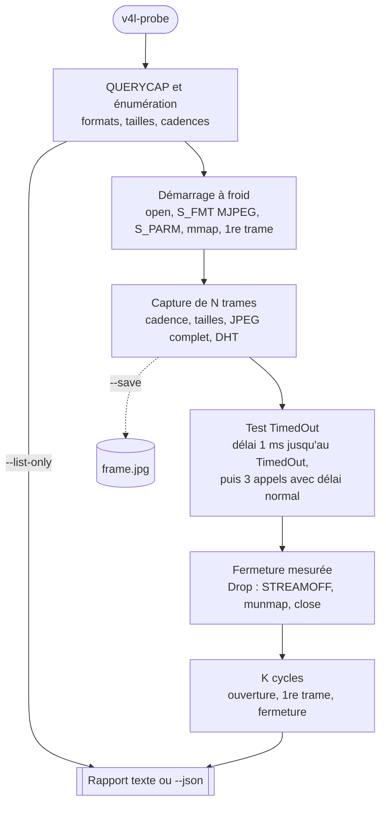

# Spike 0001 — Crate `v4l` : cross-compilation arm64 et comportement réel

- Statut : **en cours** (cross-compilation validée hors Docker ; mesures sur Raspberry Pi à faire)
- Date : 2026-11-26
- Code : [`spikes/v4l-probe/`](../../spikes/v4l-probe/) (crate isolée, jetable)
- Décisions concernées : [ADR 0003](../adr/0003-choix-des-crates.md),
  [ADR 0005](../adr/0005-image-docker-et-compilation-arm64.md),
  [ADR 0006](../adr/0006-capture-a-la-demande.md),
  [architecture § 3.5](../architecture.md#35-capture--adaptateurs)

## 1. Objectif

Lever les deux incertitudes qui conditionnent le choix de `v4l` 0.14 (ADR 0003) :

1. **Cross-compilation** : la génération des bindings V4L2 par bindgen (`v4l2-sys-mit`)
   fonctionne-t-elle vers `aarch64-unknown-linux-gnu` avec l'approche du Dockerfile prévu
   ([deploiement.md § 3](../deploiement.md#3-dockerfile-prévu-multi-étapes-cross-compilation)) ?
2. **Comportement réel sur le Pi avec une webcam** : formats proposés, négociation MJPEG
   640x480 à 15 i/s, latence ouverture → première trame (capture à la demande), cadence et
   taille réelles des trames, comportement après `TimedOut` (`EINVAL` attendu), coût d'une
   réouverture, comportement du `Drop`.

Le spike n'est **pas** du code de production : il n'est importé par rien et sera supprimé
(ou conservé comme outil de diagnostic) une fois les mesures reportées ci-dessous.

## 2. L'outil `v4l-probe`

Crate binaire autonome (`[workspace]` vide dans son `Cargo.toml`, `Cargo.lock` versionné).
Les scénarios de mesure ne dépendent que de deux traits (`FrameStream`, `StreamOpener`) :
l'adaptateur `device` les implémente au-dessus de `v4l`, les tests unitaires avec des flux
scriptés (32 tests, sans webcam).



Options principales (`v4l-probe --help`) :

| Option | Défaut | Rôle |
|---|---|---|
| `--device` | `/dev/video0` | Nœud V4L2 |
| `--resolution` / `--fps` | `640x480` / `15` | Paramètres demandés (MJPEG imposé) |
| `--frames` | `100` | Trames capturées pour les statistiques |
| `--timeout-ms` / `--short-timeout-ms` | `2000` / `1` | Délai normal / délai pour provoquer `TimedOut` |
| `--buffers` | `4` | Tampons mmap |
| `--cycles` | `5` | Cycles de réouverture (0 : aucun) |
| `--skip-timeout-test`, `--list-only` | — | Sauter le test de délai / lister seulement |
| `--save <fichier>` | — | Enregistrer la première trame complète |
| `--json` | — | Rapport JSON (journaux `tracing` sur la sortie d'erreur) |

Code de sortie : `0` si aucune étape n'a échoué, `1` sinon (le rapport est quand même produit,
sauf si le périphérique ne peut pas être ouvert).

## 3. Résultats obtenus ici (machine de build x86_64, sans webcam)

### 3.1 Cross-compilation : validée, hors Docker

| Élément | Valeur |
|---|---|
| Hôte | Ubuntu 24.04, x86_64 |
| Chaîne croisée | `gcc-aarch64-linux-gnu` 13.3, `libc6-dev-arm64-cross` 2.39, `linux-libc-dev-arm64-cross` 6.8 |
| clang / libclang | 18.1 |
| Rust | 1.97.1 (paquets Ubuntu `rustc-1.97`, `cargo-1.97`, `rust-1.97-src`) |
| Crates | `v4l` 0.14.0, `v4l2-sys-mit` 0.3.0, `bindgen` 0.65.1, `clang-sys` 1.9.1 |
| Variables | `CARGO_TARGET_AARCH64_UNKNOWN_LINUX_GNU_LINKER=aarch64-linux-gnu-gcc`, `BINDGEN_EXTRA_CLANG_ARGS_aarch64_unknown_linux_gnu=--sysroot=/usr/aarch64-linux-gnu` (identiques au Dockerfile) |
| Durée | ≈ 1 min 45 s (dont la recompilation de `std`, voir 3.3) |
| `file` | `ELF 64-bit LSB pie executable, ARM aarch64, version 1 (SYSV), dynamically linked, interpreter /lib/ld-linux-aarch64.so.1, for GNU/Linux 3.7.0, stripped` |
| Taille | 1,7 Mio (1 774 856 octets, `strip = "symbols"`, sans LTO) |
| Dépendances dynamiques | `libc.so.6`, `libgcc_s.so.1` uniquement (aucune bibliothèque V4L2) |
| Symboles glibc | version maximale requise `GLIBC_2.34` : compatible avec Raspberry Pi OS Bookworm (glibc 2.36) |
| Exécution | `--version`, `--help` et le chemin d'erreur `ENOENT` fonctionnent sous `qemu-aarch64` |
| Tests | 31/31 en natif **et** 31/31 compilés pour aarch64, exécutés sous `qemu-aarch64` (avant revue ; après corrections de revue, 32/32 en natif, non relancés pour aarch64) |

Constats :

- **bindgen cible bien arm64** : les bindings générés diffèrent de ceux du build natif
  (`__WORDSIZE_TIME64_COMPAT32`, `__nlink_t` en `c_uint`…), signe qu'ils proviennent des en-têtes
  arm64.
- **La variable `BINDGEN_EXTRA_CLANG_ARGS_aarch64_unknown_linux_gnu` n'est pas indispensable**
  quand `gcc-aarch64-linux-gnu` est installé : clang détecte l'installation GCC croisée et ajoute
  `/usr/aarch64-linux-gnu/include` (test sans la variable : bindings identiques). Elle reste
  **recommandée** : sans `--sysroot`, clang garde `/usr/include` (en-têtes de l'**hôte** x86_64)
  en fin de chemin de recherche, ce qui pourrait masquer un en-tête arm64 manquant ; avec la
  sysroot, seuls les en-têtes arm64 sont visibles.
- Aucune modification de `v4l` ni de `v4l2-sys-mit` n'a été nécessaire.

### 3.2 Build Docker : non exécuté ici

`docker buildx build --platform linux/arm64` a été tenté avec
[`spikes/v4l-probe/Dockerfile`](../../spikes/v4l-probe/Dockerfile), qui reprend à l'identique
l'approche de `deploiement.md`. Il échoue **avant toute étape** : le registre Docker Hub
(`registry-1.docker.io`) est refusé par la politique réseau de l'environnement de build, pour
l'image de base comme pour le frontend `docker/dockerfile:1.7`. Le Dockerfile reste donc **à
valider** sur une machine ayant accès à Docker Hub (commande au § 5.1).

### 3.3 Écart avec le Dockerfile

Dans l'environnement du spike, `static.rust-lang.org` est également inaccessible :
`rustup target add aarch64-unknown-linux-gnu` est impossible. La bibliothèque standard
aarch64 a donc été recompilée depuis les sources Ubuntu (`-Zbuild-std=std,panic_unwind`,
`RUSTC_BOOTSTRAP=1`). Cela ne change rien à ce qui était testé (bindgen, éditeur de liens
croisé, en-têtes arm64) ; dans le Dockerfile, l'image `rust:1-bookworm` fournit `rustup` et la
`std` précompilée, sans ce contournement.

### 3.4 Rappel des constats issus de la lecture du code de `v4l` 0.14

Établis par lecture du code source (architecture § 3.5), **à confirmer sur matériel** par
l'outil : tampon mmap renvoyé entier (taille utile = `bytesused`), `EINVAL` après `TimedOut`
(le tampon remis en file avant le `poll` expiré est remis en file une seconde fois),
`Drop` qui panique si `STREAMOFF` échoue avec autre chose que `ENODEV`. Le `Drop` de l'`Arena`
(`munmap`, `REQBUFS 0`) panique de même, et celui du `Handle` fait `close(fd).unwrap()` : si
deux d'entre eux paniquent successivement, le processus est interrompu (`abort`), ce que
`catch_unwind` (utilisé par l'outil) ne peut pas intercepter. Enfin, `set_timeout` convertit
le délai en `i32` de millisecondes avec `unwrap()` (l'outil le borne).

**Limite de mesure (mise en veille USB)** : l'outil ouvre et referme le périphérique pour
`QUERYCAP` et l'énumération juste avant le « démarrage à froid », et les cycles de réouverture
s'enchaînent sans pause. Le noyau ne suspend une webcam UVC inactive qu'après le délai
d'autosuspend USB (`/sys/module/usbcore/parameters/autosuspend`, 2 s par défaut) : les latences
mesurées sont donc celles d'une webcam **non suspendue**, alors qu'en production la capture à la
demande rouvre la webcam après le délai de grâce (10 s). Une simple pause avant de lancer
l'outil ne suffit pas (la première ouverture, non chronométrée, réveille la webcam) : mesurer ce
cas demande une pause **dans** l'outil, avant le démarrage à froid et entre les cycles (non
implémentée). Relever au moins `cat /sys/module/usbcore/parameters/autosuspend` sur le Pi.

## 4. Reste à mesurer sur le Raspberry Pi

| Mesure | Pourquoi | Champ du rapport |
|---|---|---|
| Formats et résolutions de la webcam, présence de MJPEG | MJPEG obligatoire en v1 | `formats` |
| Format réellement négocié pour 640x480 à 15 i/s | Le pilote peut imposer autre chose | `negotiated` |
| Latence à froid ouverture → première trame | Délai vu par le premier spectateur (ADR 0006) | `startup.total_ms` |
| Cadence et taille moyenne réelles | Débit réseau par client, cohérence avec 0,5–1 Mo/s | `capture.fps`, `capture.mean_bytes` |
| Taille du tampon mmap vs taille utile | Confirme la troncature à `bytesused` | `capture.buffer_len`, `capture.max_bytes` |
| Trames incomplètes, sans `DHT`, bourrage | Affichage navigateur ; besoin d'injecter une table de Huffman | `capture.incomplete_jpeg`, `capture.without_dht`, `capture.padded` |
| Trames perdues par le pilote | Charge USB / CPU | `capture.sequence_gaps` |
| Appels après `TimedOut` | Confirme `Timeout` → `Reopen` | `timeout_test` |
| Coût d'une réouverture et de la fermeture | Choix du délai de grâce (10 s par défaut) | `reopen` |
| Panique du `Drop` | Robustesse du thread de capture | `errors` |
| Voyant de la webcam après fermeture | Attendu par l'utilisateur (ADR 0006) | observation manuelle |
| Erreurs en conteneur : sans `--group-add video`, après débranchement | Table de traduction des `errno` | message d'erreur |
| CPU consommé pendant la capture | Budget du Pi | `/usr/bin/time -v` |

## 5. Commandes à lancer

Prérequis sur le Pi (Raspberry Pi OS 64 bits) : webcam branchée, `sudo apt install v4l-utils time`
(`/usr/bin/time` n'est pas toujours installé), utilisateur membre du groupe `video` (`groups`).

```bash
uname -m                                   # attendu : aarch64
v4l2-ctl --list-devices                    # nœud de capture, souvent /dev/video0
v4l2-ctl -d /dev/video0 --list-formats-ext # présence de MJPG
stat -c '%G %g' /dev/video0                # attendu : video 44
```

### 5.1 Variante A : image Docker (construite sur un PC x86_64)

Sur le PC (accès à Docker Hub requis), depuis la racine du dépôt :

```bash
cd spikes/v4l-probe
docker buildx build --platform linux/arm64 -t v4l-probe:spike --load .
docker save v4l-probe:spike | gzip | ssh pi@raspberrypi.local 'gunzip | docker load'
```

Ne pas construire ce Dockerfile **sur** le Pi : il installe la chaîne croisée
`gcc-aarch64-linux-gnu` / `*-arm64-cross`, prévue pour une machine de build x86_64 et a priori
absente des dépôts arm64 (voir deploiement.md § 3, non vérifié ici). Sur le Pi, préférer la
variante B (compilation native).

Sur le Pi :

```bash
mkdir -p ~/probe && cd ~/probe
# --user : le rapport et la trame sont écrits dans ~/probe avec vos droits.
RUN="docker run --rm --device /dev/video0:/dev/video0 --group-add video \
     --user $(id -u):$(id -g) --read-only --cap-drop ALL \
     --security-opt no-new-privileges:true -v $PWD:/out v4l-probe:spike"

$RUN --list-only
$RUN --save /out/frame-640x480.jpg | tee probe-640x480.txt
$RUN --json > probe-640x480.json
$RUN --resolution 1280x720 --fps 30 --json > probe-1280x720.json

# Erreurs attendues (table des errno). Forme « uid:gid » explicite sans --group-add : Docker
# n'applique pas les groupes supplémentaires de /etc/group, donc pas de groupe video (EACCES attendu).
docker run --rm --device /dev/video0:/dev/video0 --user 10001:10001 v4l-probe:spike --list-only
docker run --rm v4l-probe:spike --list-only        # sans --device : ENOENT attendu
```

### 5.2 Variante B : binaire copié par `scp`

Sur un PC Debian/Ubuntu x86_64 avec `rustup` :

```bash
sudo apt install clang libclang-dev gcc-aarch64-linux-gnu \
    libc6-dev-arm64-cross linux-libc-dev-arm64-cross
rustup target add aarch64-unknown-linux-gnu
cd spikes/v4l-probe
export CARGO_TARGET_AARCH64_UNKNOWN_LINUX_GNU_LINKER=aarch64-linux-gnu-gcc
export BINDGEN_EXTRA_CLANG_ARGS_aarch64_unknown_linux_gnu=--sysroot=/usr/aarch64-linux-gnu
cargo build --release --locked --target aarch64-unknown-linux-gnu
file target/aarch64-unknown-linux-gnu/release/v4l-probe
# glibc maximale requise : doit rester <= 2.36 (Bookworm)
aarch64-linux-gnu-objdump -T target/aarch64-unknown-linux-gnu/release/v4l-probe \
    | grep -o 'GLIBC_[0-9.]*' | sort -uV | tail -1
scp target/aarch64-unknown-linux-gnu/release/v4l-probe pi@raspberrypi.local:~/probe/
```

Alternative sans PC : compiler directement sur le Pi, dans une copie du dépôt
(`sudo apt install build-essential clang libclang-dev`, `rustup`, puis
`cargo build --release --locked` dans `spikes/v4l-probe`) ; plus lent, mais sans chaîne
croisée ni variable d'environnement. Sur un Pi Zero 2 W (512 Mio), la compilation peut manquer
de mémoire : préférer la compilation croisée.

Sur le Pi :

```bash
cd ~/probe
./v4l-probe --list-only
./v4l-probe --save frame-640x480.jpg | tee probe-640x480.txt
./v4l-probe --json > probe-640x480.json
./v4l-probe --resolution 1280x720 --fps 30 --json > probe-1280x720.json
/usr/bin/time -v ./v4l-probe --frames 300 --cycles 0 --skip-timeout-test 2> time.txt
grep -E 'Percent of CPU|Maximum resident' time.txt
# Débranchement : lancer puis retirer la webcam pendant la capture (erreur attendue : ENODEV)
./v4l-probe --frames 600 --cycles 0 --skip-timeout-test
```

Ouvrir `frame-640x480.jpg` dans Chrome, Firefox et, si possible, Safari (trames sans `DHT`).
Rapporter les fichiers `probe-*.json` dans la PR qui remplit le tableau ci-dessous.

## 6. Résultats sur Raspberry Pi (à remplir)

Matériel : modèle du Pi `…`, webcam `…` (`card` du rapport), noyau `uname -r` : `…`.

| Mesure | 640x480 @ 15 | 1280x720 @ 30 | Remarques |
|---|---|---|---|
| MJPEG proposé (oui/non) | | | |
| Format négocié (`negotiated`) | | | |
| Latence à froid, total (ms) | | | |
| dont `open` / `configure` / `buffers` / `first_frame` (ms) | | | |
| Cadence mesurée (i/s) | | | |
| Taille moyenne / max (octets) | | | |
| Tampon mmap (`buffer_len`, octets) | | | |
| Trames incomplètes / sans DHT / bourrées | | | |
| Trames perdues par le pilote | | | |
| `TimedOut` obtenu / appels suivants / rétabli | | | |
| Fermeture après le test de délai (ms) | | | |
| Réouverture : min / moyenne / max (ms) | | | |
| Fermeture : min / moyenne / max (ms) | | | |
| Panique du `Drop` (oui/non) | | | |
| Voyant éteint après fermeture (oui/non) | | | |
| Autosuspend USB (`/sys/module/usbcore/parameters/autosuspend`, s) | | | Latences mesurées webcam non suspendue (§ 3.4) |
| CPU pendant la capture (%) / RSS (Kio) | | | |
| Sans `--group-add video` : erreur | | | |
| Débranchement pendant la capture : erreur | | | |
| Trame affichée par Chrome / Firefox / Safari | | | |

## 7. Décisions attendues après les mesures

- `v4l` confirmé (ADR 0003 et 0005 passent à « Accepté ») ou repli sur `linuxvideo`.
- `Timeout` → `Reopen` confirmé si les appels suivants renvoient `EINVAL` sans rétablissement.
- Délai de grâce de la capture à la demande (10 s) ajusté selon la latence à froid et le coût
  de réouverture.
- Si les trames n'ont pas de `DHT` et qu'un navigateur cible ne les affiche pas : prévoir
  l'injection de la table de Huffman standard dans l'adaptateur (nouvelle décision).
